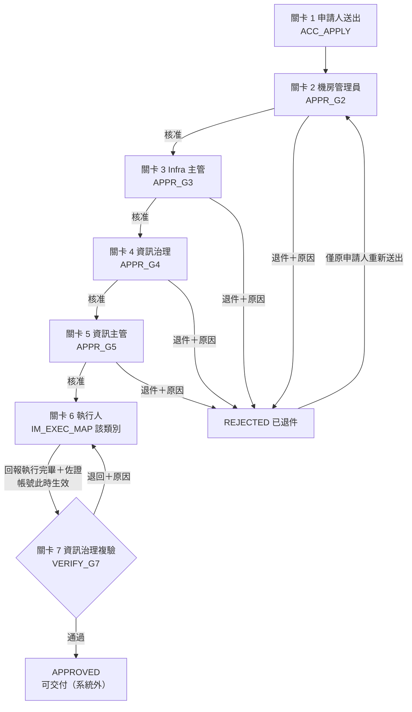
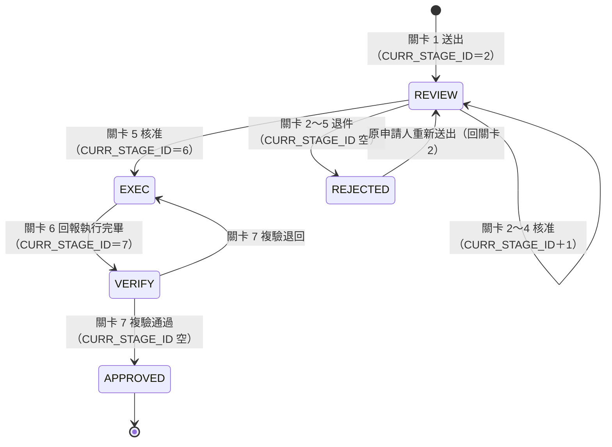
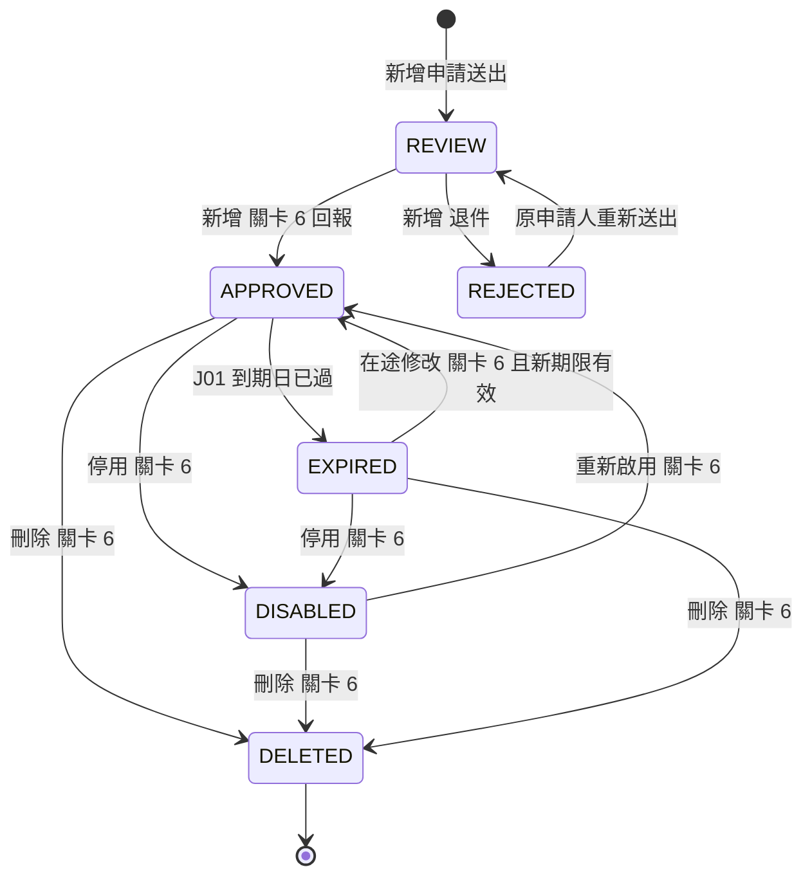
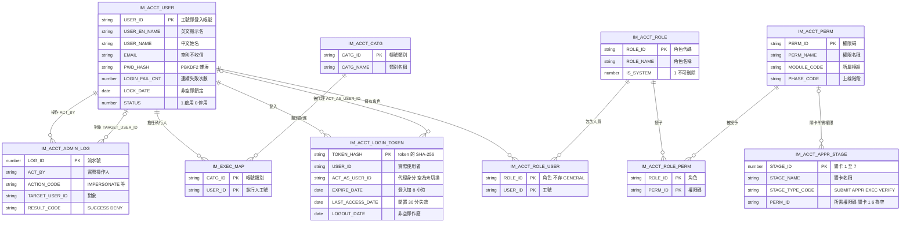
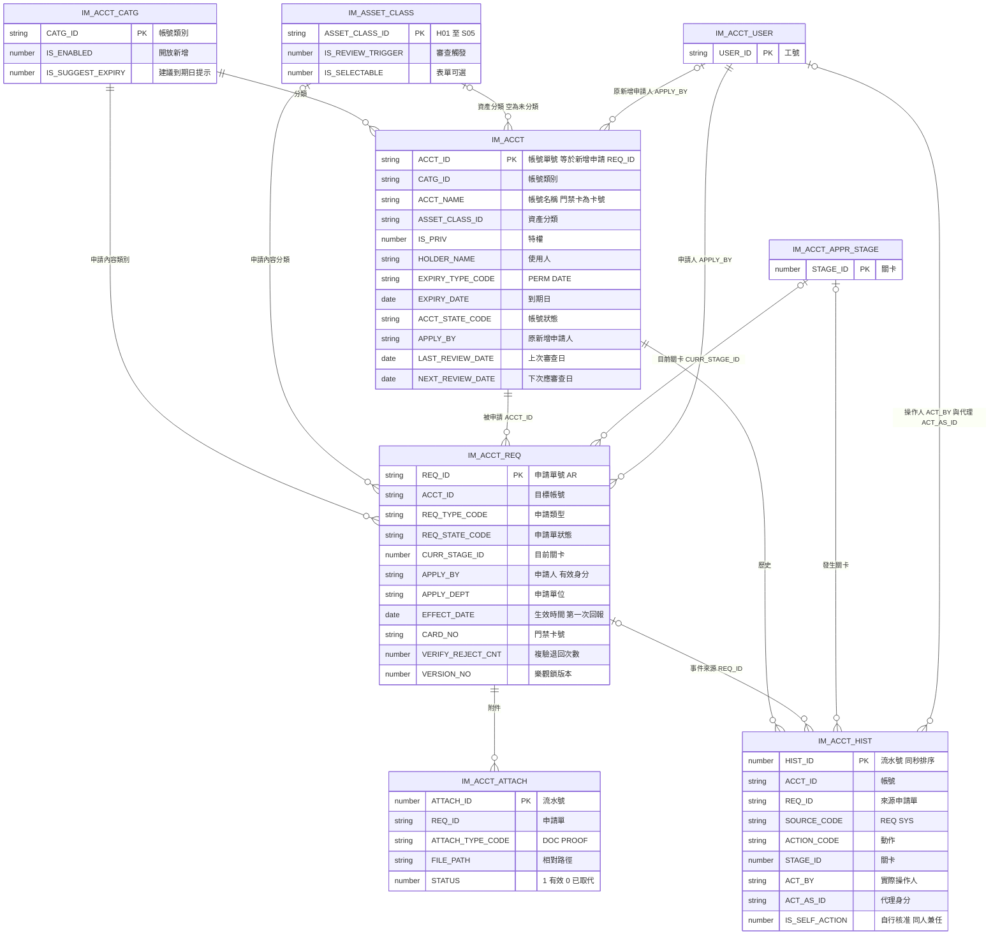
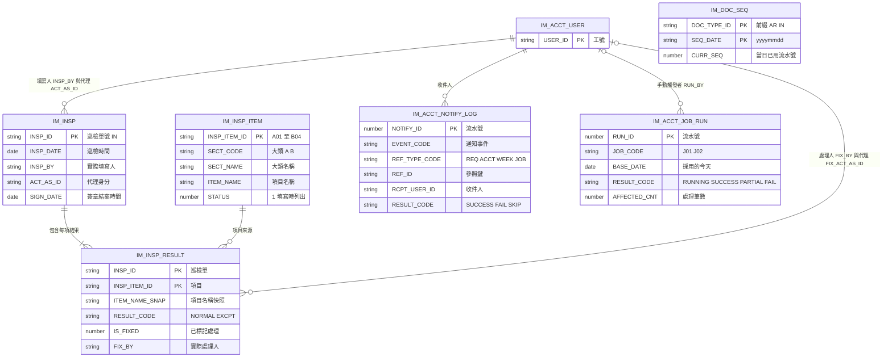

# im_acct_insp 帳號權限管理／機房巡檢 — 交接文件（功能、業務邏輯、Table、欄位）

| 項目 | 內容 |
|---|---|
| 日期 | 2026-10-08 |
| 讀者 | 接手同事使用的 Claude AI |
| 範圍 | SA v0.5 第一階段，已實作並測試通過的現況 |
| 自含 | 本文件不依賴其他文件；段末「來源」只是出處註記，內容以本文為準 |
| 路徑基準 | 程式路徑以專案資料夾為根：後端 `im_acct_insp\`、殼 jar `im_acct_insp_web\im_acct_insp_web\`、前端 `im_acct_insp_web\im_acct_insp_web_frontend\` |
| 衝突時 | 欄位型別、必填、索引以建表 SQL 為準；業務規則以開發文件 v2.0 及其變更單 #1～#3 定案為準 |

---

## 1. 系統是什麼

一句話：資訊處用來管理「被管理的系統帳號／憑證／機房門禁卡」的申請、7 關簽核、生效、到期提醒，加上「機房巡檢」紀錄的 Web 系統。

### 1.1 三個程式與請求流向

| 程式 | 負責 | 不做 |
|---|---|---|
| 後端 API（`im_acct_insp`，Spring Boot，API 根 `/api/v1`） | 登入與 token 驗證、權限判斷、資料範圍、所有業務規則、SQL、交易、附件存檔、排程、通知紀錄 | 畫面 |
| 殼 jar（`im_acct_insp_web`，context `/im_acct_insp_web`） | 提供前端靜態頁；把 `/im_acct_insp_web/api/v1/...` 原樣轉送到後端 `/api/v1/...`（Authorization、查詢字串、JSON 本文、multipart 原始位元組、二進位下載都原樣轉送；後端 4xx／5xx 狀態碼與本文原樣回） | 不連 DB、不驗 token、不解析 payload、不開 CORS；本文超過 11 MB 直接回 413 E15 不轉送 |
| Vue 前端（`im_acct_insp_web_frontend`，Vue 3＋TypeScript） | 畫面、送出前驗證（與後端同順序）、依 `/me` 的 permissions[] 決定導覽與按鈕 | 不做最終權限判斷（後端一律再驗） |

```
瀏覽器（token 存 sessionStorage，每個請求帶 Authorization: Bearer <token>）
  → 殼 jar /im_acct_insp_web/api/v1/...（原樣轉送）
  → 後端 /api/v1/...（驗 token → 權限 → 業務 → SQL）
  → Oracle（schema RD_USER，本模組 21 張表）
```

- 後端連不上時殼 jar 回 500，前端顯示 U09「查詢失敗，請稍後再試」（不得顯示成查無資料）。
- 前端收到 401 → 清 token、導向登入頁並顯示後端 message。

### 1.2 第一階段做了什麼

| 模組 | 功能 |
|---|---|
| 身分 | 本模組自建登入（帳密、token、鎖定、登出）、權限碼判斷、資料範圍、系統管理員切換身分 |
| 帳號權限管理 | 5 種申請類型、8 類帳號（依開關開放新增）、7 關簽核、退件重送、複驗退回、關卡 6 生效寫主表與審查日期、樂觀鎖、帳號列表、帳號申請單列表三區塊、申請單與帳號明細、歷史、資產分類說明頁 |
| 附件 | 關卡 1 公文（選填）、關卡 6 佐證（必填）上傳；驗權下載 |
| 到期 | J01 每日到期處理（轉已逾期、到期前 7 天信、轉逾期信）、J02 每週一彙總、手動觸發 API |
| 通知 | 寄信介面＋只寫 log 的實作（不實際寄出）；每位收件人寫通知紀錄 |
| 首頁 | 6 張卡片、到期鈴鐺（逐筆相關性）、待辦簽核 |
| 機房巡檢 | 填寫（14 項、正常／異常）、紀錄查詢、明細、標記異常已處理、整體狀態即時計算、代理身分 |

### 1.3 明確不做

| 項目 | 說明 |
|---|---|
| 展延 | 不做、也不規劃。要延長就重新提新增申請（新帳號、新單號）；已核准帳號可用「修改」調整到期日 |
| 帳號匯入、既有帳號資料轉入 | 不做（SOURCE_CODE＝MIGRATE 僅預留） |
| 第二階段 | 定期權限審查、緊急存取、統計頁、匯出（只先建權限碼與預留欄位） |
| 維護畫面 | 角色指派、執行人對照、使用者（含重設密碼、解鎖）、巡檢項目、資產分類、帳號類別開關：一律 DB 直接維護，無 API、無畫面、不寫管理軌跡 |
| 其他 | 改密碼、AD 登入、代理人、人員離職處理、系統管理軌跡查詢畫面（以 DB 查）、實際寄出 Email、機房異動申請 |

### 1.4 刻意偏離 SA 的決定

| # | SA 原規則 | 現況 |
|---|---|---|
| 1 | 登入與使用者管理與其他模組共用、本模組不開發 | 自建 IM_ACCT_USER、IM_ACCT_LOGIN_TOKEN；取身分集中在單一介面，日後換共用登入只換實作 |
| 2 | 毫秒時間戳 | 一律 DATE（到秒）；同秒事件以流水號排序 |
| 3 | 角色、執行人對照由畫面維護、每次變更寫軌跡、原因必填 | 純 DB 維護，不留軌跡；管理軌跡第一階段只記切換身分／切回 |
| 4 | 移除角色最後一位成員時若有在途項目卡在該角色則拒絕 | 不檢查；改 DB 的人自行確認 |
| 5 | J01 單筆：狀態、歷史、通知紀錄同一交易 | 狀態＋歷史同一交易；寄信與通知紀錄在交易提交後，漏寄由下次執行補上 |

來源：spec v2.0 §1；SA v0.5 §1.2。

---

## 2. 名詞定義

| 名詞 | 定義 |
|---|---|
| 使用者 | 可登入本系統的人員，存 IM_ACCT_USER；登入帳號＝工號 USER_ID |
| 角色 | 一組權限的集合（IM_ACCT_ROLE），代表職位或職能；一位使用者可有多個角色 |
| 權限 | 可被授予的操作能力，以權限碼表示（IM_ACCT_PERM，例 APPR_G3＝關卡 3 核准／退件）。程式只判斷權限碼，不判斷角色名稱或人名 |
| 資料範圍 | 進得了畫面之後「看得到哪些資料」的規則，寫在後端查詢條件（§3.7） |
| 執行人 | 關卡 6 負責在實際系統上建立／異動帳號並回報的人，依帳號類別由 IM_EXEC_MAP 決定，不是角色 |
| 帳號 | 帳號主表 IM_ACCT 的一筆，代表一個被管理的系統帳號、憑證或門禁卡。**不是**本系統的登入帳號 |
| 申請單 | 對某個帳號提出的一次異動（新增、修改、停用、重新啟用、刪除），存 IM_ACCT_REQ，走 7 關 |
| 帳號單號 | 帳號識別編號 ACCT_ID＝建立該帳號的新增申請單號 REQ_ID |
| 在途 | 申請單尚未走完：REQ_STATE_CODE 為 REVIEW、EXEC、VERIFY |
| 生效 | 異動已在實際系統完成，以關卡 6 執行人第一次回報執行完畢為準；帳號主表此時更新 |
| 交付 | 關卡 7 複驗通過後把帳號資訊交給使用者；在系統外進行，系統不介入、不寄交付通知 |
| 實際操作人 | 真正按下按鈕的登入者；切換身分時是切換前的本人 |
| 代理身分 | 系統管理員切換身分後所扮演的使用者；切換期間權限與資料範圍完全等同此人 |
| 有效身分 | 切換中＝代理身分，否則＝實際操作人；權限、資料範圍、業務欄位一律用有效身分 |

---

## 3. 身分與權限

### 3.1 登入與 token

| 項目 | 規則 |
|---|---|
| 可登入條件 | IM_ACCT_USER.STATUS＝1 且 PWD_HASH 非空 |
| 密碼雜湊 | PBKDF2WithHmacSHA256、salt 16 bytes、迭代 310,000、輸出 32 bytes；存成 `PBKDF2$310000$base64(salt)$base64(hash)`；常數時間比對 |
| 防探測 | 工號不存在、停用、無雜湊時仍做一次雜湊計算，統一回 401 A01 |
| 判斷順序 | ① 工號不存在／停用／無雜湊 → A01 ② LOCK_DATE 非空 → A02（即使密碼正確）③ 密碼錯 → LOGIN_FAIL_CNT＋1，達 5 次時同一句寫 LOCK_DATE，該次仍回 A01 ④ 成功 → LOGIN_FAIL_CNT 歸 0、寫 LAST_LOGIN_DATE、發新 token |
| 解鎖 | DB 清空 LOCK_DATE、LOGIN_FAIL_CNT 歸 0（無畫面） |
| token | 32 bytes 亂數，base64url 回前端；DB 只存 SHA-256（16 進位小寫 64 碼）於 IM_ACCT_LOGIN_TOKEN.TOKEN_HASH |
| 時效 | 有效＝LOGOUT_DATE 為空、現在 < EXPIRE_DATE（登入＋8 小時）、現在 − LAST_ACCESS_DATE ≤ 30 分鐘、使用者 STATUS＝1；任一不符 → 401 A03。驗證通過即更新 LAST_ACCESS_DATE（可節流為每分鐘最多寫一次） |
| 需驗 token 的 API | 除 `POST /auth/login` 外全部 |
| 登出 | 寫 LOGOUT_DATE，token 立即作廢 |
| 多重登入 | 同一人多個 token 可並存 |
| 不提供 | 改密碼；首次登入不強制改 |
| log | 不記密碼、token、雜湊值 |
| 常數 | 30 分鐘、8 小時、5 次、雜湊參數皆為程式常數 |

### 3.2 取身分與欄位記錄規則

- 後端只透過一個介面取得「目前身分」：實際使用者（工號、顯示名）、有效身分、是否切換中。
- 顯示名格式「英文名 (中文名)」；中文名空白時只顯示英文名。所有 *_NAME 快照都存此格式。

| 欄位種類 | 記誰 | 欄位 |
|---|---|---|
| 業務欄位 | 有效身分 | IM_ACCT_REQ 的 APPLY_BY、EXEC_BY、VERIFY_BY、REJECT_BY；IM_ACCT.APPLY_BY |
| 稽核欄位 | 實際使用者 | IM_ACCT_HIST.ACT_BY、IM_INSP.INSP_BY、IM_INSP_RESULT.FIX_BY、各表 CREATE_BY／UPDATE_BY |
| 代理欄位 | 代理身分（切換中才有值） | IM_ACCT_HIST.ACT_AS_ID／ACT_AS_NAME、IM_INSP.ACT_AS_ID／ACT_AS_NAME、IM_INSP_RESULT.FIX_ACT_AS_ID／FIX_ACT_AS_NAME |
| 系統排程 | — | ACT_BY 空、ACT_BY_NAME＝「系統排程」、CREATE_BY／UPDATE_BY＝SYSTEM |

### 3.3 切換身分

| 項目 | 規則 |
|---|---|
| 誰能用 | **實際使用者**有 SYS_IMPERSONATE（切換中即使代理身分沒有此權限，也能切回或改切別人） |
| 對象 | STATUS＝1 的其他使用者；切換成自己 → 400「不可切換為自己」；對象不存在或停用 → 404 N01；未帶對象 → 400 E02 |
| 狀態保存 | IM_ACCT_LOGIN_TOKEN.ACT_AS_USER_ID；切回清空；登出即結束 |
| 軌跡 | 切換寫 IM_ACCT_ADMIN_LOG（ACTION_CODE＝IMPERSONATE、TARGET_USER_ID＝對象、CONTENT_JSON 記對象顯示名、RESULT_CODE＝SUCCESS）；切回寫 IMPERSONATE_END；無權限者嘗試切換 → 403 並寫一筆 RESULT_CODE＝DENY |
| 交易 | UPDATE token 列與 INSERT 管理軌跡同一交易 |
| 未切換時切回 | 409 E20 |
| 對象被停用 | 代理身分 STATUS 變 0 時自動視為切回（清 ACT_AS_USER_ID，不寫軌跡） |
| 防呆 | 不另做限制 |
| 畫面 | 頁首固定顯示 U01「目前以 {代理身分顯示名} 身分操作」＋「切回」按鈕；切換或切回後重新載入 `/me`，目前頁面無權限時導向首頁 |

### 3.4 角色（9 個）

| 代碼＝中文 | IS_SYSTEM | 第一階段職責 |
|---|---|---|
| SYS_ADMIN＝系統管理員 | 1 | 切換身分、手動觸發排程（角色指派、執行人對照以 DB 維護） |
| GENERAL＝一般人員 | 1 | 送出申請、查自己的申請；**所有啟用中使用者自動擁有，不存 IM_ACCT_ROLE_USER 資料列** |
| DC_ADMIN＝機房管理員 | 0 | 關卡 2 |
| INFRA_MGR＝Infra 主管 | 0 | 關卡 3；鈴鐺看全部 |
| GOV＝資訊治理 | 0 | 關卡 4、關卡 7；到期信與週一彙總收件人 |
| GOV_MGR＝資訊治理主管 | 0 | 系統管理軌跡查詢（DB）；鈴鐺看全部 |
| IT_HEAD＝資訊主管 | 0 | 關卡 5；鈴鐺看全部 |
| ACCT_REGISTRY＝帳號清冊檢視 | 0 | 完整帳號列表 |
| INSP_STAFF＝巡檢人員 | 0 | 巡檢查詢、填寫、標記處理 |

IS_SYSTEM＝1 表示不可刪除（第一階段無維護畫面，供日後判斷）。

### 3.5 權限碼（28 個）

階段：1＝第一階段、2＝第二階段、3＝後續評估。模組：ACCT＝帳號、INSP＝巡檢、SYS＝系統管理、REVIEW＝定期審查、EMG＝緊急存取、STATS＝統計。

| 權限碼＝中文 | 模組 | 階段 |
|---|---|---|
| ACC_APPLY＝送出帳號申請、退件後重新送出 | ACCT | 1 |
| ACC_SELF_SERVICE＝進入帳號申請單列表 | ACCT | 1 |
| ACC_LIST_FULL＝完整帳號列表 | ACCT | 1 |
| ACC_EXPIRY_ALL＝到期提醒看全部帳號 | ACCT | 1 |
| APPR_G2＝關卡 2 核准／退件 | ACCT | 1 |
| APPR_G3＝關卡 3 核准／退件 | ACCT | 1 |
| APPR_G4＝關卡 4 核准／退件 | ACCT | 1 |
| APPR_G5＝關卡 5 核准／退件 | ACCT | 1 |
| VERIFY_G7＝關卡 7 複驗通過／退回 | ACCT | 1 |
| INSP_VIEW＝巡檢紀錄查詢與明細 | INSP | 1 |
| INSP_CREATE＝填寫巡檢 | INSP | 1 |
| INSP_RESOLVE＝標記異常已處理 | INSP | 1 |
| SYS_ROLE＝角色指派 | SYS | 1（只建碼，無功能） |
| SYS_EXECUTOR＝執行人對照維護 | SYS | 1（只建碼，無功能） |
| SYS_IMPERSONATE＝切換身分 | SYS | 1 |
| SYS_AUDIT_VIEW＝查詢系統管理軌跡 | SYS | 1（只建碼，無畫面） |
| SYS_JOB_RUN＝手動觸發排程 | SYS | 1 |
| ACC_EXPORT＝帳號權限清單匯出、批次匯出帳號歷史 | ACCT | 2 |
| REVIEW_LIST＝定期審查清單 | REVIEW | 2 |
| REVIEW_SIGN_INFRA＝定期審查 Infra 半簽核 | REVIEW | 2 |
| REVIEW_SIGN_GOV＝定期審查治理半簽核 | REVIEW | 2 |
| EMG_APPLY＝緊急存取申請 | EMG | 2 |
| EMG_VIEW_ALL＝緊急存取看全部 | EMG | 2 |
| EMG_DECIDE＝緊急存取補核准／退回／結案 | EMG | 2 |
| STATS_VIEW＝統計頁 | STATS | 2 |
| INSP_EXPORT＝巡檢紀錄匯出 | INSP | 2 |
| MAINT_ASSET_CODE＝資產分類說明維護 | ACCT | 3 |
| MAINT_INSP_ITEM＝巡檢項目維護 | INSP | 3 |

### 3.6 角色 × 權限（IM_ACCT_ROLE_PERM，35 列）

| 角色 | 權限碼 |
|---|---|
| GENERAL | ACC_APPLY、ACC_SELF_SERVICE、EMG_APPLY、STATS_VIEW |
| DC_ADMIN | APPR_G2 |
| INFRA_MGR | APPR_G3、ACC_EXPIRY_ALL、REVIEW_LIST、REVIEW_SIGN_INFRA、EMG_VIEW_ALL、EMG_DECIDE |
| GOV | APPR_G4、VERIFY_G7 |
| GOV_MGR | SYS_AUDIT_VIEW、ACC_EXPIRY_ALL、REVIEW_LIST、REVIEW_SIGN_GOV、EMG_VIEW_ALL、EMG_DECIDE |
| IT_HEAD | APPR_G5、ACC_EXPIRY_ALL、REVIEW_LIST、EMG_VIEW_ALL、EMG_DECIDE |
| ACCT_REGISTRY | ACC_LIST_FULL、ACC_EXPORT |
| INSP_STAFF | INSP_VIEW、INSP_CREATE、INSP_RESOLVE、INSP_EXPORT |
| SYS_ADMIN | SYS_ROLE、SYS_EXECUTOR、SYS_IMPERSONATE、SYS_AUDIT_VIEW、SYS_JOB_RUN |

MAINT_ASSET_CODE、MAINT_INSP_ITEM 不授予任何角色。

**權限集合計算（can）**

1. 有效身分在 IM_ACCT_ROLE_USER（STATUS＝1）的角色；角色本身 IM_ACCT_ROLE.STATUS＝1 才計。
2. 經 IM_ACCT_ROLE_PERM（STATUS＝1）展開成權限碼；權限 IM_ACCT_PERM.STATUS＝1 才計。
3. **再加上 GENERAL 的權限**：以 IM_ACCT_ROLE_PERM 中 ROLE_ID＝GENERAL 的列為準（不寫死權限碼），只要使用者 STATUS＝1 就自動擁有。
4. 每次請求依當下 DB 名單重算，不跨請求快取（到了某一關，以當下名單判斷誰能簽；已完成的簽核不受名單變更影響）。
5. 回應：沒有權限 → 403 P01；有權限但狀態或版本不符 → 409。
6. 前端只用 `/me` 的 permissions[] 決定導覽與按鈕顯示；後端一律再驗。

### 3.7 執行人對照（IM_EXEC_MAP，關卡 6）

判斷：IM_EXEC_MAP 中 CATG_ID＝申請單類別、USER_ID＝有效身分、STATUS＝1。同類別多人時任一人可執行。

| 帳號類別 | 執行人（初始資料） |
|---|---|
| HOST＝主機帳號 | 0000006 Alex |
| DB＝資料庫帳號 | 0000004 Terry、0000008 Michael |
| APP＝應用系統帳號 | 0000006 Alex |
| SVC＝服務帳號 | 0000006 Alex、0000007 Alan |
| NET＝網路設備帳號 | 0000006 Alex |
| VENDOR＝廠商/委外帳號 | 0000009 Sage |
| CERT＝憑證/金鑰 | 0000006 Alex、0000007 Alan |
| DOOR＝機房門禁卡 | 0000006 Alex、0000007 Alan |

Michael、Sage 只有 GENERAL＋執行人對照，沒有任何清單權限，待辦只看到被指派執行的單。Terry 同時是關卡 3 核准人與 DB 類執行人，可先核准再執行（系統不阻擋，只記 IS_SELF_ACTION）。

### 3.8 資料範圍（「我」＝有效身分；寫在後端查詢條件）

| 畫面／API | 進入條件 | 看得到什麼 |
|---|---|---|
| 我的申請單 `GET /requests` | ACC_SELF_SERVICE | APPLY_BY＝我 |
| 我曾申請新增的帳號 `GET /accounts/mine` | ACC_SELF_SERVICE | IM_ACCT.APPLY_BY＝我，且狀態不是 REJECTED、DELETED |
| 對既有帳號提出異動 `GET /accounts/lookup` | ACC_SELF_SERVICE | ACCT_NAME **完整精確比對**（去前後空白、區分大小寫），狀態 APPROVED、EXPIRED、DISABLED；不提供模糊查詢或瀏覽 |
| 異動表單帶入 `GET /accounts/lookup/{id}` | ACC_APPLY | 須同時帶 acctName 且與該帳號 ACCT_NAME 精確相符，或我「可看該帳號」；狀態同上；否則 404 |
| 完整帳號列表 `GET /accounts` | ACC_LIST_FULL | 全部（預設不含 DELETED） |
| 帳號明細／歷史 `GET /accounts/{id}`、`/history` | 登入 | 「可看帳號」者（下方） |
| 申請單明細 `GET /requests/{id}`、附件下載 | 登入 | 「可看申請單」者（下方） |
| 待辦 `GET /todos` | 登入 | 我此刻能處理的（§6.3） |
| 鈴鐺 `GET /home/expiring` | 登入 | 逐筆相關者（§6.2） |
| 首頁卡片 `GET /home/stats` | 登入 | 全部，只回聚合數字 |
| 代碼 `GET /codes`、資產分類說明頁 | 登入 | 全部 |
| 切換身分名單 `GET /users` | 實際使用者 SYS_IMPERSONATE | STATUS＝1、不含自己 |
| 巡檢 | INSP_VIEW | 全部 |

**可看申請單**——符合任一：

1. 我是申請人（APPLY_BY＝我）；
2. 我有 ACC_LIST_FULL；
3. 申請單在途，且我此刻能處理目前關卡（§6.3）；
4. 我曾在這張單上操作過（IM_ACCT_HIST 該 REQ_ID 有 ACT_BY 或 ACT_AS_ID＝我）。

**可看帳號**——符合任一：

1. 我有 ACC_LIST_FULL；
2. 我是原新增申請人（IM_ACCT.APPLY_BY＝我）；
3. 我曾對該帳號送過申請；
4. 我可看該帳號的任一張申請單（上面第 3、4 條，即被指派或處理過的執行人、簽核人）；
5. 該帳號在到期提醒範圍（§4.16）內，且我有 ACC_EXPIRY_ALL 或是該類別執行人。

不符者 403 P01。直接呼叫 API 查他人資料必須被拒絕。

來源：spec v2.0 §2；Table 規劃 v0.2 §6.1～6.4、§8.7；SA v0.5 §3～4。

---

## 4. 帳號申請業務邏輯

### 4.1 帳號類別（8 種）

8 類共用同一套 7 關流程，差異只在表單欄位、關卡 6 執行人、提示訊息。只有 DOOR 有實質不同的規則（§4.19）。

| 代碼＝中文 | 開放新增（IS_ENABLED） | 建議到期日提示（IS_SUGGEST_EXPIRY） | 執行人 | 表單 |
|---|---|---|---|---|
| HOST＝主機帳號 | 1 | 0 | Alex | 標準 |
| DB＝資料庫帳號 | 1 | 0 | Terry、Michael | 標準 |
| APP＝應用系統帳號 | 0 | 0 | Alex | 標準 |
| SVC＝服務帳號 | 0 | 1 | Alex、Alan | 標準＋U04 |
| NET＝網路設備帳號 | 0 | 0 | Alex | 標準 |
| VENDOR＝廠商/委外帳號 | 0 | 1 | Sage | 標準＋U04 |
| CERT＝憑證/金鑰 | 0 | 1 | Alex、Alan | 標準＋U04 |
| DOOR＝機房門禁卡 | 1 | 0 | Alex、Alan | 門禁卡專用 |

- IS_ENABLED 只管「新增」：新增表單類別下拉只列 IS_ENABLED＝1 且 STATUS＝1；後端收到未開放類別 → 400 E05。既有帳號照常可異動、帳號列表 8 個類別頁籤始終顯示。改 DB 該欄即生效，不需重新部署。
- IS_SUGGEST_EXPIRY＝1 時表單在有效期限旁顯示 U04「建議指定明確到期日」（非強制）。
- 「特權」是疊加在任一類別上的勾選欄位（IS_PRIV），不是第 9 類。

### 4.2 資產分類碼（15 碼）

| 代碼 | 類型 | 名稱 | 可選（IS_SELECTABLE） | 審查觸發（IS_REVIEW_TRIGGER） |
|---|---|---|---|---|
| H01 | H＝硬體 | 伺服器－與營運直接相關 | 1 | 1 |
| H02 | H | 伺服器－與營運間接相關 | 1 | 0 |
| H03 | H | 伺服器－與 IT 管理性作業相關 | 1 | 0 |
| H04 | H | 測試設備 | 1 | 0 |
| H05 | H | IT 基礎設備－與營運直接相關 | 1 | 1 |
| H06 | H | IT 基礎設備－與營運間接相關 | 1 | 0 |
| H07 | H | 個人電腦（含 NB） | 0 | 0 |
| H08 | H | 儲存設備 | 1 | 0 |
| H09 | H | 支援設備 | 1 | 0 |
| H10 | H | 輸出設備 | 0 | 0 |
| S01 | S＝軟體 | 與營運直接相關軟體 | 1 | 1 |
| S02 | S | 與營運間接相關軟體 | 1 | 0 |
| S03 | S | 與 IT 管理性作業相關軟體 | 1 | 0 |
| S04 | S | IT 基礎相關軟體 | 1 | 0 |
| S05 | S | 測試軟體／辦公室套裝軟體 | 1 | 0 |

- 「未分類」不建資料列，以 ASSET_CLASS_ID 為空表示；表單選項＝13 個可選碼＋未分類。
- 送出時資產分類碼必須存在且 IS_SELECTABLE＝1，否則 400 E06。H07、H10 只列在說明頁。
- 程式以 IS_REVIEW_TRIGGER 欄判斷審查條件，不寫死 H01、H05、S01。
- 資產分類說明頁（`/assets`）與表單旁「查看分類說明」彈窗列出全部 15 碼與存取控制要求摘要（CTRL_DESCR，原文見 §12.3），標示審查觸發碼與不可選碼。

### 4.3 申請類型（5 種）與前提

| 代碼＝中文 | 目標帳號狀態前提 | acctId | 表單行為 |
|---|---|---|---|
| ADD＝新增 | 無 | 不可帶（帶了 → 400「新增申請不可指定帳號」） | 完整填寫 |
| MODIFY＝修改 | APPROVED | 必填 | 帳號類別、帳號名稱、所屬系統鎖定；其餘可改（含到期日） |
| DISABLE＝停用 | APPROVED、EXPIRED | 必填 | 只填申請單位與原因（標示「停用原因」）；其他內容複製主表 |
| ENABLE＝重新啟用 | DISABLED | 必填 | 以停用前（主表當下）內容帶入，可一併修正 |
| DELETE＝刪除 | APPROVED、DISABLED、EXPIRED | 必填 | 同停用；標示「刪除原因」；顯示 U03 |

- 帳號不存在 → 404 N01；前提不符 → 409 E09。
- 同一帳號同時只能一筆在途 → 409 E07（§4.11）。
- 帳號列表與查詢結果的 allowedReqTypes＝依上表前提且**無在途時**才有值；在途中的帳號不顯示異動按鈕。
- DELETED 為終態，之後任何申請 409 E09。
- 五種類型都走 1～7 關。

### 4.4 表單欄位

| 畫面欄位 | API 欄位 | DB 欄位（IM_ACCT_REQ） | 標準表單 | 門禁卡表單 |
|---|---|---|---|---|
| 申請單號 | — | REQ_ID | 系統產生，畫面顯示「送出後產生」 | 同 |
| 申請日期 | — | APPLY_DATE | 系統時間，唯讀 | 同 |
| 申請人 | — | APPLY_BY | 登入者（有效身分），唯讀 | 同 |
| 申請單位 | applyDept | APPLY_DEPT | 必填；新開申請一律空白，只有退件重送保留原值 | 同 |
| 申請人分機／Email | — | （不儲存） | 灰底範例，只作「同申請人」帶入來源；API 不收 | 同 |
| 申請類型 | reqTypeCode | REQ_TYPE_CODE | 必填 | 同 |
| 帳號類別 | catgId | CATG_ID | 必填；新增只列開放類別 | 選 DOOR |
| 帳號名稱 | acctName | ACCT_NAME | 新增必填；異動鎖定 | 新增（含重送）不顯示；異動以唯讀顯示現有卡號 |
| 所屬系統/設備名稱 | sysName | SYS_NAME | 新增必填；異動鎖定 | 隱藏；後端強制「機房門禁管制系統」 |
| 門禁權限範圍 | doorScopeCode | DOOR_SCOPE_CODE | — | 必填：TEST＝僅測試區（第一道門）、FULL＝機房完整權限（兩道門）；修改時可重選 |
| 資產分類碼 | assetClassId | ASSET_CLASS_ID | 選填（13 碼＋未分類） | 鎖定未分類（後端強制空） |
| 是否特權帳號 | isPriv | IS_PRIV | 勾選 | 同 |
| 實際使用人/保管人 | holderName | HOLDER_NAME | 必填；旁有「同申請人」 | 同 |
| 所屬單位 | holderDept | HOLDER_DEPT | 選填 | 同 |
| 使用人聯絡方式 | holderCntct | HOLDER_CNTCT | 選填；灰底範例「#1614 或 Email」 | 隱藏 |
| 使用人 Email | holderEmail | HOLDER_EMAIL | — | 選填（僅門禁卡） |
| 權限範圍/角色 | accessLevelCode | ACCESS_LEVEL_CODE | 選填：RO＝唯讀、OP＝操作、ADMIN＝管理員（完全控制） | 隱藏；後端強制 DOOR |
| 存取對象 | accessTarget | ACCESS_TARGET | 選填 | 隱藏 |
| 申請原因 | applyReason | APPLY_REASON | 必填（停用／刪除時標示停用原因／刪除原因） | 同 |
| 附件（公文） | 檔案 part `docFile` | IM_ACCT_ATTACH（DOC） | 選填 | 同 |
| 有效期限類型 | expiryTypeCode | EXPIRY_TYPE_CODE | 必填：PERM＝永久有效、DATE＝指定到期日 | 同 |
| 到期日 | expiryDate | EXPIRY_DATE | DATE 時必填；不可早於今天 | 同 |
| 帳號唯一性聲明 | isUniqueConf | IS_UNIQUE_CONF | 必勾 | 同 |
| 簽核路徑預覽 | — | — | 顯示 7 關名稱 | 同 |

**依類型的必填與可改欄位**

| 類型 | 必填 | 可改的內容欄位 | 不填（後端忽略，以主表值存入申請單） |
|---|---|---|---|
| 新增（標準） | 申請單位、帳號類別、帳號名稱、所屬系統、使用人、申請原因、有效期限類型 | 全部 | — |
| 新增（門禁卡） | 申請單位、門禁權限範圍、使用人、申請原因、有效期限類型 | 門禁卡可見欄位 | — |
| 修改、重新啟用 | 申請單位、使用人、申請原因、有效期限類型（門禁卡另需門禁權限範圍） | 使用人、所屬單位、聯絡方式／使用人 Email、權限範圍、存取對象、資產分類碼、特權、有效期限、門禁權限範圍、申請原因 | 帳號類別、帳號名稱、所屬系統 |
| 停用、刪除 | 申請單位、申請原因 | 申請原因 | 其他所有內容欄位複製主表當下內容；不做到期日必填與到期日檢查 |

**「同申請人」帶入規則**（前端）

- 使用人＝登入者顯示名。
- 聯絡方式＝表單的申請人分機；空則表單 Email；再空則使用者資料 TEL_NO（`/me` 的 telNo）。
- 門禁卡使用人 Email＝表單 Email；空則使用者資料 EMAIL（`/me` 的 email）。
- 所屬單位空白時帶申請單位；有值不覆蓋。

- 分機以「#」開頭的灰底範例提示，不做格式驗證。

### 4.5 送出驗證順序（前後端相同，遇第一個錯誤即回）

| 順序 | 檢查 | 失敗 |
|---|---|---|
| 1 | isUniqueConf＝1 | 400 E01 |
| 2 | 依類型的必填欄位不為空 | 400 E02（一次列出缺的欄位名，以頓號分隔） |
| 3 | 有效期限＝DATE 時到期日不為空（停用、刪除不做） | 400 E03 |
| 4 | 到期日不早於今天（新增、修改、重新啟用） | 400 E04 |
| 5 | 新增時類別 IS_ENABLED＝1 且 STATUS＝1 | 400 E05 |
| 6 | 資產分類碼存在且 IS_SELECTABLE＝1 | 400 E06 |
| 7 | 欄寬（含申請單位）：`n CHAR` 欄以字數、`VARCHAR2(n)` 欄以 UTF-8 byte 計 | 400 E11「欄位長度超過上限：{欄位名}」 |
| 8 | 附件格式與大小（§4.18） | 400 E14／413 E15 |
| 9 | 帳號存在、前提狀態、在途（§4.3、§4.11） | 404 N01／409 E09／409 E07 |

- E11 與 E03 同時成立時回 E03。
- 代碼欄值不在值域 → 400「欄位內容不正確：{欄位}」；日期格式錯 → 400「日期格式錯誤（yyyy-MM-dd）」。

### 4.6 7 關簽核流程



關卡定義（IM_ACCT_APPR_STAGE）：關卡 2～5、7 的所需權限取自該表 PERM_ID；關卡 1、6 的 PERM_ID 為空（1 看 ACC_APPLY、6 看 IM_EXEC_MAP）。

| 關卡 | 處理者 | 動作 | 必填 | 申請單寫入 | 歷史 ACTION_CODE（STAGE_ID） | 通知 |
|---|---|---|---|---|---|---|
| 1 | ACC_APPLY | 送出 | §4.4 | 新單：REQ_STATE_CODE＝REVIEW、CURR_STAGE_ID＝2、APPLY_DATE＝SUBMIT_DATE＝現在、VERSION_NO＝0、APPLY_BY＝有效身分 | SUBMIT（1） | SUBMIT |
| 1 | 原申請人（APPLY_BY＝我，否則 403） | 重新送出 | §4.4＋versionNo | REVIEW／2、RESUB_CNT＋1、SUBMIT_DATE＝現在；內容覆寫（類型、帳號不可變）；APPLY_DATE 不變；最近一次退件欄位保留 | RESUB（1） | RESUB |
| 2～4 | 該關 APPR_Gn | 核准 | versionNo | CURR_STAGE_ID＋1 | APPROVE（n） | NEXT_STAGE |
| 5 | APPR_G5 | 核准 | versionNo | REQ_STATE_CODE＝EXEC、CURR_STAGE_ID＝6 | APPROVE（5） | TO_EXEC |
| 2～5 | 該關 APPR_Gn | 退件 | versionNo、原因（E10） | REJECTED、CURR_STAGE_ID 空、REJECT_CNT＋1、REJECT_STAGE_ID、REJECT_BY、REJECT_DATE、REJECT_REASON | REJECT（n） | REJECT |
| 6 | 該類別執行人 | 回報執行完畢 | versionNo、佐證（E12）、門禁卡新增時卡號（E13）；執行說明選填 | VERIFY／7、EXEC_BY、EXEC_DATE、EXEC_DESCR、CARD_NO；EFFECT_DATE 為空時寫現在 | EXEC_DONE（6） | EXEC_DONE |
| 7 | VERIFY_G7 | 複驗通過 | versionNo | APPROVED、CURR_STAGE_ID 空、VERIFY_BY、VERIFY_DATE、DONE_DATE | VERIFY_OK（7） | 不寄 |
| 7 | VERIFY_G7 | 複驗退回 | versionNo、原因（E10） | EXEC／6、VERIFY_REJECT_CNT＋1、VERIFY_REJECT_REASON | VERIFY_REJECT（7） | VERIFY_REJECT |

- 關卡 2～5、7 只審核，不填內容；只有退件、退回要填原因。
- 每次狀態轉移 VERSION_NO＋1（例：送出後 0，四關核准後 4）。

**核准／退件的判斷順序**（定案）

1. 沒有任何關卡 2～5 的權限 → 403 P01；
2. 未帶 versionNo → 400 E02；
3. 狀態或版本不符 → 409 E08；
4. 沒有目前關卡的權限 → 403 P01；
5. 內容檢查（退件原因 E10）。

回報執行、複驗同理：先驗權限（403），再做帶條件的 UPDATE（409）。

**主表連動**

| 時點 | IM_ACCT |
|---|---|
| 新增送出 | 以申請內容建立一列：ACCT_ID＝REQ_ID、ACCT_STATE_CODE＝REVIEW、SOURCE_CODE＝APPLY、APPLY_BY＝申請人（供列表顯示） |
| 新增重送 | 以新內容覆寫並改回 REVIEW |
| 新增退件 | 改 REJECTED |
| 其他類型的送出、退件、重送 | 不動主表 |
| 關卡 6 | §4.8 |
| 關卡 7（通過、退回） | 不動主表 |

### 4.7 狀態機

**申請單狀態（REQ_STATE_CODE）**



| 狀態碼＝中文 | CURR_STAGE_ID | 在途 |
|---|---|---|
| REVIEW＝審核中 | 2～5 | 是 |
| EXEC＝待執行 | 6 | 是 |
| VERIFY＝待複驗 | 7 | 是 |
| APPROVED＝已核准（複驗通過、可交付） | 空 | 否 |
| REJECTED＝已退件 | 空 | 否（可重送） |

畫面「審核中」須顯示目前關卡：U10「審核中：待 {關卡名}」。

**帳號狀態（ACCT_STATE_CODE）**——與申請單狀態是不同集合，不可共用列舉。



| 狀態碼＝中文 | 計入首頁帳號總數 | 到期提醒 | 可發起的申請 |
|---|---|---|---|
| REVIEW＝審核中 | 是 | — | 無（在途） |
| APPROVED＝已核准 | 是 | DATE 且到期日 ≤ 今天＋30 | 修改、停用、刪除 |
| EXPIRED＝已逾期 | 是 | 是 | 停用、刪除 |
| DISABLED＝已停用 | 是 | — | 重新啟用、刪除 |
| REJECTED＝已退件 | 是 | — | 原申請人重新送出（申請單層級） |
| DELETED＝已刪除（軟刪除） | 否 | — | 無；列表預設不顯示 |

- 「EXPIRED → APPROVED」只發生在：修改申請在途期間帳號被 J01 轉 EXPIRED，關卡 6 第一次回報時新期限為 PERM 或到期日 ≥ 今天（§4.8）。
- **待複驗標記**（U11）：該帳號有一筆 REQ_STATE_CODE＝VERIFY 的申請單即顯示，計算值，不存欄位。

### 4.8 關卡 6 生效與主表同步

**第一次回報**（申請單 EFFECT_DATE 原本為空）在同一交易依類型更新 IM_ACCT，UPDATE_BY＝實際操作人：

| 類型 | 寫入 IM_ACCT 的欄位 | ACCT_STATE_CODE |
|---|---|---|
| ADD | 申請單全部內容欄位（CATG_ID、ACCT_NAME、SYS_NAME、DOOR_SCOPE_CODE、ASSET_CLASS_ID、IS_PRIV、HOLDER_NAME、HOLDER_DEPT、HOLDER_CNTCT、HOLDER_EMAIL、ACCESS_LEVEL_CODE、ACCESS_TARGET、APPLY_REASON、EXPIRY_TYPE_CODE、EXPIRY_DATE）；門禁卡 ACCT_NAME＝CARD_NO | APPROVED |
| MODIFY | HOLDER_NAME、HOLDER_DEPT、HOLDER_CNTCT、HOLDER_EMAIL、ACCESS_LEVEL_CODE、ACCESS_TARGET、ASSET_CLASS_ID、IS_PRIV、EXPIRY_TYPE_CODE、EXPIRY_DATE、DOOR_SCOPE_CODE、APPLY_REASON | 不變；但若當下是 EXPIRED，且新期限為 PERM 或到期日 ≥ 今天 → APPROVED |
| ENABLE | 同 MODIFY 的欄位 | APPROVED |
| DISABLE | APPLY_REASON | DISABLED |
| DELETE | APPLY_REASON | DELETED |

- 門禁卡完成時清空使用人聯絡方式（HOLDER_CNTCT）與存取對象（ACCESS_TARGET）。
- 之後依 §4.15 寫審查日期。
- 修改完成後 DB 與畫面須一致（例：取消特權後列表的特權標籤消失）。
- APPLY_REASON 主表只存最近一次；每次原因都寫進歷史。

**複驗退回後再次回報**：只更新申請單（EXEC_BY、EXEC_DATE、EXEC_DESCR、CARD_NO）與附件（舊佐證 STATUS＝0、新佐證一列）；不重寫主表、不重寫審查日期、不改 EFFECT_DATE。唯一例外：門禁卡新增若卡號改變，主表 ACCT_NAME 同步為新卡號。

### 4.9 關卡 7 複驗

| 結果 | 規則 |
|---|---|
| 通過 | 申請單 APPROVED、CURR_STAGE_ID 空、寫 VERIFY_BY、VERIFY_DATE、DONE_DATE；不寄信；主表不動 |
| 退回 | 原因必填（E10）；回 EXEC／6、VERIFY_REJECT_CNT＋1、VERIFY_REJECT_REASON；**主表不回復**（帳號已生效，執行人在實際系統修正後重新上傳佐證、回報）；若需改變申請內容須另提修改申請 |
| 提示 | VERIFY_REJECT_CNT＞0 時，關卡 6 回報彈窗與關卡 7 複驗彈窗顯示 U02「此案件先前已被複驗退回過，上次退回原因：{VERIFY_REJECT_REASON}」 |

### 4.10 退件與重送

- 退件只發生在關卡 2～5；原因必填（E10）。
- 只有原申請人（APPLY_BY＝我）看得到、能做「重新送出」，否則 403。
- 沿用同一單號、回 REVIEW 關卡 2、保留原申請單位；需帶 versionNo（樂觀鎖）。
- 重送的申請類型與目標帳號不可變（送了也忽略）。
- 重送附新公文時，舊公文 STATUS＝0、新公文一列；不附則保留舊公文。
- 申請單列表的 canResubmit＝REJECTED 且 APPLY_BY＝我。

### 4.11 同帳號一筆在途

- 規則：同一 ACCT_ID 同時只能有一筆 REQ_STATE_CODE 為 REVIEW、EXEC、VERIFY 的申請單。
- 程式先查；併發競態由唯一函式索引 IND_IM_ACCT_REQ_04 擋下：

```sql
CREATE UNIQUE INDEX IND_IM_ACCT_REQ_04 ON RD_USER.IM_ACCT_REQ
  (CASE WHEN REQ_STATE_CODE IN ('REVIEW','EXEC','VERIFY') THEN ACCT_ID END);
```

- 非在途列的索引值為 NULL，不參與唯一性；ORA-00001 一律轉 409 E07。

### 4.12 樂觀鎖 VERSION_NO

- 所有狀態轉移 UPDATE 的條件：`REQ_ID＝:id AND VERSION_NO＝:前端帶回值 AND REQ_STATE_CODE＝:預期狀態 AND CURR_STAGE_ID＝:預期關卡`，同時 `VERSION_NO＝VERSION_NO＋1`。
- 影響 0 筆 → 409 E08「此申請已由他人處理，請重新整理」（先送出者成功）。
- 前端從明細（`GET /requests/{id}`）或待辦（`GET /todos`）取得 versionNo；未帶 → 400 E02。
- 前端收到 409 → toast 後端 message 並重新載入該清單或明細。

### 4.13 單號規則

- 格式：**前綴 2 碼＋yyyymmdd＋「-」＋當日 3 碼流水號**，例 `AR20261015-001`。
- 前綴：AR＝帳號申請單（新增申請的單號同時是帳號單號 ACCT_ID）、IN＝機房巡檢；EA＝緊急存取（第二階段預留，第一階段不取號）。
- 流水號依前綴分開、每日從 001 起，存 IM_DOC_SEQ（CURR_SEQ 為 NUMBER(3)，單日上限 999）。
- 取號（樂觀 CAS）：讀 CURR_SEQ → `UPDATE … SET CURR_SEQ＝原值＋1 WHERE DOC_TYPE_ID、SEQ_DATE、CURR_SEQ＝原值`；影響 0 筆重試，最多 10 次；當日第一筆先 INSERT，PK 衝突改走 UPDATE。
- 取號在送出交易內；交易回復時流水號一併回復。唯一性由各業務表 PK 保證。

### 4.14 歷史事件（IM_ACCT_HIST）

- 每個動作寫一筆，與狀態更新同一交易；只增不改，程式不提供更新、刪除路徑。
- 排序：ACT_DATE、HIST_ID 遞增（同秒以 HIST_ID）。畫面顯示快照姓名，不 JOIN 使用者表。

| 欄位 | 寫入值 |
|---|---|
| ACCT_ID | 目標帳號 |
| REQ_ID | 來源申請單（SOURCE_CODE＝REQ 時） |
| SOURCE_CODE | REQ＝簽核流程；SYS＝系統排程 |
| ACTION_CODE | SUBMIT、RESUB、APPROVE、REJECT、EXEC_DONE、VERIFY_OK、VERIFY_REJECT、EXPIRE |
| STAGE_ID | 發生關卡（§4.6）；系統事件為空 |
| ACT_BY／ACT_BY_NAME | 實際操作人工號與顯示名快照；排程：空／「系統排程」 |
| ACT_AS_ID／ACT_AS_NAME | 切換中才寫：代理身分工號與顯示名快照 |
| APPLY_DEPT | 申請單位快照（REQ 來源） |
| RESULT_DESCR | 至少含：送出／重送的申請原因、核准的關卡名、退件與複驗退回的原因、執行說明與門禁卡號、到期轉逾期的到期日 |
| IS_SELF_ACTION | 見下 |

**操作人顯示**：ACT_AS_ID 為空 → ACT_BY_NAME；否則「{ACT_BY_NAME}（以 {ACT_AS_NAME} 身分）」，例「Hank (黃志翰)（以 Gary (許永成) 身分）」。

**IS_SELF_ACTION 判定**（只對 APPROVE、REJECT、EXEC_DONE、VERIFY_OK、VERIFY_REJECT 判斷，其他動作固定 0）

以有效身分＝COALESCE(ACT_AS_ID, ACT_BY) 比對，符合任一即 1：

1. 等於該申請單 APPLY_BY；
2. 同一 REQ_ID 已有「其他關卡（STAGE_ID 不同）」的上述 5 種動作，且其有效身分相同。

顯示標籤（U12）：條件 1 成立 →「自行核准」；否則 →「同人兼任」。不影響流程，系統不阻擋。

### 4.15 審查日期寫入

- 審查條件（符合任一）：資產分類 IS_REVIEW_TRIGGER＝1、類別為 DOOR、IS_PRIV＝1。由單一共用函式判斷，不寫死分類碼。
- 只在關卡 6 **第一次回報**時判斷：

| 類型 | 何時寫 |
|---|---|
| ADD | 新內容符合 |
| MODIFY、ENABLE | 新內容符合，且（主表舊內容不符合，或 LAST_REVIEW_DATE 為空） |
| DISABLE、DELETE | 不寫 |

- 寫入值：LAST_REVIEW_DATE＝EFFECT_DATE 的日期；NEXT_REVIEW_DATE＝LAST_REVIEW_DATE＋180 天。
- 第一階段不做審查流程，這兩欄寫入後不再變動。

### 4.16 到期管理與排程

**到期提醒範圍**（首頁卡片、鈴鐺、帳號列表橫幅與 expiring 篩選共用同一條件）：

```sql
(a.ACCT_STATE_CODE = 'APPROVED' AND a.EXPIRY_TYPE_CODE = 'DATE' AND a.EXPIRY_DATE <= :today + 30)
OR a.ACCT_STATE_CODE = 'EXPIRED'
```

剩餘天數 daysLeft＝EXPIRY_DATE − today（已過為負數）；依到期日由近到遠排序。

**排程共通**

| 項目 | 規則 |
|---|---|
| 觸發 | 排程（時區 Asia/Taipei）；可由設定關閉排程，手動 API 仍可用 |
| 手動 | `POST /jobs/{code}/run`（SYS_JOB_RUN），邏輯同排程；可帶 baseDate 指定「今天」，僅在允許的環境（測試）可用，否則 400 E17 |
| 不重入 | 同一 JOB_CODE 同時只跑一個；執行中再觸發 → 409 E16（鎖只在單一程序內） |
| 紀錄 | 每次寫 IM_ACCT_JOB_RUN：開始 RESULT_CODE＝RUNNING；結束更新 END_DATE、RESULT_CODE、AFFECTED_CNT、ERR_MSG；RUN_BY＝手動觸發者（排程為空）；BASE_DATE＝採用的今天 |
| 逐筆交易 | 每筆帳號一個交易；單筆失敗記錄後繼續，整體 PARTIAL；整個作業無法進行（例：查詢失敗）為 FAIL |
| 失敗通知 | PARTIAL、FAIL 寄 JOB_FAIL；寄信失敗只記通知紀錄 FAIL，不算排程失敗 |
| 可重複執行 | 同一基準日跑兩次結果相同：不重複轉換、不重寄 |

**J01 到期處理**（預設每日 00:10）

1. 轉逾期：APPROVED、DATE、EXPIRY_DATE < today 的每筆，交易內 `UPDATE IM_ACCT SET ACCT_STATE_CODE='EXPIRED' WHERE ACCT_ID=:id AND ACCT_STATE_CODE='APPROVED'`；影響 1 筆才寫歷史 EXPIRE（SOURCE_CODE＝SYS、RESULT_DESCR 含到期日）。在途申請不受影響、照常完成。
2. 轉逾期信：狀態 EXPIRED，且通知紀錄沒有（EVENT_CODE＝EXPIRED、REF_ID＝該帳號參照鍵）任何一筆者，寄 EXPIRED。
3. 到期前 7 天信：APPROVED、DATE、today ≤ EXPIRY_DATE ≤ today＋7，且通知紀錄沒有（EXPIRY_7D、該帳號參照鍵）任何一筆者，寄 EXPIRY_7D。

- 參照鍵＝`ACCT_ID_到期日yyyymmdd`；修改到期日即視為新的一輪。
- **防重寄以帳號參照鍵為單位**：該鍵已有任何紀錄（SUCCESS、FAIL、SKIP）就不再寄；FAIL 不自動重寄。
- 漏跑：第 1 步補轉所有已到期者；第 2、3 步以「尚未寄過」判斷，漏跑幾天也會補寄。
- AFFECTED_CNT＝轉逾期筆數＋寄出轉逾期信的帳號數＋寄出 7 天信的帳號數。

**J02 每週彙總**（預設每日 08:00 觸發，實際每週只寄一次）

- 週鍵＝基準日所在週的週一 yyyymmdd。通知紀錄已有（WEEKLY_SUMMARY、週鍵）任何一筆 → 本次不寄，RESULT_CODE＝SUCCESS、AFFECTED_CNT＝0。
- 否則寄一封給每位 GOV 角色成員：列出所有 EXPIRED 帳號（單號、類別、帳號名稱、使用人、到期日、逾期天數，依到期日排序）；0 筆時仍寄，內文寫 U13「目前沒有已逾期未處理的帳號」。不含停用或刪除的帳號。
- 正常於週一 08:00 寄出；週一漏跑則該週第一次執行補寄。
- 無任何收件人時記 WARN log，結果照常 SUCCESS。
- 內容以「區塊」組成，第二階段加逾期未審區塊不改結構。
- AFFECTED_CNT＝彙總列出的帳號數。

### 4.17 通知事件與收件人

- 寄信介面（收件 Email、主旨、本文）；第一階段實作只寫 log：逐筆記收件人**工號**與主旨，不記 Email、不記本文；視為成功。
- 業務動作的通知在**交易提交後**寄出；寄送失敗不影響業務結果與 API 回應。
- 每位收件人寫一筆 IM_ACCT_NOTIFY_LOG；收件人無 Email → RESULT_CODE＝SKIP；例外 → FAIL。
- 收件人在寄送當下計算；只含 STATUS＝1 使用者；同一封信同一人去重。
- 「有權限 X 的人」＝依 §3.6 展開後擁有 X 的所有啟用中使用者。
- 角色型收件人固定為程式常數（不放設定檔）：到期前 7 天、轉已逾期、每週彙總 → GOV；排程失敗 → SYS_ADMIN。成員於寄信當下查 IM_ACCT_ROLE_USER（STATUS＝1）＋IM_ACCT_USER（STATUS＝1）。

| 事件碼＝中文 | 收件人 | REF_TYPE_CODE（REF_ID） | 主旨 |
|---|---|---|---|
| SUBMIT＝申請送出 | 有 APPR_G2 的人 | REQ（REQ_ID） | 【帳號申請】{單號} 待您審核（機房管理員） |
| RESUB＝重新送出 | 有 APPR_G2 的人 | REQ | 【帳號申請】{單號} 已重新送出，待您審核 |
| NEXT_STAGE＝進入下一關（關卡 2～4 核准） | 有下一關 APPR_Gn 的人 | REQ | 【帳號申請】{單號} 待您審核（{關卡名}） |
| TO_EXEC＝待執行（關卡 5 核准） | 該類別執行人 | REQ | 【帳號申請】{單號} 待您執行 |
| REJECT＝退件 | 申請人 | REQ | 【帳號申請】{單號} 已退件 |
| EXEC_DONE＝回報執行完畢 | 有 VERIFY_G7 的人 | REQ | 【帳號申請】{單號} 待您複驗 |
| VERIFY_REJECT＝複驗退回 | 該次執行人（EXEC_BY） | REQ | 【帳號申請】{單號} 複驗退回，請重新處理 |
| EXPIRY_7D＝到期前 7 天 | 原新增申請人（空則略過）、該類別執行人、GOV 成員 | ACCT（ACCT_ID_到期日） | 【帳號到期】{帳號名稱} 將於 {到期日} 到期 |
| EXPIRED＝轉為已逾期 | 同上 | ACCT（ACCT_ID_到期日） | 【帳號到期】{帳號名稱} 已逾期 |
| WEEKLY_SUMMARY＝每週一彙總 | GOV 成員 | WEEK（週一 yyyymmdd） | 【帳號到期】本週已逾期未處理帳號彙總（{n} 筆） |
| JOB_FAIL＝排程失敗 | SYS_ADMIN 成員 | JOB（RUN_ID） | 【排程失敗】{排程代碼} 執行{部分}失敗 |

- 複驗通過（VERIFY_OK）不寄信。
- 本文至少含：單號、申請類型、帳號類別、帳號名稱、申請人、目前關卡；退件、退回含原因；到期信含到期日。門禁卡尚無卡號時帳號名稱顯示「（門禁卡，待發卡）」。

### 4.18 附件

| 項目 | 規則 |
|---|---|
| 種類 | DOC＝公文：送出、重新送出時選填，每次最多 1 檔（檔案 part `docFile`）；PROOF＝執行佐證：回報執行完畢時**必填**（E12），每次 1 檔（part `proofFile`） |
| 格式 | 副檔名（不分大小寫）限 .pdf .doc .docx .jpg .png，且檔頭須相符：pdf `%PDF`、doc OLE2、docx zip、jpg `FF D8 FF`、png `89 50 4E 47`；否則 400 E14 |
| 大小 | 單檔 ≤ 10 MB（10×1024×1024 byte），否則 413 E15；請求總長上限 11 MB；空檔視同未上傳 |
| 存放 | 檔案系統的附件根目錄（設定值，必須是絕對路徑，啟動時檢查，不符則啟動失敗）；DB 存相對路徑 `REQ_ID/uuid.副檔名`、原檔名、大小、MIME（依副檔名決定）；不用原檔名當路徑 |
| 寫入順序 | 先寫檔，再在交易內寫 DB；交易回復時刪除剛寫的檔（盡力而為，失敗記 log） |
| 取代 | 重送附新公文、再次回報附新佐證時，同種類舊列 STATUS＝0（檔案保留）；明細只列 STATUS＝1 |
| 下載 | `GET /attachments/{id}`：須「可看申請單」，否則 403；STATUS＝0 的附件可看該單者仍可下載；回原始位元組、Content-Type＝MIME、Content-Disposition attachment，以 RFC 5987 編碼原檔名 |
| 前端讀檔失敗 | 送出前先讀檔：公文讀取失敗 → 提示 U07，使用者確認後不附公文送出；佐證讀取失敗 → 提示 U08 並擋下 |
| 前端下載 | 以 blob 取得後存檔（需帶 Authorization，不能用一般連結） |

### 4.19 機房門禁卡（CATG_ID＝DOOR）特殊規則

| 規則 | 內容 |
|---|---|
| 隱藏欄位 | 帳號名稱（新增時）、所屬系統、權限範圍、存取對象、使用人聯絡方式 |
| 後端強制值 | SYS_NAME＝「機房門禁管制系統」、ACCESS_LEVEL_CODE＝DOOR、ASSET_CLASS_ID＝空（未分類）、送出時 ACCT_NAME＝空；前端送來的值忽略 |
| 專屬欄位 | 門禁權限範圍 DOOR_SCOPE_CODE（TEST／FULL，必填，修改時可重選）、使用人 Email HOLDER_EMAIL |
| 帳號名稱欄 | 新增申請（含退件重送）不顯示；修改／停用／重新啟用／刪除以唯讀顯示現有卡號 |
| 卡號 | 新增申請在關卡 6 必填（E13），寫入申請單 CARD_NO 與主表 ACCT_NAME；其他類型不需卡號，佐證為門禁系統操作截圖 |
| 審查 | 必定符合審查條件（§4.15） |
| 完成時 | 清空主表使用人聯絡方式與存取對象 |
| 通知 | 尚無卡號時帳號名稱顯示「（門禁卡，待發卡）」 |

### 4.20 交易邊界

業務層以 TransactionTemplate 包住多句寫入（與 DB 存取共用同一連線池；連線池第一次取用才建立，交易管理器延遲建立）。任一步失敗全部回復。

| 動作 | 交易內容（依序） | 交易提交後 |
|---|---|---|
| 送出申請 | 取號 → INSERT 申請單 → 新增類型 INSERT 主表 → INSERT 公文附件列 → INSERT 歷史 SUBMIT | 寄 SUBMIT |
| 重新送出 | 帶條件 UPDATE 申請單 → 新增類型 UPDATE 主表 → 舊公文 STATUS＝0、INSERT 新公文 → INSERT 歷史 RESUB | 寄 RESUB |
| 核准 | 帶條件 UPDATE 申請單 → INSERT 歷史 APPROVE | 寄 NEXT_STAGE／TO_EXEC |
| 退件 | 帶條件 UPDATE 申請單 → 新增類型主表改 REJECTED → INSERT 歷史 REJECT | 寄 REJECT |
| 回報執行完畢 | 帶條件 UPDATE 申請單（含 EFFECT_DATE）→ 舊佐證 STATUS＝0、INSERT 新佐證 → 更新主表（§4.8）→ INSERT 歷史 EXEC_DONE → 寫審查日期（§4.15） | 寄 EXEC_DONE |
| 複驗通過 | 帶條件 UPDATE 申請單（APPROVED、DONE_DATE）→ INSERT 歷史 VERIFY_OK | — |
| 複驗退回 | 帶條件 UPDATE 申請單（EXEC、VERIFY_REJECT_CNT＋1）→ INSERT 歷史 VERIFY_REJECT；主表不動 | 寄 VERIFY_REJECT |
| 巡檢送出 | 取號 → INSERT 巡檢單 → INSERT 全部結果 | — |
| 標記處理 | 帶條件 UPDATE 結果（RESULT_CODE＝EXCPT AND IS_FIXED＝0） | — |
| 切換身分／切回 | UPDATE token 列 → INSERT 管理軌跡 | — |
| J01 單筆轉逾期 | 帶條件 UPDATE 主表 → INSERT 歷史 EXPIRE | 寄 EXPIRED（下一步驟） |

- 附件檔案先寫、交易失敗刪檔（§4.18）。
- 登入失敗計數、LAST_ACCESS_DATE 等單句更新不需交易。
- 業務時間由應用程式 Clock（Asia/Taipei）產生並以參數綁定寫入，SQL 不用 SYSDATE；比較「日期」時去掉時分秒。

來源：spec v2.0 §4.1～§4.13、§5、變更單 #1～#3；Table 規劃 v0.2 §5、§6.5；SA v0.5 §5。

---

## 5. 機房巡檢業務邏輯

### 5.1 巡檢項目（14 項）

| 代碼 | 大類 | 項目名稱 |
|---|---|---|
| A01 | A＝甲、機房環境設施 | 機房溫度 |
| A02 | A | 機房溼度 |
| A03 | A | UPS 電力狀態 |
| A04 | A | UPS 電池狀態 |
| A05 | A | 精密空調運作 |
| A06 | A | 消防偵煙系統 |
| A07 | A | 滅火系統 |
| A08 | A | 門禁系統 |
| A09 | A | 監視系統 |
| A10 | A | 漏水偵測 |
| B01 | B＝乙、資訊設備狀態（只需觀察，不需判斷原因） | 交換器面板燈是否全部正常（無紅燈閃爍、無告警音） |
| B02 | B | 路由器/防火牆面板是否有紅色告警燈或告警音 |
| B03 | B | 伺服器面板燈是否正常（電源/風扇/溫度指示燈無紅、黃燈） |
| B04 | B | 儲存陣列面板是否有紅色/黃色告警燈 |

項目 STATUS＝1 才在填寫時列出；停用不刪除；第一階段無維護畫面。

### 5.2 填寫規則（`POST /inspections`，INSP_CREATE）

| 規則 | 內容 |
|---|---|
| 結果完整 | results 必須剛好涵蓋所有 STATUS＝1 的項目、每項 NORMAL＝正常 或 EXCPT＝異常；否則 400 E18 |
| 異常說明 | EXCPT 必填 EXCPT_DESCR，否則 400 E10「請填寫異常說明」 |
| 巡檢時間 | INSP_DATE 預設現在、可調整，不可晚於現在（400「巡檢時間不可晚於現在」） |
| 簽章時間 | SIGN_DATE＝送出時系統時間（送出即簽章結案） |
| 單號 | 取號 IN |
| 結果列 | 每項一筆 IM_INSP_RESULT，存送出當下的 ITEM_NAME_SNAP、SECT_NAME_SNAP；畫面顯示以快照為準 |
| 送出後 | 各項結果不可修改，沒有修改 API |
| 畫面 | 14 項分甲乙兩大類，每項正常／異常（無預設，全部選完才能送出）；異常展開說明欄；異常數即時統計；按鈕「巡檢人員簽章並結案」 |

### 5.3 整體狀態即時計算

不存欄位；列表、明細、狀態篩選共用同一段 SQL（對該巡檢單的 IM_INSP_RESULT 彙總）：

```sql
CASE
  WHEN SUM(CASE WHEN r.RESULT_CODE = 'EXCPT' THEN 1 ELSE 0 END) = 0 THEN 'NORMAL'
  WHEN SUM(CASE WHEN r.RESULT_CODE = 'EXCPT' AND r.IS_FIXED = 0 THEN 1 ELSE 0 END) > 0 THEN 'EXCPT'
  ELSE 'FIXED'
END
```

| 狀態碼＝中文 | 條件 |
|---|---|
| NORMAL＝正常結案 | 沒有任何異常項目 |
| EXCPT＝有異常 | 至少一項異常且未處理 |
| FIXED＝異常已排除 | 有異常項目，且全部已標記處理 |

列表另回 excptCnt（異常項目數）與 unfixedCnt（未處理異常數）。

### 5.4 標記處理（`POST /inspections/{id}/items/{itemId}/fix`，INSP_RESOLVE）

- 只接受 RESULT_CODE＝EXCPT 且 IS_FIXED＝0 的項目；否則 409 E19（條件寫在 UPDATE 的 WHERE）。
- FIX_DESCR 必填，否則 400 E10「請填寫處理方式與結果」。
- 寫 IS_FIXED＝1、FIX_DATE＝現在、FIX_BY／FIX_BY_NAME＝實際使用者、切換中寫 FIX_ACT_AS_ID／FIX_ACT_AS_NAME。
- 巡檢人員本人也可標記。回應帶最新 inspStateCode。

### 5.5 代理身分

- INSP_BY／INSP_BY_NAME＝實際使用者；切換中 ACT_AS_ID／ACT_AS_NAME＝代理身分。處理人（FIX_*）同規則。
- 畫面顯示：無代理身分 → INSP_BY_NAME；有 →「{ACT_AS_NAME}（實際操作人：{INSP_BY_NAME}）」，例「Kevin (李凱鈞)（實際操作人：Hank (黃志翰)）」。

### 5.6 查詢條件（`GET /inspections`，INSP_VIEW，範圍全部）

| 條件 | 規則 |
|---|---|
| keyword | 比對 INSP_ID、INSP_BY_NAME、ACT_AS_NAME（LIKE，跳脫 `\ % _`，`ESCAPE '\'`） |
| stateCode | 全部／NORMAL／EXCPT／FIXED（以 §5.3 計算值篩選） |
| 日期區間 | 全部、近 7／30（預設）／90 天、自訂；依 INSP_DATE，含頭尾 |
| 明細 | 各項結果（快照名稱）、異常項目的處理資訊；未處理的異常項目有「標記已處理」 |

來源：spec v2.0 §4.14；Table 規劃 v0.2 §8.4。

---

## 6. 首頁、鈴鐺、待辦

### 6.1 首頁六張卡片（`GET /home/stats`，所有登入者，只回數字）

計算函式寫成共用，供第二階段統計頁使用。

| 卡片 | 回應欄位 | 口徑 | 點擊 |
|---|---|---|---|
| 帳號總數 | acctTotal | ACCT_STATE_CODE ≠ DELETED | — |
| 待審核 | acctReviewing | ACCT_STATE_CODE＝REVIEW | — |
| 30 天內到期 | acctExpiring | 到期提醒範圍（§4.16，含已逾期） | 有 ACC_LIST_FULL → 帳號列表（到期篩選）；否則無權限頁 |
| 特權帳號 | acctPriv | IS_PRIV＝1 且 ≠ DELETED | — |
| 本月巡檢次數 | inspThisMonth | INSP_DATE 在本月 | — |
| 本月發現異常項目數 | inspExcptThisMonth | 本月巡檢中 RESULT_CODE＝EXCPT 且 IS_FIXED＝0 的項目數 | — |

### 6.2 到期鈴鐺（`GET /home/expiring`）

- 範圍：到期提醒範圍（§4.16）內，逐筆判斷與我相關才列出：我有 ACC_EXPIRY_ALL；或我是該帳號原新增申請人（IM_ACCT.APPLY_BY）；或我是該類別執行人。
- 無相關者連筆數都不顯示（無徽章、無清單）。
- 回應：acctId、acctName、catgId、catgName、acctStateCode、expiryDate、daysLeft；**不得含 applyBy**（只在後端判斷用）。
- 點擊：有 ACC_LIST_FULL → 帳號列表（到期篩選）；否則開該筆唯讀帳號明細彈窗（可看帳號第 5 條或第 2 條保證可看；不顯示異動按鈕）。

### 6.3 待辦簽核（`GET /todos`）

- 來源：目前只有帳號申請單（source＝ACCT_REQ）；回應格式為多來源合併格式，日後加來源不改畫面。
- 「此刻能處理」＝申請單在該關，且有效身分符合下表；每次查詢依當下名單計算。待辦與明細的可用動作（actions）都依此計算。
- 排序：送出時間由舊到新。

| 申請單狀態／關卡 | 出現在誰的待辦 | actionKind | 可做 |
|---|---|---|---|
| REVIEW／2 | 有 APPR_G2 | APPROVE | 查看明細、核准（確認）、退件（填原因） |
| REVIEW／3 | 有 APPR_G3 | APPROVE | 同上 |
| REVIEW／4 | 有 APPR_G4 | APPROVE | 同上 |
| REVIEW／5 | 有 APPR_G5 | APPROVE | 同上 |
| EXEC／6 | IM_EXEC_MAP 該單類別的執行人 | EXEC | 回報執行（彈窗：佐證必選、門禁卡新增時卡號必填、執行說明選填） |
| VERIFY／7 | 有 VERIFY_G7 | VERIFY | 複驗通過、複驗退回（填原因） |
| REJECTED | 不出現（原申請人在「我的申請單」看到重新送出） | — | — |

- verifyRejectCnt＞0 的列在回報與複驗彈窗顯示 U02。
- 待辦項目欄位：reqId、title、reqTypeCode、catgId、catgName、acctName、isPriv、applyBy、applyByName、stageId、stageName、submitDate、actionKind、versionNo、verifyRejectCnt、verifyRejectReason。

### 6.4 前端畫面一覽（路由）

| 路徑 | 畫面 | 進入條件 | 重點 |
|---|---|---|---|
| `/login` | 登入 | 無 | 工號、密碼；錯誤顯示後端 message（A01、A02）；已登入導向首頁 |
| `/` | 首頁 | 登入 | 6 卡片 |
| `/todo` | 待辦簽核 | 登入 | §6.3 |
| `/accounts` | 帳號列表 | ACC_LIST_FULL | 橫幅 U14（點擊套用到期篩選）；關鍵字（比對 ACCT_ID、ACCT_NAME、HOLDER_NAME）、類別頁籤（含數量，8 類都顯示）、狀態（含數量，預設全部不含已刪除）、資產分類碼可同時套用；列顯示特權標籤與 U11；操作依 allowedReqTypes |
| `/requests` | 帳號申請單列表 | ACC_SELF_SERVICE | 三區塊：①對既有帳號提出異動（完整名稱輸入＋U05；查無 U06；在途不顯示操作）②我曾申請新增的帳號（在途只有查看、歷史）③我的申請單（狀態篩選全部／審核中／待執行／待複驗／已核准／已退件；已退件顯示原因與「重新送出」） |
| `/requests/new` | 申請表單 | ACC_APPLY | 模式：新增；異動（query reqType、acctId、acctName，經 `/accounts/lookup/{id}` 帶入）；重送（query resubmit＝reqId，經 `/requests/{id}` 帶入）；規則 §4.4、§4.19；刪除顯示 U03 |
| `/assets` | 資產分類說明 | 登入 | 15 碼表格 |
| `/inspections` | 巡檢紀錄 | INSP_VIEW | §5.6；查看彈窗可標記處理（INSP_RESOLVE） |
| `/inspections/new` | 新增巡檢 | INSP_CREATE | §5.2 |
| `/no-access` | 無權限 | 無 | 提供回首頁 |

- 左側導覽：首頁、待辦簽核（數量）；帳號權限管理：帳號列表（無 ACC_LIST_FULL 時此連結改指向帳號申請單列表）、帳號申請單列表、新增申請、資產分類說明；機房巡檢（有 INSP_VIEW 才顯示）：巡檢紀錄、新增巡檢（有 INSP_CREATE 才顯示）。
- 頁首：頁名、鈴鐺、登入者顯示名、登出；實際使用者有 SYS_IMPERSONATE 且未切換時顯示「切換身分」。
- 全域路由守衛：沒有 token → 登入頁（登入後回原路由）；路由標所需權限碼，不符 → 無權限頁。
- 清單每頁 20 筆；彈窗點遮罩關閉等同取消。

來源：spec v2.0 §4.13、§6.3、§8。

---

## 7. API 一覽（後端 `/api/v1`；經殼 jar 為 `/im_acct_insp_web/api/v1`）

### 7.1 通則

- JSON 請求與回應，欄位 camelCase，與 DB 欄名一一對應（例 ACCT_NAME → acctName）。
- 日期 `yyyy-MM-dd`、時間 `yyyy-MM-dd HH:mm:ss`。
- 錯誤格式 `{ "message": "…" }`，message 原樣顯示於 toast 或表單。
- multipart：part `form` 為 JSON（Content-Type application/json，前端以 Blob 送），檔案 part 名稱見各 API。
- 除 `POST /auth/login` 外都需 `Authorization: Bearer <token>`；無效 → 401 A03。
- 「範圍」＝依 §3.8 的可看判斷。

| 狀態碼 | 意義 | 典型情境 |
|---|---|---|
| 200 | 成功 | — |
| 400 | 驗證失敗 | E01～E06、E10～E14、E17、E18、E02（缺 versionNo／必填）、欄位內容不正確、日期格式錯、不可切換為自己、新增申請不可指定帳號、巡檢時間不可晚於現在 |
| 401 | 未登入或 token 無效 | A01、A02（登入）、A03（其他所有 API） |
| 403 | 無權限 | P01：無權限碼、不在資料範圍、非原申請人重送、非該類別執行人 |
| 404 | 查無 | N01：單號／帳號／附件／巡檢單不存在、lookup 名稱不符、jobs code 不是 J01／J02、切換對象不存在或停用 |
| 409 | 衝突 | E07 在途、E08 版本或狀態不符、E09 帳號狀態不符前提、E16 排程執行中、E19 巡檢項目已處理或非異常、E20 未切換身分 |
| 413 | 附件過大 | E15 |
| 500 | 其他 | 不外洩例外內容 |

### 7.2 身分

| 方法 | 路徑 | 權限 | 請求 | 回應 | 主要錯誤 |
|---|---|---|---|---|---|
| POST | `/auth/login` | 無 | userId、password | token、me（同 `/me`） | 401 A01、A02 |
| POST | `/auth/logout` | 登入 | — | 200 空本文 | 401 A03 |
| GET | `/me` | 登入 | — | userId、userName（有效身分）、realUserId、realUserName、impersonating、canImpersonate（實際使用者有 SYS_IMPERSONATE 且未切換中）、permissions[]、roleIds[]、execCatgIds[]、telNo、email（有效身分的，可空） | 401 |
| GET | `/users` | 實際使用者 SYS_IMPERSONATE | — | [userId、userName、roleIds[]]（STATUS＝1、不含自己） | 403 |
| POST | `/auth/impersonate` | 實際使用者 SYS_IMPERSONATE | targetUserId | me | 403（寫 DENY）、400 E02／不可切換為自己、404 |
| POST | `/auth/impersonate/end` | 登入（切換中） | — | me | 409 E20 |

### 7.3 共用

| 方法 | 路徑 | 權限 | 回應 |
|---|---|---|---|
| GET | `/codes` | 登入 | categories[catgId、catgName、catgDescr、enabled、suggestExpiry、sortSeq]、assetClasses[assetClassId、assetTypeCode、assetClassName、reviewTrigger、selectable、ctrlDescr、sortSeq]、stages[stageId、stageName、stageTypeCode、permId] |
| GET | `/home/stats` | 登入 | §6.1 六個數字 |
| GET | `/home/expiring` | 登入 | §6.2 |
| GET | `/todos` | 登入 | §6.3 |

### 7.4 帳號

| 方法 | 路徑 | 權限 | 請求 | 回應 | 主要錯誤 |
|---|---|---|---|---|---|
| GET | `/accounts` | ACC_LIST_FULL | query：keyword、catgId、stateCode、assetClassId、expiring（1＝只看到期提醒範圍） | items[IM_ACCT 全欄、catgName、assetClassName、inFlight、inFlightReqId、pendingVerify、allowedReqTypes[]]、stateCounts{狀態碼:數}、catgCounts{類別碼:數}、expiringCount | 403 |
| GET | `/accounts/mine` | ACC_SELF_SERVICE | — | 同 items | 403 |
| GET | `/accounts/lookup` | ACC_SELF_SERVICE | query：acctName（必填） | [acctId、catgId、catgName、acctName、sysName、holderName、acctStateCode、expiryTypeCode、expiryDate、inFlight、allowedReqTypes[]] | 400 E02、403 |
| GET | `/accounts/lookup/{id}` | ACC_APPLY＋範圍 | query：acctName | IM_ACCT 內容欄位（供異動表單帶入） | 403、404 |
| GET | `/accounts/{id}` | 範圍 | — | IM_ACCT 全欄、catgName、assetClassName、inFlight、pendingVerify、allowedReqTypes | 403、404 |
| GET | `/accounts/{id}/history` | 範圍 | — | [histId、actDate、sourceCode、actionCode、stageId、stageName、reqId、actBy、actByName、actAsId、actAsName、applyDept、resultDescr、isSelfAction、selfActionLabel（空／自行核准／同人兼任）] | 403、404 |

- 列表預設不含 DELETED（指定 stateCode 時依指定）。
- stateCounts 套用 stateCode 以外的條件計算；catgCounts 套用 catgId 以外的條件計算；expiringCount 不受篩選影響。
- inFlight＝有在途申請；pendingVerify＝有 VERIFY 申請單（§4.7 待複驗）。

### 7.5 申請單

| 方法 | 路徑 | 權限 | 請求 | 回應 | 主要錯誤 |
|---|---|---|---|---|---|
| POST | `/requests` | ACC_APPLY | multipart：form＝reqTypeCode、acctId、applyDept、catgId、acctName、sysName、doorScopeCode、assetClassId、isPriv、holderName、holderDept、holderCntct、holderEmail、accessLevelCode、accessTarget、applyReason、expiryTypeCode、expiryDate、isUniqueConf；`docFile`（選填） | reqId | 400 E01～E06、E11、E14、新增帶 acctId；403；404；409 E07、E09；413 E15 |
| GET | `/requests` | ACC_SELF_SERVICE | query：stateCode | [reqId、acctId、reqTypeCode、reqStateCode、currStageId、stageName、catgId、catgName、acctName、sysName、applyDate、submitDate、rejectReason、canResubmit] | 403 |
| GET | `/requests/{id}` | 範圍 | — | IM_ACCT_REQ 全欄（含 versionNo）、stageName、applyByName、execByName、verifyByName、attachments[attachId、attachTypeCode、fileName、fileSize、createDate、createByName]（STATUS＝1）、history（該單事件）、actions[]（我此刻可做：APPROVE、REJECT、EXEC_DONE、VERIFY_OK、VERIFY_REJECT、RESUBMIT） | 403、404 |
| POST | `/requests/{id}/approve` | 該關 APPR_Gn | versionNo | reqId、reqStateCode、currStageId、versionNo | 403、400 E02、404、409 E08 |
| POST | `/requests/{id}/reject` | 該關 APPR_Gn | versionNo、reason | 同上 | 同上＋400 E10 |
| POST | `/requests/{id}/resubmit` | 原申請人 | multipart：form＝同送出內容欄位＋versionNo（reqTypeCode、acctId 忽略）；`docFile`（選填，有則取代舊公文） | 同上 | 403、400 E01～E06、E11、E14；409 E08；413 |
| POST | `/requests/{id}/exec-done` | 該類別執行人 | multipart：form＝versionNo、cardNo、execDescr；`proofFile`（必填） | 同上 | 403、400 E02、E11、E12、E13、E14；409 E08；413 |
| POST | `/requests/{id}/verify-ok` | VERIFY_G7 | versionNo | 同上 | 403、400 E02、409 E08 |
| POST | `/requests/{id}/verify-reject` | VERIFY_G7 | versionNo、reason | 同上 | 同上＋400 E10 |
| GET | `/attachments/{id}` | 可看申請單 | — | 二進位檔（§4.18） | 403、404 |

### 7.6 巡檢

| 方法 | 路徑 | 權限 | 請求 | 回應 | 主要錯誤 |
|---|---|---|---|---|---|
| GET | `/inspection-items` | INSP_VIEW 或 INSP_CREATE | — | [inspItemId、sectCode、sectName、itemName、itemDescr、sortSeq]（STATUS＝1、依排序） | 403 |
| POST | `/inspections` | INSP_CREATE | inspDate（時間）、results[inspItemId、resultCode、excptDescr] | inspId | 403、400 E18、E10、E11、巡檢時間晚於現在 |
| GET | `/inspections` | INSP_VIEW | query：keyword、stateCode、dateFrom、dateTo | [inspId、inspDate、inspByName、actAsName、excptCnt、unfixedCnt、inspStateCode] | 403 |
| GET | `/inspections/{id}` | INSP_VIEW | — | 上列欄位＋signDate、results[inspItemId、sectNameSnap、itemNameSnap、resultCode、excptDescr、isFixed、fixDescr、fixByName、fixActAsName、fixDate] | 403、404 |
| POST | `/inspections/{id}/items/{itemId}/fix` | INSP_RESOLVE | fixDescr | inspId、inspStateCode | 403、404、400 E10、409 E19 |

### 7.7 排程

| 方法 | 路徑 | 權限 | 請求 | 回應 | 主要錯誤 |
|---|---|---|---|---|---|
| POST | `/jobs/{code}/run` | SYS_JOB_RUN | code＝J01／J02；query：baseDate（選填） | runId、resultCode、affectedCnt | 403、404（其他 code）、400 E17、409 E16 |

### 7.8 殼 jar Controller 路徑對照

| 殼 jar Controller | 轉送的路徑 |
|---|---|
| AuthController | `/auth/login`、`/auth/logout`、`/auth/impersonate`、`/auth/impersonate/end`、`/me`、`/users` |
| HomeController | `/codes`、`/home/stats`、`/home/expiring`、`/todos` |
| AccountController | `/accounts`、`/accounts/mine`、`/accounts/lookup`、`/accounts/lookup/{id}`、`/accounts/{id}`、`/accounts/{id}/history` |
| RequestController | `/requests`（POST multipart、GET）、`/requests/{id}`、`/approve`、`/reject`、`/verify-ok`、`/verify-reject`（JSON）、`/resubmit`、`/exec-done`（multipart） |
| AttachmentController | `/attachments/{id}`（二進位） |
| InspectionController | `/inspection-items`、`/inspections`（POST、GET）、`/inspections/{id}`、`/inspections/{id}/items/{itemId}/fix` |
| JobController | `/jobs/{code}/run` |

來源：spec v2.0 §6、§7。

---

## 8. 訊息文案表

### 8.1 錯誤訊息（後端 message，前端原樣顯示）

| 代號 | 狀態碼 | 文案 |
|---|---|---|
| E01 | 400 | 請勾選帳號唯一性聲明 |
| E02 | 400 | 請填寫必填欄位：{欄位名，以頓號分隔} |
| E03 | 400 | 請填寫到期日 |
| E04 | 400 | 到期日不可早於今天 |
| E05 | 400 | 此帳號類別尚未開放申請 |
| E06 | 400 | 此資產分類碼不可選用 |
| E07 | 409 | 此帳號目前已有一筆申請正在處理中 |
| E08 | 409 | 此申請已由他人處理，請重新整理 |
| E09 | 409 | 此帳號目前的狀態不可提出此類申請 |
| E10 | 400 | 請填寫{原因／異常說明／處理方式與結果} |
| E11 | 400 | 欄位長度超過上限：{欄位名} |
| E12 | 400 | 請上傳執行佐證附件 |
| E13 | 400 | 請填寫門禁卡號 |
| E14 | 400 | 附件格式僅限 .pdf .doc .docx .jpg .png |
| E15 | 413 | 附件大小不可超過 10 MB |
| E16 | 409 | 排程執行中，請稍後再試 |
| E17 | 400 | 此環境不允許指定基準日 |
| E18 | 400 | 巡檢項目不完整，請重新整理後再填寫 |
| E19 | 409 | 此項目已處理或不是異常項目 |
| E20 | 409 | 目前未切換身分 |
| A01 | 401 | 帳號或密碼錯誤（工號不存在、密碼錯、使用者停用、無雜湊都用此句） |
| A02 | 401 | 此帳號已鎖定，請聯絡系統管理員 |
| A03 | 401 | 登入已逾時，請重新登入（未帶、無效、過期、已登出的 token） |
| P01 | 403 | 您沒有執行此操作的權限 |
| N01 | 404 | 查無資料 |

E10 受詞：退件／複驗退回＝「原因」、巡檢異常＝「異常說明」、標記處理＝「處理方式與結果」。

**程式補充文案（無代號，皆 400）**

| 情境 | 文案 |
|---|---|
| 代碼欄值不在值域 | 欄位內容不正確：{欄位} |
| 日期格式錯 | 日期格式錯誤（yyyy-MM-dd） |
| 時間格式錯 | 時間格式錯誤（yyyy-MM-dd HH:mm:ss） |
| 新增申請帶 acctId | 新增申請不可指定帳號 |
| 切換成自己 | 不可切換為自己 |
| 巡檢時間晚於現在 | 巡檢時間不可晚於現在 |

### 8.2 畫面固定文字

| 代號 | 文案 | 出現位置 |
|---|---|---|
| U01 | 目前以 {代理身分顯示名} 身分操作 | 切換中頁首，旁有「切回」 |
| U02 | 此案件先前已被複驗退回過，上次退回原因：{VERIFY_REJECT_REASON} | 回報執行與複驗彈窗、申請單明細（關卡 6、7） |
| U03 | 刪除後此帳號將無法再啟用或異動，僅保留歷史紀錄供稽核查詢。 | 刪除申請表單 |
| U04 | 建議指定明確到期日 | IS_SUGGEST_EXPIRY＝1 類別的有效期限旁 |
| U05 | 請輸入完整帳號名稱（不提供模糊查詢） | 對既有帳號提出異動 |
| U06 | 查無此帳號，請確認輸入的是完整帳號名稱 | 同上查無時 |
| U07 | 公文附件讀取失敗，是否不附公文直接送出？ | 送出前讀公文失敗 |
| U08 | 佐證附件讀取失敗，請重新選擇檔案 | 回報前讀佐證失敗 |
| U09 | 查詢失敗，請稍後再試 | 任何查詢失敗（不得顯示成查無資料） |
| U10 | 審核中：待 {關卡名} | 申請單狀態顯示 |
| U11 | 待複驗 | 帳號列表標記 |
| U12 | 自行核准／同人兼任 | 歷史標籤 |
| U13 | 目前沒有已逾期未處理的帳號 | J02 彙總 0 筆 |
| U14 | 有 {n} 個帳號 30 天內到期或已逾期 | 帳號列表橫幅 |

來源：spec v2.0 §4.15；程式 `common\AcctMsg.java`。

---

## 9. Table 關係

### 9.1 21 張表

| # | 類型 | 表名＝中文 | 用途 |
|---|---|---|---|
| 1 | 權限 | IM_ACCT_USER＝使用者 | 登入帳號、顯示名、聯絡資料、密碼雜湊、鎖定 |
| 2 | 權限 | IM_ACCT_ROLE＝角色 | 9 個角色 |
| 3 | 權限 | IM_ACCT_PERM＝權限碼 | 28 個權限碼 |
| 4 | 權限 | IM_ACCT_ROLE_PERM＝角色權限對照 | 角色授予哪些權限碼（含 GENERAL） |
| 5 | 權限 | IM_ACCT_ROLE_USER＝角色人員 | 使用者擁有哪些角色（不存 GENERAL） |
| 6 | 權限 | IM_EXEC_MAP＝執行人對照 | 帳號類別 → 關卡 6 執行人 |
| 7 | 權限 | IM_ACCT_LOGIN_TOKEN＝登入 token | 每次登入一列；含切換身分狀態 |
| 8 | 稽核 | IM_ACCT_ADMIN_LOG＝系統管理軌跡 | 切換身分、切回、拒絕 |
| 9 | 設定 | IM_ACCT_APPR_STAGE＝簽核關卡 | 關卡 1～7 與所需權限碼 |
| 10 | 設定 | IM_DOC_SEQ＝單號流水號 | 每日每前綴取號 |
| 11 | 代碼 | IM_ACCT_CATG＝帳號類別 | 8 類、開放開關 |
| 12 | 代碼 | IM_ASSET_CLASS＝資產分類碼 | 15 碼、可選與審查觸發 |
| 13 | 代碼 | IM_INSP_ITEM＝巡檢項目 | 14 項 |
| 14 | 業務 | IM_ACCT＝帳號主表 | 被管理帳號目前生效的內容 |
| 15 | 業務 | IM_ACCT_REQ＝帳號申請單 | 申請內容與簽核進度 |
| 16 | 業務 | IM_ACCT_ATTACH＝申請單附件 | 公文與執行佐證 |
| 17 | 業務 | IM_ACCT_HIST＝帳號歷史事件 | 所有動作的只增不改紀錄 |
| 18 | 業務 | IM_INSP＝巡檢單 | 每次巡檢一筆 |
| 19 | 業務 | IM_INSP_RESULT＝巡檢結果明細 | 每單每項一筆 |
| 20 | 共用 | IM_ACCT_NOTIFY_LOG＝通知紀錄 | 每收件人每封信一筆；防重寄依據 |
| 21 | 共用 | IM_ACCT_JOB_RUN＝排程執行紀錄 | 每次排程／手動一筆 |

SEQUENCE 5 個：SEQ_IM_ACCT_ATTACH（NOCACHE）、SEQ_IM_ACCT_HIST（CACHE 20）、SEQ_IM_ACCT_ADMIN_LOG、SEQ_IM_ACCT_NOTIFY_LOG、SEQ_IM_ACCT_JOB_RUN（皆 NOCACHE），START WITH 1。

第二階段待重建（目前不存在）：IM_ACCT_REVIEW（定期審查）、IM_EMG_ACCESS（緊急存取）、IM_EMG_ACCESS_HIST（緊急存取受影響帳號／歷史）。

DB 共用硬規則：schema RD_USER 與既有「機房異動申請」模組共用，既有模組的表（IM_USER、IM_ROLE、IM_USER_ROLE_MAP、IM_APPR*、IM_ATTACH 等）本模組不可建立、刪除、修改或在程式引用；與既有模組重疊的概念一律另建 IM_ACCT_ 前綴的新表，人員一律參照 IM_ACCT_USER。

### 9.2 ER 圖一：使用者與角色權限



### 9.3 ER 圖二：帳號申請



### 9.4 ER 圖三：巡檢與共用



IM_DOC_SEQ 不與其他表關聯（只用於產生 IM_ACCT_REQ.REQ_ID 與 IM_INSP.INSP_ID）。

### 9.5 邏輯參照清單（本專案不建實體 FK，參照靠同名或註明欄位，由程式維護）

| 來源表.欄 | → 目標表.欄 | 備註 |
|---|---|---|
| IM_ACCT_ROLE_PERM.ROLE_ID | IM_ACCT_ROLE.ROLE_ID | |
| IM_ACCT_ROLE_PERM.PERM_ID | IM_ACCT_PERM.PERM_ID | |
| IM_ACCT_ROLE_USER.ROLE_ID | IM_ACCT_ROLE.ROLE_ID | 不得為 GENERAL |
| IM_ACCT_ROLE_USER.USER_ID | IM_ACCT_USER.USER_ID | |
| IM_EXEC_MAP.CATG_ID | IM_ACCT_CATG.CATG_ID | |
| IM_EXEC_MAP.USER_ID | IM_ACCT_USER.USER_ID | |
| IM_ACCT_LOGIN_TOKEN.USER_ID | IM_ACCT_USER.USER_ID | 實際使用者 |
| IM_ACCT_LOGIN_TOKEN.ACT_AS_USER_ID | IM_ACCT_USER.USER_ID | 代理身分，可空 |
| IM_ACCT_ADMIN_LOG.ACT_BY | IM_ACCT_USER.USER_ID | |
| IM_ACCT_ADMIN_LOG.TARGET_USER_ID | IM_ACCT_USER.USER_ID | 可空 |
| IM_ACCT_APPR_STAGE.PERM_ID | IM_ACCT_PERM.PERM_ID | 關卡 1、6 為空 |
| IM_ACCT.CATG_ID | IM_ACCT_CATG.CATG_ID | |
| IM_ACCT.ASSET_CLASS_ID | IM_ASSET_CLASS.ASSET_CLASS_ID | 空＝未分類 |
| IM_ACCT.APPLY_BY | IM_ACCT_USER.USER_ID | 原新增申請人 |
| IM_ACCT.REVIEW_FLAG_BY | IM_ACCT_USER.USER_ID | 第二階段 |
| IM_ACCT.ACCT_ID | IM_ACCT_REQ.REQ_ID | 值相同：建立它的新增申請單號 |
| IM_ACCT_REQ.ACCT_ID | IM_ACCT.ACCT_ID | 新增時＝本單 REQ_ID |
| IM_ACCT_REQ.CURR_STAGE_ID | IM_ACCT_APPR_STAGE.STAGE_ID | APPROVED、REJECTED 為空 |
| IM_ACCT_REQ.REJECT_STAGE_ID | IM_ACCT_APPR_STAGE.STAGE_ID | |
| IM_ACCT_REQ.CATG_ID | IM_ACCT_CATG.CATG_ID | |
| IM_ACCT_REQ.ASSET_CLASS_ID | IM_ASSET_CLASS.ASSET_CLASS_ID | |
| IM_ACCT_REQ.APPLY_BY、REJECT_BY、EXEC_BY、VERIFY_BY | IM_ACCT_USER.USER_ID | 有效身分 |
| IM_ACCT_ATTACH.REQ_ID | IM_ACCT_REQ.REQ_ID | |
| IM_ACCT_HIST.ACCT_ID | IM_ACCT.ACCT_ID | |
| IM_ACCT_HIST.REQ_ID | IM_ACCT_REQ.REQ_ID | SOURCE_CODE＝REQ 時 |
| IM_ACCT_HIST.STAGE_ID | IM_ACCT_APPR_STAGE.STAGE_ID | 系統事件為空 |
| IM_ACCT_HIST.ACT_BY、ACT_AS_ID | IM_ACCT_USER.USER_ID | 排程時 ACT_BY 空 |
| IM_ACCT_HIST.EMG_ID、REVIEW_ID | （第二階段的 IM_EMG_ACCESS、IM_ACCT_REVIEW） | 預留，第一階段為空 |
| IM_INSP.INSP_BY、ACT_AS_ID | IM_ACCT_USER.USER_ID | |
| IM_INSP_RESULT.INSP_ID | IM_INSP.INSP_ID | |
| IM_INSP_RESULT.INSP_ITEM_ID | IM_INSP_ITEM.INSP_ITEM_ID | |
| IM_INSP_RESULT.FIX_BY、FIX_ACT_AS_ID | IM_ACCT_USER.USER_ID | |
| IM_ACCT_NOTIFY_LOG.RCPT_USER_ID | IM_ACCT_USER.USER_ID | |
| IM_ACCT_NOTIFY_LOG.REF_ID | 依 REF_TYPE_CODE：REQ→IM_ACCT_REQ.REQ_ID；ACCT→`IM_ACCT.ACCT_ID_到期日yyyymmdd`；WEEK→週一日期；JOB→IM_ACCT_JOB_RUN.RUN_ID | 組合鍵，非單一欄位參照 |
| IM_ACCT_JOB_RUN.RUN_BY | IM_ACCT_USER.USER_ID | 排程觸發為空 |
| 各表 CREATE_BY、UPDATE_BY | IM_ACCT_USER.USER_ID | 系統排程與初始資料為 SYSTEM |

來源：Table 規劃 v0.2 §3、§4；建表 SQL。

---

## 10. 欄位定義

### 10.0 共用規則

- 欄位表的「必填」＝NOT NULL；「PK」標 ✓。
- 型別慣例：中文欄 `VARCHAR2(n CHAR)`（欄寬以字數計）、代碼／英數欄 `VARCHAR2(n)`（欄寬以 UTF-8 byte 計）、旗標 `NUMBER(1)`（1＝是、0＝否）、日期時間 `DATE`（到秒，不用 TIMESTAMP）、流水號 `NUMBER(12)`。
- 人員欄一律存工號 `VARCHAR2(30)`（數字字串、最多 7 碼）。
- 不建 FK。PK 名 `PK_表名`；索引名 `IND_表名_NN`。
- 每張表最後固定以下**共用五欄**，各表欄位表不再重列：

| 欄名 | 型別 | 必填 | 預設 | 說明 |
|---|---|---|---|---|
| STATUS | NUMBER(1) | ✓ | 1 | 資料狀態：1＝啟用、0＝停用（業務狀態另用 *_STATE_CODE）；各表特殊語意見該表備註 |
| CREATE_DATE | DATE | ✓ | SYSDATE | 建立日期（含時分秒） |
| CREATE_BY | VARCHAR2(30) | ✓ | | 建立人員工號；系統排程與初始資料為 SYSTEM |
| UPDATE_DATE | DATE | | | 最後更新日期；新增時為空 |
| UPDATE_BY | VARCHAR2(30) | | | 最後更新人員工號 |

### 10.1 IM_ACCT_USER 使用者

本模組自建的登入使用者表；STATUS＝1 才能登入並自動擁有 GENERAL 權限；DB 維護。保留永久。

| 欄名 | 型別 | 必填 | PK | 中文說明 | 代碼值域／預設 |
|---|---|---|---|---|---|
| USER_ID | VARCHAR2(30) | ✓ | ✓ | 工號，即登入帳號 | 數字字串，最多 7 碼 |
| USER_EN_NAME | VARCHAR2(50) | ✓ | | 英文顯示名（例 Terry） | |
| USER_NAME | VARCHAR2(30 CHAR) | | | 中文姓名（例 邱健唐）；顯示「英文名 (中文名)」，空白時只顯示英文名 | |
| DEPT_NAME | VARCHAR2(50 CHAR) | | | 部門 | |
| EMAIL | VARCHAR2(100) | | | Email；空白者不收信（通知記 SKIP） | |
| TEL_NO | VARCHAR2(30) | | | 分機／電話（例 #1614） | |
| PWD_HASH | VARCHAR2(200) | | | 密碼雜湊 `PBKDF2$迭代次數$base64(salt)$base64(hash)`；空＝不可登入；不存明文 | |
| PWD_UPDATE_DATE | DATE | | | 密碼最後設定時間 | |
| LOGIN_FAIL_CNT | NUMBER(2) | ✓ | | 連續登入失敗次數；達 5 次寫 LOCK_DATE，成功歸 0 | 預設 0 |
| LOCK_DATE | DATE | | | 鎖定時間；非空＝鎖定中；清空此欄並 LOGIN_FAIL_CNT 歸 0 即解鎖 | |
| LAST_LOGIN_DATE | DATE | | | 最後成功登入時間 | |

STATUS：1＝啟用（可登入）、0＝停用（不可登入；若正被切換為代理身分，自動視為切回）。索引：PK_IM_ACCT_USER（USER_ID）。

### 10.2 IM_ACCT_ROLE 角色

角色經 IM_ACCT_ROLE_PERM 展開為權限碼。初始資料。保留永久。

| 欄名 | 型別 | 必填 | PK | 中文說明 | 代碼值域／預設 |
|---|---|---|---|---|---|
| ROLE_ID | VARCHAR2(20) | ✓ | ✓ | 角色代碼 | SYS_ADMIN、GENERAL、DC_ADMIN、INFRA_MGR、GOV、GOV_MGR、IT_HEAD、ACCT_REGISTRY、INSP_STAFF（§3.4） |
| ROLE_NAME | VARCHAR2(30 CHAR) | ✓ | | 角色名稱 | |
| ROLE_DESCR | VARCHAR2(200 CHAR) | | | 職責說明 | |
| IS_SYSTEM | NUMBER(1) | ✓ | | 系統角色 | 1＝不可刪除（GENERAL、SYS_ADMIN）、0＝一般；預設 0 |
| SORT_SEQ | NUMBER(3) | ✓ | | 顯示排序 | 預設 0 |

STATUS＝0 的角色不計入權限。索引：PK_IM_ACCT_ROLE（ROLE_ID）。

### 10.3 IM_ACCT_PERM 權限碼

28 個一次建齊；程式以 can(身分, 權限碼) 判斷。初始資料。保留永久。

| 欄名 | 型別 | 必填 | PK | 中文說明 | 代碼值域／預設 |
|---|---|---|---|---|---|
| PERM_ID | VARCHAR2(30) | ✓ | ✓ | 權限碼 | §3.5 |
| PERM_NAME | VARCHAR2(50 CHAR) | ✓ | | 權限名稱 | |
| MODULE_CODE | VARCHAR2(10) | ✓ | | 所屬模組 | ACCT＝帳號、INSP＝巡檢、SYS＝系統管理、REVIEW＝定期審查、EMG＝緊急存取、STATS＝統計 |
| PHASE_CODE | VARCHAR2(1) | ✓ | | 上線階段 | 1＝第一階段、2＝第二階段、3＝後續評估 |
| SORT_SEQ | NUMBER(3) | ✓ | | 顯示排序 | 預設 0 |

STATUS＝0 的權限不計入。索引：PK_IM_ACCT_PERM（PERM_ID）。

### 10.4 IM_ACCT_ROLE_PERM 角色權限對照

角色授予的權限碼；GENERAL 的權限也以資料列存在，程式對每位啟用中使用者自動加上。授予人與時間即 CREATE_BY、CREATE_DATE。保留永久。

| 欄名 | 型別 | 必填 | PK | 中文說明 | 代碼值域／預設 |
|---|---|---|---|---|---|
| ROLE_ID | VARCHAR2(20) | ✓ | ✓ | 角色代碼 → IM_ACCT_ROLE | |
| PERM_ID | VARCHAR2(30) | ✓ | ✓ | 權限碼 → IM_ACCT_PERM | |

STATUS＝0 即不再授予。索引：PK_IM_ACCT_ROLE_PERM（ROLE_ID, PERM_ID）、IND_IM_ACCT_ROLE_PERM_01（PERM_ID）。

### 10.5 IM_ACCT_ROLE_USER 角色人員

一位人員可有多個角色；不得存 GENERAL。指派人與時間即 CREATE_BY、CREATE_DATE。DB 維護。保留永久。

| 欄名 | 型別 | 必填 | PK | 中文說明 | 代碼值域／預設 |
|---|---|---|---|---|---|
| ROLE_ID | VARCHAR2(20) | ✓ | ✓ | 角色代碼 → IM_ACCT_ROLE；不得為 GENERAL | |
| USER_ID | VARCHAR2(30) | ✓ | ✓ | 人員工號 → IM_ACCT_USER | |

STATUS＝0 即不再具此角色（下一個請求就生效）。索引：PK_IM_ACCT_ROLE_USER（ROLE_ID, USER_ID）、IND_IM_ACCT_ROLE_USER_01（USER_ID）。

### 10.6 IM_EXEC_MAP 執行人對照

帳號類別對應關卡 6 的執行人；同類別多人時任一人可執行。DB 維護。保留永久。

| 欄名 | 型別 | 必填 | PK | 中文說明 | 代碼值域／預設 |
|---|---|---|---|---|---|
| CATG_ID | VARCHAR2(10) | ✓ | ✓ | 帳號類別 → IM_ACCT_CATG | |
| USER_ID | VARCHAR2(30) | ✓ | ✓ | 執行人工號 → IM_ACCT_USER | |

STATUS＝0 即失效。索引：PK_IM_EXEC_MAP（CATG_ID, USER_ID）、IND_IM_EXEC_MAP_01（USER_ID）。

### 10.7 IM_ACCT_LOGIN_TOKEN 登入 token

每次登入一列；DB 只存 SHA-256；同一人可多個並存；切換身分狀態記於 ACT_AS_USER_ID。登入時間即 CREATE_DATE。過期列不自動清除。

| 欄名 | 型別 | 必填 | PK | 中文說明 | 代碼值域／預設 |
|---|---|---|---|---|---|
| TOKEN_HASH | VARCHAR2(64) | ✓ | ✓ | token 的 SHA-256（16 進位小寫 64 碼）；token 本身不入庫 | |
| USER_ID | VARCHAR2(30) | ✓ | | 登入的實際使用者 → IM_ACCT_USER | |
| ACT_AS_USER_ID | VARCHAR2(30) | | | 切換身分中的代理身分 → IM_ACCT_USER | 空＝未切換 |
| EXPIRE_DATE | DATE | ✓ | | 最長時效到期時間 | 登入時間＋8 小時 |
| LAST_ACCESS_DATE | DATE | ✓ | | 最後使用時間；超過 30 分鐘未使用即失效 | |
| LOGOUT_DATE | DATE | | | 登出時間 | 非空＝已作廢 |

CREATE_BY＝登入者本人。索引：PK_IM_ACCT_LOGIN_TOKEN（TOKEN_HASH）、IND_IM_ACCT_LOGIN_TOKEN_01（USER_ID）。

### 10.8 IM_ACCT_ADMIN_LOG 系統管理軌跡

只增不改；第一階段只記切換身分與切回（含拒絕）。序列 SEQ_IM_ACCT_ADMIN_LOG。保留永久。

| 欄名 | 型別 | 必填 | PK | 中文說明 | 代碼值域／預設 |
|---|---|---|---|---|---|
| LOG_ID | NUMBER(12) | ✓ | ✓ | 軌跡流水號（同秒以此排序） | |
| ACT_DATE | DATE | ✓ | | 發生時間 | |
| ACT_BY | VARCHAR2(30) | ✓ | | 實際操作人工號 → IM_ACCT_USER | |
| ACT_BY_NAME | VARCHAR2(100 CHAR) | ✓ | | 操作人顯示名快照 | |
| ACTION_CODE | VARCHAR2(30) | ✓ | | 動作 | IMPERSONATE＝切換身分、IMPERSONATE_END＝切回；預留 ROLE_GRANT、ROLE_REVOKE、EXEC_GRANT、EXEC_REVOKE |
| TARGET_USER_ID | VARCHAR2(30) | | | 對象使用者（切換／切回的代理身分）→ IM_ACCT_USER | |
| CONTENT_JSON | VARCHAR2(2000 CHAR) | | | 內容（JSON 文字）；切換時記對象顯示名 `{"targetUserName":"…"}` | |
| REASON | VARCHAR2(500 CHAR) | | | 原因（日後角色指派必填；切換身分可空） | |
| RESULT_CODE | VARCHAR2(10) | ✓ | | 結果 | SUCCESS＝成功、DENY＝拒絕 |

STATUS 固定 1。索引：PK_IM_ACCT_ADMIN_LOG（LOG_ID）、IND_IM_ACCT_ADMIN_LOG_01（ACT_DATE）。

### 10.9 IM_ACCT_APPR_STAGE 簽核關卡

帳號申請單關卡 1～7 與各關所需權限；五種申請類型皆走 1～7。初始資料。保留永久。

| 欄名 | 型別 | 必填 | PK | 中文說明 | 代碼值域／預設 |
|---|---|---|---|---|---|
| STAGE_ID | NUMBER(2) | ✓ | ✓ | 關卡序號 | 1＝申請人送出、2＝機房管理員、3＝Infra 主管、4＝資訊治理、5＝資訊主管、6＝執行人、7＝資訊治理複驗 |
| STAGE_NAME | VARCHAR2(30 CHAR) | ✓ | | 關卡名稱 | |
| STAGE_TYPE_CODE | VARCHAR2(10) | ✓ | | 關卡類型 | SUBMIT＝送出、APPR＝核准／退件、EXEC＝執行回報、VERIFY＝複驗 |
| PERM_ID | VARCHAR2(30) | | | 處理此關所需權限碼 → IM_ACCT_PERM | 關卡 1（看 ACC_APPLY）、關卡 6（看 IM_EXEC_MAP）為空 |

索引：PK_IM_ACCT_APPR_STAGE（STAGE_ID）。

### 10.10 IM_DOC_SEQ 單號流水號

各類單據每日取號用（§4.13）；當日第一筆由程式建立，無初始資料。保留永久。

| 欄名 | 型別 | 必填 | PK | 中文說明 | 代碼值域／預設 |
|---|---|---|---|---|---|
| DOC_TYPE_ID | VARCHAR2(2) | ✓ | ✓ | 單據前綴 | AR＝帳號申請單、IN＝機房巡檢；EA＝緊急存取（第二階段預留） |
| SEQ_DATE | VARCHAR2(8) | ✓ | ✓ | 取號日期 | yyyymmdd |
| CURR_SEQ | NUMBER(3) | ✓ | | 當日已用到的流水號 | 預設 0 |

STATUS 固定 1。索引：PK_IM_DOC_SEQ（DOC_TYPE_ID, SEQ_DATE）。

### 10.11 IM_ACCT_CATG 帳號類別

8 種類別；IS_ENABLED 控制新增是否可選。初始資料。保留永久。

| 欄名 | 型別 | 必填 | PK | 中文說明 | 代碼值域／預設 |
|---|---|---|---|---|---|
| CATG_ID | VARCHAR2(10) | ✓ | ✓ | 帳號類別代碼 | HOST＝主機帳號、DB＝資料庫帳號、APP＝應用系統帳號、SVC＝服務帳號、NET＝網路設備帳號、VENDOR＝廠商/委外帳號、CERT＝憑證/金鑰、DOOR＝機房門禁卡 |
| CATG_NAME | VARCHAR2(30 CHAR) | ✓ | | 類別名稱 | |
| CATG_DESCR | VARCHAR2(100 CHAR) | | | 類別說明（表單旁範例文字） | |
| IS_ENABLED | NUMBER(1) | ✓ | | 開放新增申請（只管新增） | 1＝新增可選、0＝不可選；預設 0 |
| IS_SUGGEST_EXPIRY | NUMBER(1) | ✓ | | 表單顯示 U04 提示（非強制） | 1＝顯示、0＝不顯示；預設 0 |
| SORT_SEQ | NUMBER(3) | ✓ | | 顯示排序 | 預設 0 |

新增時另需 STATUS＝1。索引：PK_IM_ACCT_CATG（CATG_ID）。

### 10.12 IM_ASSET_CLASS 資產分類碼

依 SR-008-A04 的硬體／軟體分類碼；「未分類」不建資料列。初始資料。保留永久。

| 欄名 | 型別 | 必填 | PK | 中文說明 | 代碼值域／預設 |
|---|---|---|---|---|---|
| ASSET_CLASS_ID | VARCHAR2(5) | ✓ | ✓ | 資產分類碼 | H01～H10、S01～S05 |
| ASSET_TYPE_CODE | VARCHAR2(1) | ✓ | | 資產類型 | H＝硬體、S＝軟體 |
| ASSET_CLASS_NAME | VARCHAR2(50 CHAR) | ✓ | | 分類名稱 | |
| IS_REVIEW_TRIGGER | NUMBER(1) | ✓ | | 納入定期審查條件（程式以此欄判斷） | 1＝是（H01、H05、S01）、0＝否；預設 0 |
| IS_SELECTABLE | NUMBER(1) | ✓ | | 申請表單可選 | 1＝可選、0＝僅列於說明頁（H07、H10）；預設 1 |
| CTRL_DESCR | VARCHAR2(200 CHAR) | | | 存取控制要求摘要（說明頁顯示） | |
| SORT_SEQ | NUMBER(3) | ✓ | | 顯示排序 | 預設 0 |

索引：PK_IM_ASSET_CLASS（ASSET_CLASS_ID）。

### 10.13 IM_INSP_ITEM 巡檢項目

STATUS 即「是否啟用」：1＝填寫時列出、0＝停用（不刪除）。初始資料。保留永久。

| 欄名 | 型別 | 必填 | PK | 中文說明 | 代碼值域／預設 |
|---|---|---|---|---|---|
| INSP_ITEM_ID | VARCHAR2(10) | ✓ | ✓ | 巡檢項目代碼 | A01～A10、B01～B04 |
| SECT_CODE | VARCHAR2(1) | ✓ | | 大類 | A＝甲、機房環境設施；B＝乙、資訊設備狀態 |
| SECT_NAME | VARCHAR2(50 CHAR) | ✓ | | 大類名稱 | |
| ITEM_NAME | VARCHAR2(100 CHAR) | ✓ | | 項目名稱 | |
| ITEM_DESCR | VARCHAR2(200 CHAR) | | | 項目說明（初始為空） | |
| SORT_SEQ | NUMBER(3) | ✓ | | 顯示排序 | 預設 0 |

索引：PK_IM_INSP_ITEM（INSP_ITEM_ID）。

### 10.14 IM_ACCT 帳號主表

被管理帳號的清冊，存「目前生效的內容」；新增申請送出時建立（REVIEW），之後只在關卡 6 回報時依申請內容更新。保留永久（刪除為狀態 DELETED）。

| 欄名 | 型別 | 必填 | PK | 中文說明 | 代碼值域／預設 |
|---|---|---|---|---|---|
| ACCT_ID | VARCHAR2(20) | ✓ | ✓ | 帳號單號＝建立它的新增申請 REQ_ID | AR 前綴 |
| CATG_ID | VARCHAR2(10) | ✓ | | 帳號類別 → IM_ACCT_CATG | §10.11 |
| ACCT_NAME | VARCHAR2(100 CHAR) | | | 帳號名稱；門禁卡為卡號，關卡 6 後才有值 | |
| SYS_NAME | VARCHAR2(100 CHAR) | | | 所屬系統／設備名稱；門禁卡固定「機房門禁管制系統」 | |
| DOOR_SCOPE_CODE | VARCHAR2(10) | | | 門禁權限範圍（僅門禁卡） | TEST＝僅測試區（第一道門）、FULL＝機房完整權限（兩道門） |
| ASSET_CLASS_ID | VARCHAR2(5) | | | 資產分類碼 → IM_ASSET_CLASS | 空＝未分類（門禁卡固定空） |
| IS_PRIV | NUMBER(1) | ✓ | | 特權帳號 | 1＝是、0＝否；預設 0 |
| HOLDER_NAME | VARCHAR2(50 CHAR) | | | 實際使用人／保管人 | |
| HOLDER_DEPT | VARCHAR2(50 CHAR) | | | 使用人所屬單位 | |
| HOLDER_CNTCT | VARCHAR2(100 CHAR) | | | 使用人聯絡方式（門禁卡不用） | |
| HOLDER_EMAIL | VARCHAR2(100) | | | 使用人 Email（僅門禁卡） | |
| ACCESS_LEVEL_CODE | VARCHAR2(10) | | | 權限範圍 | RO＝唯讀、OP＝操作、ADMIN＝管理員（完全控制）、DOOR＝門禁通行權（門禁卡固定） |
| ACCESS_TARGET | VARCHAR2(200 CHAR) | | | 存取對象（門禁卡不用） | |
| APPLY_REASON | VARCHAR2(500 CHAR) | | | 最近一次生效申請的原因；歷次見 IM_ACCT_HIST | |
| EXPIRY_TYPE_CODE | VARCHAR2(10) | ✓ | | 有效期限類型 | PERM＝永久有效、DATE＝指定到期日；預設 'PERM' |
| EXPIRY_DATE | DATE | | | 到期日（DATE 時必有值，時分秒為 0） | |
| ACCT_STATE_CODE | VARCHAR2(10) | ✓ | | 帳號狀態 | REVIEW＝審核中、APPROVED＝已核准、EXPIRED＝已逾期、DISABLED＝已停用、REJECTED＝已退件、DELETED＝已刪除 |
| SOURCE_CODE | VARCHAR2(10) | ✓ | | 建立來源 | APPLY＝新增申請；MIGRATE＝資料轉入（預留）；預設 'APPLY' |
| APPLY_BY | VARCHAR2(30) | | | 原新增申請人工號 → IM_ACCT_USER（之後的異動不覆蓋；轉入者為空） | |
| LAST_REVIEW_DATE | DATE | | | 上次審查日；生效且符合審查條件時寫入生效日（§4.15） | |
| NEXT_REVIEW_DATE | DATE | | | 下次應審查日＝LAST_REVIEW_DATE＋180 天 | |
| IS_REVIEW_FLAG | NUMBER(1) | ✓ | | 審查異常標記（第二階段） | 1＝有異常、0＝正常；預設 0 |
| REVIEW_FLAG_REASON | VARCHAR2(500 CHAR) | | | 審查異常原因（第二階段） | |
| REVIEW_FLAG_SOURCE_CODE | VARCHAR2(10) | | | 審查異常來源（第二階段） | REVIEW＝定期審查駁回、EMG＝緊急存取 |
| REVIEW_FLAG_DATE | DATE | | | 審查異常標記時間（第二階段） | |
| REVIEW_FLAG_BY | VARCHAR2(30) | | | 審查異常標記人工號（第二階段） | |

STATUS：1＝啟用（業務狀態請用 ACCT_STATE_CODE）。索引：PK_IM_ACCT（ACCT_ID）、IND_IM_ACCT_01（ACCT_STATE_CODE, CATG_ID）、IND_IM_ACCT_02（ACCT_NAME）、IND_IM_ACCT_03（EXPIRY_DATE）、IND_IM_ACCT_04（NEXT_REVIEW_DATE）、IND_IM_ACCT_05（APPLY_BY）。

### 10.15 IM_ACCT_REQ 帳號申請單

存申請內容與簽核進度；在途期間不動主表；停用、刪除申請由主表複製當下內容（快照）。保留永久。

| 欄名 | 型別 | 必填 | PK | 中文說明 | 代碼值域／預設 |
|---|---|---|---|---|---|
| REQ_ID | VARCHAR2(20) | ✓ | ✓ | 申請單號 | AR 前綴 |
| ACCT_ID | VARCHAR2(20) | ✓ | | 目標帳號 → IM_ACCT；新增＝本單 REQ_ID | |
| REQ_TYPE_CODE | VARCHAR2(10) | ✓ | | 申請類型 | ADD＝新增、MODIFY＝修改、DISABLE＝停用、ENABLE＝重新啟用、DELETE＝刪除 |
| REQ_STATE_CODE | VARCHAR2(10) | ✓ | | 申請單狀態 | REVIEW＝審核中、EXEC＝待執行、VERIFY＝待複驗、APPROVED＝已核准、REJECTED＝已退件 |
| CURR_STAGE_ID | NUMBER(2) | | | 目前關卡 → IM_ACCT_APPR_STAGE | REVIEW＝2～5、EXEC＝6、VERIFY＝7；APPROVED、REJECTED 為空 |
| APPLY_BY | VARCHAR2(30) | ✓ | | 申請人工號（有效身分）→ IM_ACCT_USER | |
| APPLY_DEPT | VARCHAR2(50 CHAR) | ✓ | | 申請單位 | |
| APPLY_DATE | DATE | ✓ | | 申請日期＝第一次送出時間；重送不變 | |
| CATG_ID | VARCHAR2(10) | ✓ | | 申請內容－帳號類別 → IM_ACCT_CATG | §10.11 |
| ACCT_NAME | VARCHAR2(100 CHAR) | | | 申請內容－帳號名稱；門禁卡為卡號（關卡 6 後才有值） | |
| SYS_NAME | VARCHAR2(100 CHAR) | | | 申請內容－所屬系統；門禁卡固定「機房門禁管制系統」 | |
| DOOR_SCOPE_CODE | VARCHAR2(10) | | | 申請內容－門禁權限範圍（僅門禁卡） | TEST、FULL |
| ASSET_CLASS_ID | VARCHAR2(5) | | | 申請內容－資產分類碼 → IM_ASSET_CLASS | 空＝未分類 |
| IS_PRIV | NUMBER(1) | ✓ | | 申請內容－特權帳號 | 1＝是、0＝否；預設 0 |
| HOLDER_NAME | VARCHAR2(50 CHAR) | | | 申請內容－實際使用人／保管人 | |
| HOLDER_DEPT | VARCHAR2(50 CHAR) | | | 申請內容－使用人所屬單位 | |
| HOLDER_CNTCT | VARCHAR2(100 CHAR) | | | 申請內容－使用人聯絡方式（門禁卡不用） | |
| HOLDER_EMAIL | VARCHAR2(100) | | | 申請內容－使用人 Email（僅門禁卡） | |
| ACCESS_LEVEL_CODE | VARCHAR2(10) | | | 申請內容－權限範圍 | RO、OP、ADMIN、DOOR |
| ACCESS_TARGET | VARCHAR2(200 CHAR) | | | 申請內容－存取對象（門禁卡不用） | |
| APPLY_REASON | VARCHAR2(500 CHAR) | | | 申請內容－申請原因（停用／刪除時為停用／刪除原因） | |
| EXPIRY_TYPE_CODE | VARCHAR2(10) | ✓ | | 申請內容－有效期限類型 | PERM、DATE；預設 'PERM' |
| EXPIRY_DATE | DATE | | | 申請內容－到期日（DATE 時必有值，時分秒為 0） | |
| IS_UNIQUE_CONF | NUMBER(1) | ✓ | | 帳號唯一性聲明已勾選 | 1＝已勾選、0＝未勾選；預設 0 |
| SUBMIT_DATE | DATE | ✓ | | 最近一次送出時間（重送時更新） | |
| RESUB_CNT | NUMBER(3) | ✓ | | 重新送出次數 | 預設 0 |
| REJECT_CNT | NUMBER(3) | ✓ | | 被退件次數（關卡 2～5） | 預設 0 |
| REJECT_STAGE_ID | NUMBER(2) | | | 最近一次退件關卡 | 2～5 |
| REJECT_BY | VARCHAR2(30) | | | 最近一次退件人工號 | |
| REJECT_DATE | DATE | | | 最近一次退件時間 | |
| REJECT_REASON | VARCHAR2(500 CHAR) | | | 最近一次退件原因 | |
| EXEC_BY | VARCHAR2(30) | | | 最近一次回報執行完畢的執行人工號 | |
| EXEC_DATE | DATE | | | 最近一次回報時間 | |
| EXEC_DESCR | VARCHAR2(500 CHAR) | | | 執行說明（選填） | |
| CARD_NO | VARCHAR2(50) | | | 門禁卡號（門禁卡新增於關卡 6 必填） | |
| EFFECT_DATE | DATE | | | 生效時間＝第一次回報執行完畢的時間；之後不覆寫 | |
| VERIFY_BY | VARCHAR2(30) | | | 複驗通過人工號 | |
| VERIFY_DATE | DATE | | | 複驗通過時間 | |
| VERIFY_REJECT_CNT | NUMBER(3) | ✓ | | 複驗退回次數 | 預設 0 |
| VERIFY_REJECT_REASON | VARCHAR2(500 CHAR) | | | 最近一次複驗退回原因 | |
| DONE_DATE | DATE | | | 結案時間＝複驗通過時間 | |
| VERSION_NO | NUMBER(9) | ✓ | | 樂觀鎖版本號；每次狀態變更＋1 | 預設 0 |

索引：

| 索引 | 欄位 | 用途 |
|---|---|---|
| PK_IM_ACCT_REQ | REQ_ID | 主鍵 |
| IND_IM_ACCT_REQ_01 | ACCT_ID | 依帳號找申請單 |
| IND_IM_ACCT_REQ_02 | REQ_STATE_CODE, CURR_STAGE_ID | 待辦、在途查詢 |
| IND_IM_ACCT_REQ_03 | APPLY_BY, SUBMIT_DATE | 我的申請單 |
| IND_IM_ACCT_REQ_04（UNIQUE 函式索引） | `CASE WHEN REQ_STATE_CODE IN ('REVIEW','EXEC','VERIFY') THEN ACCT_ID END` | 同一帳號同時只能一筆在途；非在途列為 NULL 不參與；ORA-00001 → 409 E07 |

### 10.16 IM_ACCT_ATTACH 申請單附件

關卡 1 公文與關卡 6 佐證。上傳人與時間即 CREATE_BY、CREATE_DATE。序列 SEQ_IM_ACCT_ATTACH。隨申請單永久保留。

| 欄名 | 型別 | 必填 | PK | 中文說明 | 代碼值域／預設 |
|---|---|---|---|---|---|
| ATTACH_ID | NUMBER(12) | ✓ | ✓ | 附件流水號 | |
| REQ_ID | VARCHAR2(20) | ✓ | | 申請單號 → IM_ACCT_REQ | |
| ATTACH_TYPE_CODE | VARCHAR2(10) | ✓ | | 附件類型 | DOC＝公文（關卡 1）、PROOF＝執行佐證（關卡 6） |
| FILE_NAME | VARCHAR2(255 CHAR) | ✓ | | 原始檔名 | |
| FILE_PATH | VARCHAR2(500) | ✓ | | 相對於附件根目錄的路徑 | `REQ_ID/uuid.副檔名` |
| FILE_SIZE | NUMBER(12) | ✓ | | 檔案大小（byte） | ≤ 10,485,760 |
| MIME_TYPE | VARCHAR2(100) | ✓ | | 依副檔名決定的 MIME | |

STATUS：1＝有效、0＝已被新檔取代（檔案保留、仍可下載）。索引：PK_IM_ACCT_ATTACH（ATTACH_ID）、IND_IM_ACCT_ATTACH_01（REQ_ID）。

### 10.17 IM_ACCT_HIST 帳號歷史事件

帳號從申請到異動的所有事件；只增不改；切換身分期間同時記實際操作人與代理身分。序列 SEQ_IM_ACCT_HIST。保留永久。

| 欄名 | 型別 | 必填 | PK | 中文說明 | 代碼值域／預設 |
|---|---|---|---|---|---|
| HIST_ID | NUMBER(12) | ✓ | ✓ | 歷史流水號（同秒以此排序） | |
| ACCT_ID | VARCHAR2(20) | ✓ | | 帳號單號 → IM_ACCT | |
| REQ_ID | VARCHAR2(20) | | | 來源申請單號（SOURCE_CODE＝REQ 時）→ IM_ACCT_REQ | |
| EMG_ID | VARCHAR2(20) | | | 來源緊急存取單號（第二階段預留） | |
| REVIEW_ID | NUMBER(12) | | | 來源定期審查流水號（第二階段預留） | |
| SOURCE_CODE | VARCHAR2(10) | ✓ | | 事件來源 | REQ＝簽核流程、SYS＝系統排程；EMG＝緊急存取、REVIEW＝定期審查（第二階段預留） |
| ACTION_CODE | VARCHAR2(20) | ✓ | | 動作 | SUBMIT＝送出申請、RESUB＝重新送出、APPROVE＝核准、REJECT＝退件、EXEC_DONE＝回報執行完畢（帳號生效）、VERIFY_OK＝複驗通過、VERIFY_REJECT＝複驗退回、EXPIRE＝到期轉為已逾期；第二階段預留 REVIEW_DONE、REVIEW_REJECT、FLAG_CLEAR、EMG_MODIFY、EMG_CLOSE_MODIFY |
| STAGE_ID | NUMBER(2) | | | 發生關卡 → IM_ACCT_APPR_STAGE；系統事件為空 | 1～7 |
| ACT_BY | VARCHAR2(30) | | | 實際操作人工號 → IM_ACCT_USER；系統排程為空 | |
| ACT_BY_NAME | VARCHAR2(100 CHAR) | ✓ | | 實際操作人顯示名快照；排程為「系統排程」 | |
| ACT_AS_ID | VARCHAR2(30) | | | 代理身分工號（切換身分時）→ IM_ACCT_USER | |
| ACT_AS_NAME | VARCHAR2(100 CHAR) | | | 代理身分顯示名快照 | |
| ACT_DATE | DATE | ✓ | | 發生時間（伺服器時間） | |
| APPLY_DEPT | VARCHAR2(50 CHAR) | | | 申請單位快照（僅 SOURCE_CODE＝REQ） | |
| RESULT_DESCR | VARCHAR2(1000 CHAR) | | | 結果文字（內容見 §4.14） | |
| IS_SELF_ACTION | NUMBER(1) | ✓ | | 自行核准／同人兼任旗標（§4.14） | 1＝是、0＝否；預設 0 |

STATUS 固定 1；CREATE_BY＝實際操作人（排程為 SYSTEM）。索引：PK_IM_ACCT_HIST（HIST_ID）、IND_IM_ACCT_HIST_01（ACCT_ID, ACT_DATE）、IND_IM_ACCT_HIST_02（REQ_ID）。

### 10.18 IM_INSP 巡檢單

每次巡檢一筆，送出即簽章結案；整體狀態不存欄位（§5.3）。保留永久。

| 欄名 | 型別 | 必填 | PK | 中文說明 | 代碼值域／預設 |
|---|---|---|---|---|---|
| INSP_ID | VARCHAR2(20) | ✓ | ✓ | 巡檢單號 | IN 前綴 |
| INSP_DATE | DATE | ✓ | | 巡檢日期時間（預設當下，可調整，不可晚於現在） | |
| INSP_BY | VARCHAR2(30) | ✓ | | 實際填寫人工號 → IM_ACCT_USER（切換時為切換前本人） | |
| INSP_BY_NAME | VARCHAR2(100 CHAR) | ✓ | | 實際填寫人顯示名快照 | |
| ACT_AS_ID | VARCHAR2(30) | | | 代理身分工號 → IM_ACCT_USER | |
| ACT_AS_NAME | VARCHAR2(100 CHAR) | | | 代理身分顯示名快照 | |
| SIGN_DATE | DATE | ✓ | | 送出（簽章結案）時間＝系統時間 | |

索引：PK_IM_INSP（INSP_ID）、IND_IM_INSP_01（INSP_DATE）。

### 10.19 IM_INSP_RESULT 巡檢結果明細

每張巡檢單每個啟用中項目一筆；項目與大類名稱存送出當下快照。保留永久。

| 欄名 | 型別 | 必填 | PK | 中文說明 | 代碼值域／預設 |
|---|---|---|---|---|---|
| INSP_ID | VARCHAR2(20) | ✓ | ✓ | 巡檢單號 → IM_INSP | |
| INSP_ITEM_ID | VARCHAR2(10) | ✓ | ✓ | 巡檢項目 → IM_INSP_ITEM | |
| ITEM_NAME_SNAP | VARCHAR2(100 CHAR) | ✓ | | 送出當下的項目名稱快照（畫面以此為準） | |
| SECT_NAME_SNAP | VARCHAR2(50 CHAR) | ✓ | | 送出當下的大類名稱快照 | |
| RESULT_CODE | VARCHAR2(10) | ✓ | | 巡檢結果 | NORMAL＝正常、EXCPT＝異常 |
| EXCPT_DESCR | VARCHAR2(500 CHAR) | | | 異常說明（EXCPT 必填） | |
| IS_FIXED | NUMBER(1) | ✓ | | 已標記處理 | 1＝已處理、0＝未處理；NORMAL 固定 0；預設 0 |
| FIX_DESCR | VARCHAR2(500 CHAR) | | | 處理方式與結果 | |
| FIX_BY | VARCHAR2(30) | | | 實際處理人工號 → IM_ACCT_USER | |
| FIX_BY_NAME | VARCHAR2(100 CHAR) | | | 實際處理人顯示名快照 | |
| FIX_ACT_AS_ID | VARCHAR2(30) | | | 處理時的代理身分工號 → IM_ACCT_USER | |
| FIX_ACT_AS_NAME | VARCHAR2(100 CHAR) | | | 處理時的代理身分顯示名快照 | |
| FIX_DATE | DATE | | | 標記處理時間 | |

STATUS 固定 1。索引：PK_IM_INSP_RESULT（INSP_ID, INSP_ITEM_ID）、IND_IM_INSP_RESULT_01（RESULT_CODE, IS_FIXED）。

### 10.20 IM_ACCT_NOTIFY_LOG 通知紀錄

每位收件人每封信一筆；排程類通知的防重寄依據（§4.16）。序列 SEQ_IM_ACCT_NOTIFY_LOG。保留永久。

| 欄名 | 型別 | 必填 | PK | 中文說明 | 代碼值域／預設 |
|---|---|---|---|---|---|
| NOTIFY_ID | NUMBER(12) | ✓ | ✓ | 通知流水號 | |
| EVENT_CODE | VARCHAR2(20) | ✓ | | 通知事件 | SUBMIT、RESUB、NEXT_STAGE、TO_EXEC、REJECT、EXEC_DONE、VERIFY_REJECT、EXPIRY_7D、EXPIRED、WEEKLY_SUMMARY、JOB_FAIL（中文見 §11） |
| REF_TYPE_CODE | VARCHAR2(10) | ✓ | | 參照類型 | REQ＝申請單、ACCT＝帳號、WEEK＝週彙總、JOB＝排程 |
| REF_ID | VARCHAR2(40) | ✓ | | 參照鍵 | REQ＝REQ_ID；ACCT＝`ACCT_ID_到期日yyyymmdd`；WEEK＝該週一 yyyymmdd；JOB＝RUN_ID |
| RCPT_USER_ID | VARCHAR2(30) | ✓ | | 收件人工號 → IM_ACCT_USER | |
| RCPT_EMAIL | VARCHAR2(100) | | | 寄出當下的 Email；SKIP 時為空 | |
| SEND_DATE | DATE | ✓ | | 寄送（嘗試）時間 | |
| RESULT_CODE | VARCHAR2(10) | ✓ | | 寄送結果 | SUCCESS＝已寄出、FAIL＝寄送失敗、SKIP＝收件人無 Email 略過 |
| ERR_MSG | VARCHAR2(500 CHAR) | | | 失敗原因（不含帳密） | |

STATUS 固定 1；排程寫入 CREATE_BY＝SYSTEM。索引：PK_IM_ACCT_NOTIFY_LOG（NOTIFY_ID）、IND_IM_ACCT_NOTIFY_LOG_01（EVENT_CODE, REF_ID, RCPT_USER_ID）。

### 10.21 IM_ACCT_JOB_RUN 排程執行紀錄

每次排程或手動觸發一筆。序列 SEQ_IM_ACCT_JOB_RUN。保留永久。

| 欄名 | 型別 | 必填 | PK | 中文說明 | 代碼值域／預設 |
|---|---|---|---|---|---|
| RUN_ID | NUMBER(12) | ✓ | ✓ | 執行流水號 | |
| JOB_CODE | VARCHAR2(10) | ✓ | | 排程代碼 | J01＝到期處理、J02＝每週彙總；J03、J04 第二階段預留 |
| RUN_BY | VARCHAR2(30) | | | 手動觸發者工號 → IM_ACCT_USER；排程觸發為空 | |
| BASE_DATE | DATE | ✓ | | 本次採用的「今天」（手動指定時記指定值） | |
| START_DATE | DATE | ✓ | | 開始時間 | |
| END_DATE | DATE | | | 結束時間 | |
| RESULT_CODE | VARCHAR2(10) | ✓ | | 執行結果 | RUNNING＝執行中、SUCCESS＝成功、PARTIAL＝部分失敗、FAIL＝失敗 |
| AFFECTED_CNT | NUMBER(6) | ✓ | | 處理筆數（定義見 §4.16） | 預設 0 |
| ERR_MSG | VARCHAR2(1000 CHAR) | | | 錯誤摘要（失敗筆的帳號與例外類別） | |

STATUS 固定 1；排程觸發 CREATE_BY＝SYSTEM。索引：PK_IM_ACCT_JOB_RUN（RUN_ID）、IND_IM_ACCT_JOB_RUN_01（JOB_CODE, START_DATE）。

索引總數：PK 21＋一般索引 21＝42。

來源：建表 SQL `im_acct_insp_create_table.sql` v0.2；Table 規劃 v0.2 §7。

---

## 11. 代碼集總表

| 代碼集（欄位） | 值域（代碼＝中文） |
|---|---|
| 角色（IM_ACCT_ROLE.ROLE_ID） | SYS_ADMIN＝系統管理員、GENERAL＝一般人員、DC_ADMIN＝機房管理員、INFRA_MGR＝Infra 主管、GOV＝資訊治理、GOV_MGR＝資訊治理主管、IT_HEAD＝資訊主管、ACCT_REGISTRY＝帳號清冊檢視、INSP_STAFF＝巡檢人員 |
| 權限碼（IM_ACCT_PERM.PERM_ID） | 28 個，見 §3.5 |
| 權限模組（MODULE_CODE） | ACCT＝帳號、INSP＝巡檢、SYS＝系統管理、REVIEW＝定期審查、EMG＝緊急存取、STATS＝統計 |
| 權限階段（PHASE_CODE） | 1＝第一階段、2＝第二階段、3＝後續評估 |
| 關卡（IM_ACCT_APPR_STAGE.STAGE_ID） | 1＝申請人送出、2＝機房管理員、3＝Infra 主管、4＝資訊治理、5＝資訊主管、6＝執行人、7＝資訊治理複驗 |
| 關卡類型（STAGE_TYPE_CODE） | SUBMIT＝送出、APPR＝核准／退件、EXEC＝執行回報、VERIFY＝複驗 |
| 帳號類別（CATG_ID） | HOST＝主機帳號、DB＝資料庫帳號、APP＝應用系統帳號、SVC＝服務帳號、NET＝網路設備帳號、VENDOR＝廠商/委外帳號、CERT＝憑證/金鑰、DOOR＝機房門禁卡 |
| 資產類型（ASSET_TYPE_CODE） | H＝硬體、S＝軟體 |
| 申請類型（REQ_TYPE_CODE） | ADD＝新增、MODIFY＝修改、DISABLE＝停用、ENABLE＝重新啟用、DELETE＝刪除 |
| 申請前提（目標帳號狀態） | ADD：無；MODIFY：APPROVED；DISABLE：APPROVED、EXPIRED；ENABLE：DISABLED；DELETE：APPROVED、DISABLED、EXPIRED |
| 申請單狀態（REQ_STATE_CODE） | REVIEW＝審核中、EXEC＝待執行、VERIFY＝待複驗、APPROVED＝已核准、REJECTED＝已退件（在途＝REVIEW、EXEC、VERIFY） |
| 帳號狀態（ACCT_STATE_CODE） | REVIEW＝審核中、APPROVED＝已核准、EXPIRED＝已逾期、DISABLED＝已停用、REJECTED＝已退件、DELETED＝已刪除 |
| 帳號來源（IM_ACCT.SOURCE_CODE） | APPLY＝新增申請、MIGRATE＝資料轉入（預留） |
| 有效期限類型（EXPIRY_TYPE_CODE） | PERM＝永久有效、DATE＝指定到期日 |
| 權限範圍（ACCESS_LEVEL_CODE） | RO＝唯讀、OP＝操作、ADMIN＝管理員（完全控制）、DOOR＝門禁通行權（門禁卡固定） |
| 門禁範圍（DOOR_SCOPE_CODE） | TEST＝僅測試區（第一道門）、FULL＝機房完整權限（兩道門） |
| 附件種類（ATTACH_TYPE_CODE） | DOC＝公文（關卡 1）、PROOF＝執行佐證（關卡 6） |
| 歷史來源（IM_ACCT_HIST.SOURCE_CODE） | REQ＝簽核流程、SYS＝系統排程；EMG＝緊急存取、REVIEW＝定期審查（第二階段預留） |
| 歷史動作（IM_ACCT_HIST.ACTION_CODE） | SUBMIT＝送出申請、RESUB＝重新送出、APPROVE＝核准、REJECT＝退件、EXEC_DONE＝回報執行完畢（帳號生效）、VERIFY_OK＝複驗通過、VERIFY_REJECT＝複驗退回、EXPIRE＝到期轉為已逾期；預留 REVIEW_DONE、REVIEW_REJECT、FLAG_CLEAR、EMG_MODIFY、EMG_CLOSE_MODIFY |
| 自行核准標籤（計算值） | 自行核准＝有效身分＝申請人；同人兼任＝同單其他關已由同一有效身分處理 |
| 審查異常來源（REVIEW_FLAG_SOURCE_CODE） | REVIEW＝定期審查駁回、EMG＝緊急存取（第二階段） |
| 通知事件（EVENT_CODE） | SUBMIT＝申請送出、RESUB＝重新送出、NEXT_STAGE＝進入下一關（關卡 2～4 核准）、TO_EXEC＝待執行（關卡 5 核准）、REJECT＝退件、EXEC_DONE＝回報執行完畢、VERIFY_REJECT＝複驗退回、EXPIRY_7D＝到期前 7 天、EXPIRED＝轉為已逾期、WEEKLY_SUMMARY＝每週一彙總、JOB_FAIL＝排程失敗 |
| 通知參照類型（REF_TYPE_CODE） | REQ＝申請單、ACCT＝帳號、WEEK＝週彙總、JOB＝排程 |
| 通知結果（NOTIFY_LOG.RESULT_CODE） | SUCCESS＝已寄出、FAIL＝寄送失敗、SKIP＝收件人無 Email 略過 |
| 排程代碼（JOB_CODE） | J01＝到期處理、J02＝每週彙總；J03、J04 第二階段預留 |
| 排程結果（JOB_RUN.RESULT_CODE） | RUNNING＝執行中、SUCCESS＝成功、PARTIAL＝部分失敗、FAIL＝失敗 |
| 管理軌跡動作（ADMIN_LOG.ACTION_CODE） | IMPERSONATE＝切換身分、IMPERSONATE_END＝切回；預留 ROLE_GRANT＝指派角色、ROLE_REVOKE＝移除角色、EXEC_GRANT＝指派執行人、EXEC_REVOKE＝移除執行人 |
| 管理軌跡結果（ADMIN_LOG.RESULT_CODE） | SUCCESS＝成功、DENY＝拒絕 |
| 巡檢大類（SECT_CODE） | A＝甲、機房環境設施；B＝乙、資訊設備狀態 |
| 巡檢結果（INSP_RESULT.RESULT_CODE） | NORMAL＝正常、EXCPT＝異常 |
| 巡檢整體狀態（計算值） | NORMAL＝正常結案、EXCPT＝有異常、FIXED＝異常已排除 |
| 單號前綴（DOC_TYPE_ID） | AR＝帳號申請單、IN＝機房巡檢；EA＝緊急存取（第二階段預留） |
| 待辦動作（API actionKind） | APPROVE＝核准／退件、EXEC＝回報執行、VERIFY＝複驗 |
| 明細可用動作（API actions） | APPROVE、REJECT、EXEC_DONE、VERIFY_OK、VERIFY_REJECT、RESUBMIT |
| 資料狀態（各表 STATUS） | 1＝啟用、0＝停用（附件 0＝已取代） |

前端畫面上的代碼中文以本表為準，集中一份對照（`utils\labels.ts`）。

---

## 12. 初始資料

所有初始資料 CREATE_BY＝SYSTEM、STATUS＝1。業務表與紀錄表（IM_ACCT、IM_ACCT_REQ、IM_ACCT_ATTACH、IM_ACCT_HIST、IM_INSP、IM_INSP_RESULT、IM_ACCT_NOTIFY_LOG、IM_ACCT_JOB_RUN、IM_ACCT_LOGIN_TOKEN、IM_ACCT_ADMIN_LOG、IM_DOC_SEQ）初始為 0 筆。

| 表 | 筆數 | 內容 |
|---|---|---|
| IM_ACCT_ROLE | 9 | §3.4（SORT_SEQ 依表列順序 1～9） |
| IM_ACCT_PERM | 28 | §3.5（SORT_SEQ 依表列順序 1～28） |
| IM_ACCT_ROLE_PERM | 35 | §3.6 |
| IM_ACCT_APPR_STAGE | 7 | §10.9 值域；PERM_ID：1 空、2 APPR_G2、3 APPR_G3、4 APPR_G4、5 APPR_G5、6 空、7 VERIFY_G7 |
| IM_ACCT_CATG | 8 | §12.2 |
| IM_ASSET_CLASS | 15 | §4.2＋§12.3 |
| IM_INSP_ITEM | 14 | §5.1（SORT_SEQ 1～14，ITEM_DESCR 為空） |
| IM_EXEC_MAP | 12 | §3.7 |
| IM_ACCT_USER | 12 | §12.1（假資料） |
| IM_ACCT_ROLE_USER | 20 | §12.1 |

### 12.1 假使用者（12 位；部門與聯絡資料為假值，上線前替換）

12 位共用同一個初始密碼（只存雜湊，本文件不記載）；LOGIN_FAIL_CNT＝0、未鎖定。

| 工號 | 英文名 | 中文名 | 角色（GENERAL 人人自動有，不存資料列） | 執行人類別 |
|---|---|---|---|---|
| 0000001 | Kevin | 李凱鈞 | GOV、INSP_STAFF | — |
| 0000002 | Molly | 林宜瑾 | GOV、GOV_MGR、ACCT_REGISTRY、INSP_STAFF | — |
| 0000003 | Cathy | 周佩欣 | GOV | — |
| 0000004 | Terry | 邱健唐 | INFRA_MGR、ACCT_REGISTRY、INSP_STAFF | DB |
| 0000005 | Wensen | 林文松 | INFRA_MGR、INSP_STAFF | — |
| 0000006 | Alex | 陳儀仁 | DC_ADMIN、INSP_STAFF | HOST、APP、SVC、NET、CERT、DOOR |
| 0000007 | Alan | 王祖樑 | DC_ADMIN、INSP_STAFF | SVC、CERT、DOOR |
| 0000008 | Michael | 許漢煒 | 僅 GENERAL | DB |
| 0000009 | Sage | 秦一中 | 僅 GENERAL | VENDOR |
| 0000010 | Gary | 許永成 | IT_HEAD、ACCT_REGISTRY、INSP_STAFF | — |
| 0000011 | Hank | 黃志翰 | SYS_ADMIN | — |
| 0000012 | Tester | 一般測試員 | 僅 GENERAL（無任何清單權限、不在執行人對照） | — |

### 12.2 帳號類別

| CATG_ID | CATG_NAME | CATG_DESCR | IS_ENABLED | IS_SUGGEST_EXPIRY | SORT_SEQ |
|---|---|---|---|---|---|
| HOST | 主機帳號 | 例如：POS 後台主機、財務 Oracle 主機 | 1 | 0 | 1 |
| DB | 資料庫帳號 | 例如：Oracle、MySQL、MSSQL | 1 | 0 | 2 |
| APP | 應用系統帳號 | 例如：VG 電子價標、ERP、POS 後台管理 | 0 | 0 | 3 |
| SVC | 服務帳號 | 例如：備份服務、監控 Agent | 0 | 1 | 4 |
| NET | 網路設備帳號 | 例如：防火牆、核心交換器 | 0 | 0 | 5 |
| VENDOR | 廠商/委外帳號 | 例如：委外維護廠商臨時帳號 | 0 | 1 | 6 |
| CERT | 憑證/金鑰 | 例如：SSL 憑證、API Key | 0 | 1 | 7 |
| DOOR | 機房門禁卡 | 卡鐘，例如：測試區、機房實體門禁 | 1 | 0 | 8 |

### 12.3 資產分類存取控制要求（CTRL_DESCR，SORT_SEQ＝1～15 依代碼順序）

| 代碼 | CTRL_DESCR |
|---|---|
| H01、H02、H03 | 存取控制：只有獲得授權的人員，可以進入管制區域。 |
| H04 | 得考量有適當之實體保護措施，限制授權人員方可進入管制區域。 |
| H05 | 診斷埠／組態埠之使用宜採帳號密碼辨識、限定來源位置、通訊加密等保護措施。 |
| H06 | 得考量適當的實體保護措施，必要時宜使用帳號密碼辨識使用者身分。 |
| H07 | 得考量適當的實體保護措施，並確保僅有經授權之人員可使用。 |
| H08、H10 | 得考量適當的實體保護措施。 |
| H09 | 得視資產特性採取適當之實體保護措施，例如僅經授權之人員可調整監視器角度。 |
| S01 | 存取權限賦予應與角色職責相符，且應至少每半年清查帳號與權限一次，交由權責單位覆核。 |
| S02 | 將可存取的帳號及權限減到最少或最小，賦予應與角色職責相符。 |
| S03、S04 | 須維持各系統之帳號權限清單，並於人員調離職時及時更新清單。 |
| S05 | 管理測試與套裝軟體的使用授權。 |

來源：建表 SQL 第三段；Table 規劃 v0.2 §8。

---

## 13. 程式對照表

### 13.1 後端 `im_acct_insp\src\main\java\com\mpx\im_acct_insp\`

`com.mpx.common.*` 與 `com.mpx.Application` 為範本共用程式，不屬本模組業務。

**common**

| 檔案 | 職責 |
|---|---|
| `common\AppConfig.java` | Clock（Asia/Taipei）、TransactionTemplate、啟用排程、載入業務設定 |
| `common\LazyDataSourceTransactionManager.java` | 第一次開交易才取 DataSource 的交易管理器（§4.20） |
| `common\Identity.java` | 目前身分：實際使用者、有效身分、是否切換中、權限集合 |
| `common\IdentityProvider.java` | 取身分單一介面（§3.2） |
| `common\IdentityArgumentResolver.java` | Controller 方法宣告 Identity 參數即注入目前身分 |
| `common\WebConfig.java` | 註冊 resolver |
| `common\TokenCodec.java` | 產 token、SHA-256（§3.1） |
| `common\PasswordHasher.java` | PBKDF2 雜湊、常數時間驗證、防探測假雜湊（§3.1） |
| `common\AcctConst.java` | 代碼常數、時效與次數常數、通知收件角色 GOV／SYS_ADMIN |
| `common\AcctMsg.java` | 錯誤文案（§8.1）與例外工廠 |
| `common\ApiException.java` | 帶 HTTP 狀態碼的業務例外 |
| `common\GlobalExceptionHandler.java` | 例外轉 `{message}`；multipart 超限轉 413 E15；其他 500 不外洩 |
| `common\DocSeqService.java` | 單號取號（§4.13） |
| `common\Texts.java` | 顯示名格式、trim、LIKE 跳脫、欄寬檢查（E11） |

**controller**（只轉呼叫 service，不寫權限邏輯）

| 檔案 | 路徑 |
|---|---|
| `controller\AuthController.java` | §7.2 |
| `controller\HomeController.java` | `/codes`、`/home/*`、`/todos` |
| `controller\AccountController.java` | §7.4 |
| `controller\RequestController.java` | §7.5（附件下載除外） |
| `controller\AttachmentController.java` | `/attachments/{id}` |
| `controller\InspectionController.java` | §7.6 |
| `controller\JobController.java` | §7.7 |

**service**

| 檔案 | 負責的邏輯 |
|---|---|
| `service\AuthService.java` | 登入、鎖定、登出、`/me`、`/users`、切換身分與切回、管理軌跡（§3.1、§3.3） |
| `service\TokenIdentityProvider.java` | 驗 Bearer token、時效、更新 LAST_ACCESS_DATE、代理身分、代理被停用自動切回 |
| `service\PermissionService.java` | can()、權限集合載入（含 GENERAL）、執行人判斷、此刻能處理哪關、可看申請單、可看帳號、到期相關性（§3.6～§3.8） |
| `service\RequestService.java` | 申請送出驗證、7 關狀態機、樂觀鎖、在途、關卡 6 主表同步、歷史與 IS_SELF_ACTION、交易邊界（§4.3～§4.14、§4.20） |
| `service\ReviewRule.java` | 審查條件與審查日期寫入判斷（§4.15） |
| `service\AccountService.java` | 帳號列表與計數、我的帳號、精確查詢、明細、歷史、allowedReqTypes（§4.3、§7.4） |
| `service\AttachmentService.java` | 附件格式／檔頭／大小檢查、寫檔、交易失敗刪檔、下載、啟動時檢查根目錄（§4.18） |
| `service\NotificationService.java` | 收件人計算、寫通知紀錄、交易提交後寄送（§4.17） |
| `service\MailSender.java` | 寄信介面 |
| `service\LogMailSender.java` | 第一階段實作：只寫 log（工號、主旨） |
| `service\JobService.java` | J01、J02、手動觸發、不重入、JOB_RUN 紀錄（§4.16） |
| `service\HomeService.java` | 首頁 6 卡片、鈴鐺、待辦（§6） |
| `service\InspectionService.java` | 巡檢送出、查詢、整體狀態、標記處理（§5） |
| `service\CodeService.java` | `/codes` |

**dao**（具名參數 SQL）

| 檔案 | 對應表 |
|---|---|
| `dao\DaoSupport.java` | 共用：時間轉換、單筆計數 |
| `dao\UserDao.java` | IM_ACCT_USER（含登入失敗計數、鎖定） |
| `dao\PermDao.java` | IM_ACCT_ROLE_USER、IM_ACCT_ROLE_PERM、IM_ACCT_ROLE、IM_ACCT_PERM、IM_EXEC_MAP（權限展開、執行人、角色收件人） |
| `dao\LoginTokenDao.java` | IM_ACCT_LOGIN_TOKEN |
| `dao\AdminLogDao.java` | IM_ACCT_ADMIN_LOG |
| `dao\CodeDao.java` | IM_ACCT_CATG、IM_ASSET_CLASS、IM_ACCT_APPR_STAGE |
| `dao\AcctDao.java` | IM_ACCT |
| `dao\AcctReqDao.java` | IM_ACCT_REQ（帶條件狀態轉移 UPDATE） |
| `dao\AcctHistDao.java` | IM_ACCT_HIST |
| `dao\AttachDao.java` | IM_ACCT_ATTACH |
| `dao\NotifyLogDao.java` | IM_ACCT_NOTIFY_LOG |
| `dao\JobRunDao.java` | IM_ACCT_JOB_RUN |
| `dao\HomeDao.java` | 首頁卡片、到期提醒範圍、待辦聚合查詢 |
| `dao\InspDao.java` | IM_INSP、IM_INSP_RESULT、IM_INSP_ITEM（整體狀態 CASE SQL） |
| `dao\DocSeqDao.java` | IM_DOC_SEQ |

**model**：查詢結果與回應 POJO（Acct、AcctReq、AcctReqDetail、AcctHist、AcctAttach、Insp、InspDetail、TodoItem、ExpiringAcct、HomeStats、MeInfo 等）；`model\request\` 為請求表單（AcctReqForm、ExecDoneForm、ReasonForm、VersionForm、ImpersonateForm、LoginForm、InspForm、InspResultForm、FixForm）。

**tools**：`tools\PwdHashTool.java`，從主控台讀密碼（不回顯、不收命令列參數）輸出 PWD_HASH 格式字串，供 DB 維護使用者時使用。

### 13.2 殼 jar `im_acct_insp_web\im_acct_insp_web\src\main\java\com\mpx\im_acct_insp_web\controller\`

| 檔案 | 職責 |
|---|---|
| `BackendForwarder.java` | 共用轉送：Authorization、Content-Type（含 boundary）、查詢字串、本文 byte[] 原樣轉送；11 MB 上限回 413 E15；後端狀態碼與本文原樣回；去掉長度類 header；log 不記 Authorization 與本文 |
| `AuthController.java`、`HomeController.java`、`AccountController.java`、`RequestController.java`、`AttachmentController.java`、`InspectionController.java`、`JobController.java` | 路徑與後端一一對應（§7.8），只呼叫 BackendForwarder |

### 13.3 前端 `im_acct_insp_web\im_acct_insp_web_frontend\src\`

| 檔案 | 職責 |
|---|---|
| `api\http.ts` | axios（baseURL `/im_acct_insp_web/api/v1`）、帶 Bearer、401 清 token 導登入 |
| `api\tokenStore.ts` | token 存 sessionStorage |
| `api\errors.ts` | 錯誤 message 取用、查詢失敗 U09 |
| `api\auth.ts`、`api\common.ts`、`api\account.ts`、`api\request.ts`、`api\attachment.ts`、`api\inspection.ts` | 各 API 呼叫（附件以 blob 下載） |
| `types\common.ts`、`types\account.ts`、`types\request.ts`、`types\inspection.ts` | API 型別 |
| `router\index.ts`、`router\redirect.ts` | 路由、全域登入守衛、路由所需權限碼、登入後回原路由 |
| `composables\useSession.ts` | `/me` 共用狀態、切換身分後重載 |
| `composables\useToast.ts`、`composables\usePaging.ts` | toast、每頁 20 筆 |
| `layouts\AppLayout.vue` | 頁首（鈴鐺、切換身分、U01、登出）、左側導覽（§6.4） |
| `views\LoginView.vue` | 登入 |
| `views\HomeView.vue` | 首頁 6 卡片 |
| `views\TodoView.vue` | 待辦簽核與核准／退件／回報／複驗彈窗 |
| `views\AccountListView.vue` | 帳號列表、篩選、橫幅 U14 |
| `views\RequestListView.vue` | 帳號申請單列表三區塊 |
| `views\RequestFormView.vue` | 申請表單（新增／異動／重送、門禁卡版面、同申請人、讀檔失敗 U07） |
| `views\AssetRefView.vue` | 資產分類說明頁 |
| `views\InspectionListView.vue`、`views\InspectionFormView.vue` | 巡檢紀錄、新增巡檢 |
| `views\NoAccessView.vue` | 無權限頁 |
| `components\RequestDetailModal.vue` | 申請單明細（附件、事件、actions、U02） |
| `components\AccountDetailModal.vue`、`components\AccountHistoryModal.vue`、`components\HistoryTable.vue` | 帳號明細（含唯讀模式）、歷史（操作人顯示、U12） |
| `components\InspectionDetailModal.vue` | 巡檢明細、標記處理 |
| `components\ImpersonateModal.vue` | 切換身分選人 |
| `components\AcctOpButtons.vue` | 依 allowedReqTypes 顯示修改／停用／重新啟用／刪除 |
| `components\AssetClassTable.vue` | 資產分類表格（說明頁與彈窗共用） |
| `components\BaseModal.vue`、`components\ToastHost.vue`、`components\PagerBar.vue` | 共用彈窗、toast、分頁 |
| `utils\requestForm.ts` | 表單模型、送出前驗證（§4.5 順序）、轉 API 本文 |
| `utils\labels.ts` | 代碼 → 中文集中對照（§11）、狀態 U10、操作人與巡檢人員顯示 |
| `utils\codes.ts` | `/codes` 查詢工具（類別名、資產分類說明、關卡名、建議到期提示） |
| `utils\perms.ts` | 權限碼型別與判斷 |
| `utils\attach.ts` | 前端附件檢查與讀檔 |
| `utils\date.ts` | 日期格式 |
