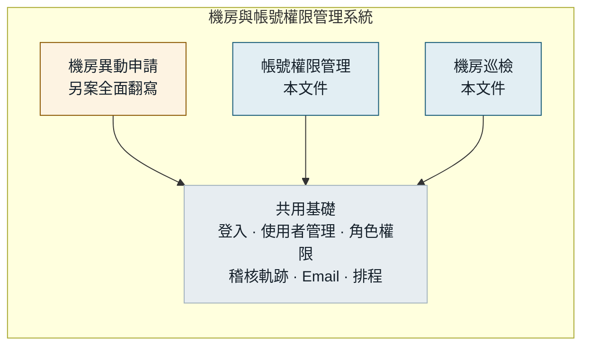
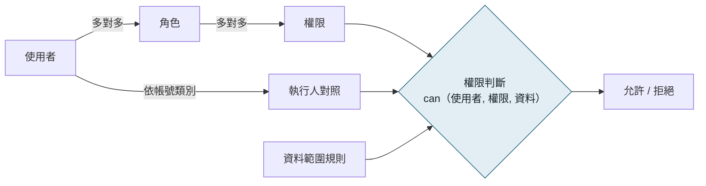
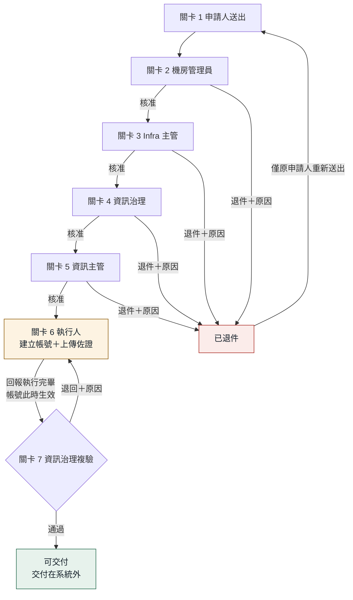
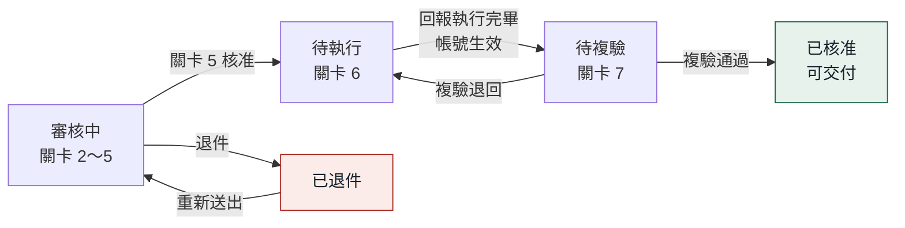
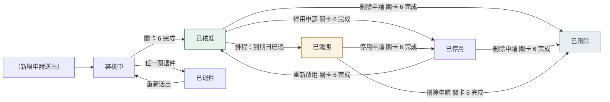
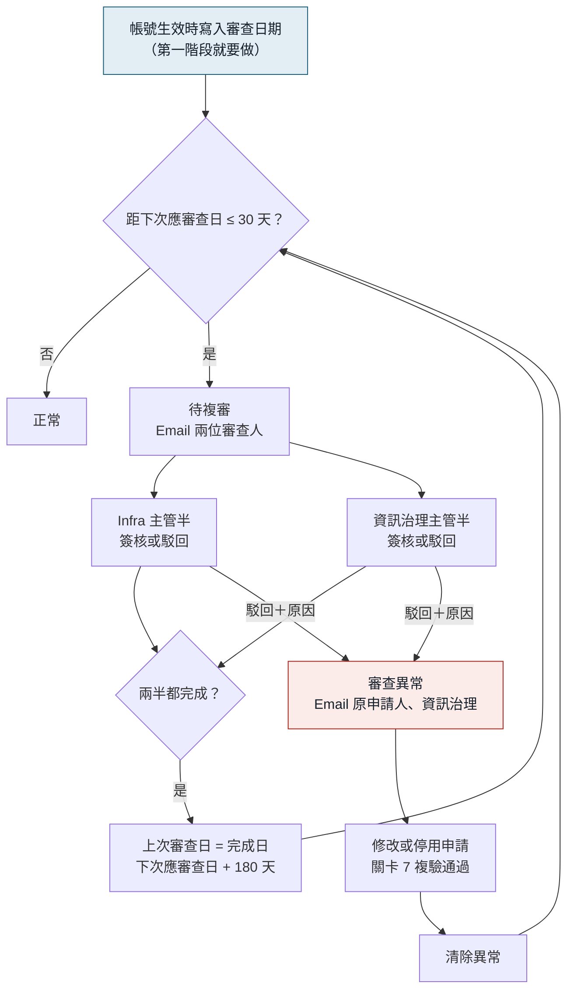
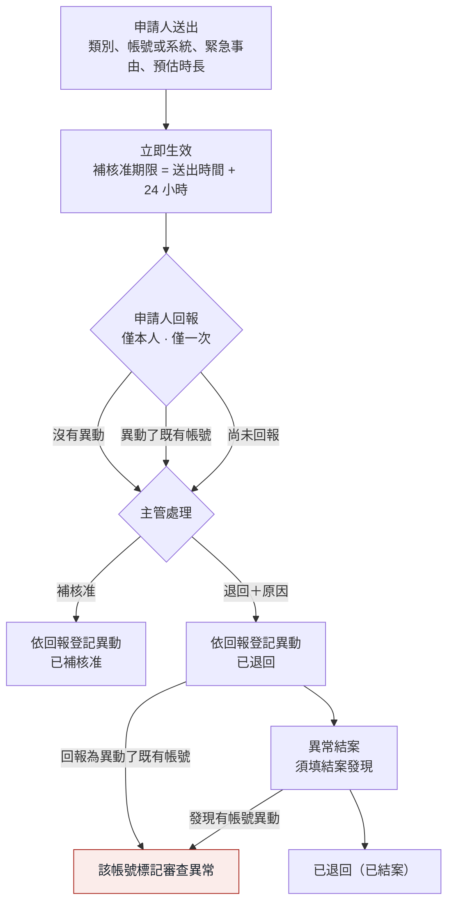
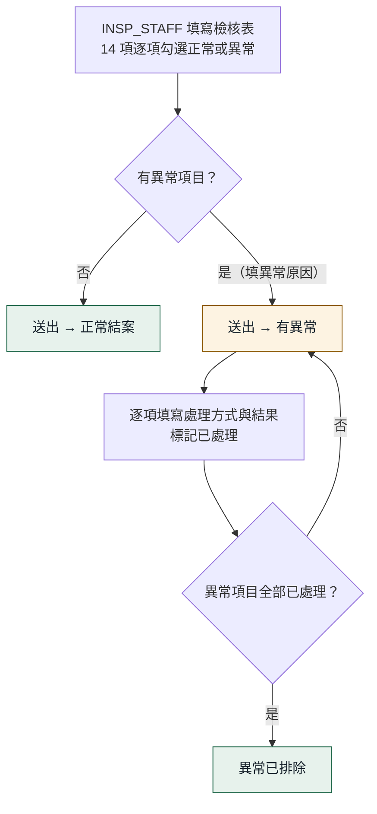
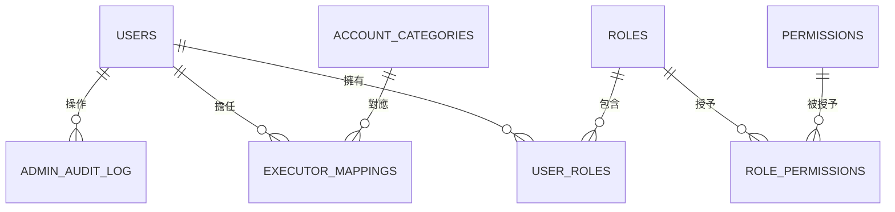
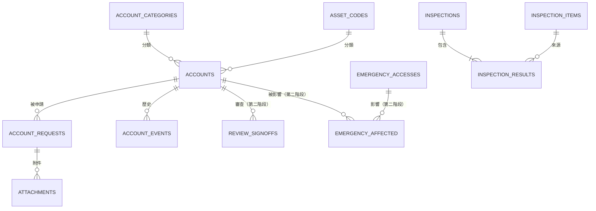

# 機房與帳號權限管理系統
# 帳號權限管理與機房巡檢模組 — 系統分析文件（SA）

| 項目 | 內容 |
|---|---|
| 文件版本 | v0.5 |
| 文件日期 | 2026-10-07 |
| 依據 | 《帳號權限管理與機房巡檢模組 功能規格書》（資訊治理組，2026-09-11）、HTML 原型、需求確認紀錄（2026-10-06～07） |
| 讀者 | 開發工程師、測試人員 |
| 範圍 | 帳號權限管理模組、機房巡檢模組。機房異動申請另案全面翻寫，不在本文件功能範圍內，但共用登入、角色權限與 Email（見 1.1） |

## 0. 閱讀說明

### 0.1 標記

| 標記 | 意義 |
|---|---|
| 〔規格〕 | 依功能規格書，標註章節 |
| 〔確認〕 | 需求確認時已決定 |
| 〔決策〕 | SA 補充或修正（規格未定義或有矛盾），彙整於附錄 A |
| 〔週四〕 | 週四展示版開發（前端畫面、假資料），見第 13 章 |
| 〔第一階段〕 | 第一階段上線 |
| 〔第二階段〕 | 第二階段上線；第一階段需預留的設計彙整於附錄 B |
| 〔後續評估〕 | 尚未排入階段，上線後再評估 |

未標示階段的內容，預設為〔第一階段〕。規格書已詳細描述的畫面行為，本文件只摘要並標註章節，**開發時以規格書原文為準**；與規格書衝突時，以本文件標示〔決策〕或〔確認〕的項目為準。

### 0.2 v0.5 變更（相對 v0.4）

| 項目 | v0.4 | v0.5 |
|---|---|---|
| 申請類型 | 6 種（含展延） | **5 種，展延不做**；需要延長就重新提出新增申請（5.3） |
| 帳號生效時點 | 關卡 7 複驗通過後生效 | **關卡 6 執行人完成即生效**；複驗通過後才交付，交付在系統外（5.5） |
| 帳號類別開放 | 8 種全部開放 | 8 種全部開發；**優先開放主機、資料庫、機房門禁卡**（5.1） |
| 機房異動申請 | 既有模組維持原狀，沿用其登入與 Email | **另案全面翻寫**；三模組共用登入、角色權限、Email（1.1、3.1） |
| 到期 Email | 未定義 | 到期前 7 天、轉已逾期當天、每週一彙總（5.12） |
| 定期審查 | 只有流程 | 補上審查狀態（正常／待複審／逾期未審／審查異常）與 Email（5.10） |
| 帳號狀態「已作廢」 | 由展延產生 | **移除**（展延不做，不再有此狀態） |
| 階段名稱 | 此次／下次 | 第一階段／第二階段；另增「後續評估」 |

v0.1～v0.4 的變更紀錄見前版文件。

---

## 1. 系統範圍

### 1.1 系統組成

三個模組同屬一套系統，**共用同一個登入頁、使用者管理、角色權限與 Email 機制**〔確認〕。機房異動申請的翻寫另案進行，其功能與權限定義不在本文件範圍；本文件定義的角色權限資料表（第 4 章）設計為整套系統共用，機房異動申請所需的權限可在同一套表中新增。

### 1.2 分階段範圍

詳細工作項目與時數見第 13 章。

| 功能 | 週四展示 | 第一階段 | 第二階段 |
|---|---|---|---|
| 帳號申請（8 類別、5 申請類型） | 畫面 | ✅（優先開放 3 類） | |
| 7 關簽核、退件、複驗退回 | 畫面 | ✅ | |
| 帳號列表、申請單列表、待辦簽核 | 畫面 | ✅ | |
| 首頁儀表板 | 畫面 | ✅（部分卡片） | 其餘卡片 |
| 機房巡檢 | 畫面 | ✅ | 巡檢匯出 |
| 登入、使用者管理（與機房異動申請共用） | | ✅ | |
| 角色權限、執行人對照 | 切換身分 | ✅（可先用 DB 維護） | |
| 系統管理員切換身分 | ✅ | ✅ | |
| 歷史軌跡 | 畫面 | ✅ | |
| Email 通知（含到期通知、每週彙總） | | ✅ | 審查、緊急存取相關通知 |
| 到期轉為「已逾期」 | | ✅ | |
| 帳號生效時寫入審查起算日 | | ✅ | |
| 定期權限審查 | | | ✅ |
| 緊急存取 | | | ✅ |
| 統計頁、匯出 | | | ✅ |

〔後續評估〕AD 登入、代理人、人員離職處理、既有帳號資料轉入、巡檢項目維護、資產分類說明維護、機房異動申請待辦併入待辦簽核。

**不做**：展延〔確認〕、帳號匯入功能〔確認〕。

---

## 2. 名詞定義

| 名詞 | 定義 |
|---|---|
| 使用者 | 可登入本系統的人員，與機房異動申請共用 |
| 角色 | 一組權限的集合，代表組織職位或職能，例如「Infra 主管」。一位使用者可擁有多個角色 |
| 權限 | 一個可被授予的操作能力，例如「關卡 3 核准」「檢視完整帳號列表」 |
| 資料範圍 | 進入畫面後「能看到哪些資料」的規則，與權限（能不能進畫面）是兩件事，見 4.5 |
| 執行人對照 | 「帳號類別 → 可擔任關卡 6 執行人的使用者」對照表，見 4.6 |
| 帳號 | 帳號主表中的一筆紀錄，代表一個被管理的系統帳號、憑證或門禁卡。**不是**本系統的登入帳號 |
| 申請單 | 對某個帳號提出的一次異動（新增、修改、停用、重新啟用、刪除），走簽核流程 |
| 帳號單號 | 帳號的識別編號，等於建立該帳號的新增申請單號，見 10.4 |
| 在途 | 申請單尚未走完流程（審核中、待執行、待複驗） |
| 生效 | 帳號異動在實際系統上已完成，以關卡 6 執行人回報完成為準（見 5.5） |
| 交付 | 複驗通過後，把帳號資訊交給使用者；在系統外進行（見 5.5） |
| 實際操作人 | 執行某動作的那一位使用者，不是該關所有可能人選〔規格 5.1〕；切換身分時為切換前的本人 |

---

## 3. 使用者與登入

### 3.1 登入與使用者管理〔確認〕

登入頁、帳號密碼驗證、使用者管理畫面**與翻寫後的機房異動申請共用**。本模組不另開發登入與使用者管理功能，只使用共用的使用者資料。

| 項目 | 規則 |
|---|---|
| 登入 | 使用共用登入頁 |
| 使用者管理 | 使用共用的使用者管理畫面，必要時微幅修改（例如補欄位） |
| 本模組需要的使用者欄位 | 使用者 ID、英文顯示名（例如 Terry）、中文姓名（例如 邱健唐）、部門、Email、電話；畫面顯示格式為「Terry (邱健唐)」 |
| 缺少欄位時 | 以擴充欄位或關聯表補上，**不修改共用使用者表既有欄位的語意** |

### 3.2 系統管理員切換身分〔確認 D23〕

| 規則 | 內容 |
|---|---|
| 誰能用 | 只有 SYS_ADMIN 角色 |
| 切換後 | 畫面、權限、資料範圍完全等同被切換的使用者 |
| 紀錄 | 所有事件同時記錄**實際操作人**與**代理身分**，歷史顯示為「Hank（以 Gary 身分）」 |
| 切換本身 | 每次切換、切回寫入系統管理軌跡 |
| 防呆 | 不另做限制〔確認〕 |
| 畫面提示 | 切換期間頁首固定顯示「目前以 Gary 身分操作」與「切回」按鈕 |

用途為突發狀況處理與週四展示。

### 3.3 AD 登入〔後續評估〕

AD 只負責驗證帳號密碼，角色仍存在本系統。登入驗證須集中在單一介面，日後新增 AD 實作即可。由於登入頁與機房異動申請共用，此預留應在共用登入的設計中處理。

---

## 4. 角色與權限

### 4.1 模型

設計原則：

- **畫面能不能進、按鈕能不能按，由「權限」決定**；權限掛在角色上，角色指派給使用者。程式碼只判斷權限，**不判斷角色名稱、更不判斷人名**。
- **進得去之後能看到哪些資料，由「資料範圍」決定**（見 4.5），寫在查詢條件裡，由後端強制。
- **關卡 6 誰能執行，由「執行人對照」決定**（見 4.6），不是角色。
- 所有權限判斷集中在一個函式（例如 `can(user, permission, resource)`），畫面按鈕與後端 API 共用〔規格 5.1〕。
- 角色、權限資料表為**整套系統共用**，機房異動申請的權限日後加在同一套表中。

### 4.2 角色清單

| 代碼 | 角色 | 職責 | 目前人員 |
|---|---|---|---|
| SYS_ADMIN | 系統管理員 | 角色指派、執行人對照維護、切換身分 | Hank（暫定） |
| GENERAL | 一般人員 | 送出申請、查自己的申請 | 所有使用者自動擁有 |
| DC_ADMIN | 機房管理員 | 關卡 2 核准 | Alex、Alan |
| INFRA_MGR | Infra 主管 | 關卡 3 核准；〔第二階段〕定期審查 Infra 半、緊急存取補核准 | Terry、Wensen |
| GOV | 資訊治理 | 關卡 4 核准、關卡 7 複驗 | Molly、Cathy、Kevin |
| GOV_MGR | 資訊治理主管 | 查詢系統管理軌跡；〔第二階段〕定期審查治理半、緊急存取補核准 | Molly |
| IT_HEAD | 資訊主管 | 關卡 5 核准；〔第二階段〕緊急存取補核准 | Gary |
| ACCT_REGISTRY | 帳號清冊檢視 | 完整帳號列表；〔第二階段〕帳號匯出 | Gary、Terry、Molly |
| INSP_STAFF | 巡檢人員 | 巡檢紀錄查詢、填寫巡檢、標記異常已處理；〔第二階段〕巡檢匯出 | Alex、Alan、Kevin、Terry、Wensen、Gary、Molly |

**為什麼多了 ACCT_REGISTRY 與 INSP_STAFF**〔決策 D06〕：完整帳號列表只開放給 Infra 主管其中一位（Terry），巡檢紀錄只開放給資訊治理其中一位（Kevin）。同一角色內的人權限不同，只能把這兩種權限拆成獨立角色，否則程式裡必須寫人名。

**一人多角色範例**：Molly ＝ GENERAL＋GOV＋GOV_MGR＋ACCT_REGISTRY＋INSP_STAFF；Terry ＝ GENERAL＋INFRA_MGR＋ACCT_REGISTRY＋INSP_STAFF，另在執行人對照中負責資料庫帳號。

**關於「主管」**：不另設「主管」角色。「主管等級」指 IT_HEAD、GOV_MGR、INFRA_MGR 三個角色，相關權限直接授予這三個角色。

### 4.3 權限清單

**權限代碼一次全部建好**（含第二階段的），只是第二階段的功能尚未開發。

| 權限代碼 | 說明 | 階段 |
|---|---|---|
| ACC_APPLY | 送出帳號申請（含新增、對既有帳號發起異動）、退件後重新送出 | 第一階段 |
| ACC_SELF_SERVICE | 進入「帳號申請單列表」自助服務入口 | 第一階段 |
| ACC_LIST_FULL | 進入完整帳號列表 | 第一階段 |
| APPR_G2 ～ APPR_G5 | 關卡 2～5 核准或退件 | 第一階段 |
| VERIFY_G7 | 關卡 7 複驗通過或退回 | 第一階段 |
| INSP_VIEW | 巡檢紀錄查詢與明細 | 第一階段 |
| INSP_CREATE | 填寫巡檢 | 第一階段 |
| INSP_RESOLVE | 標記異常項目已處理 | 第一階段 |
| SYS_ROLE | 角色指派 | 第一階段 |
| SYS_EXECUTOR | 執行人對照維護 | 第一階段 |
| SYS_IMPERSONATE | 切換身分 | 第一階段 |
| SYS_AUDIT_VIEW | 查詢系統管理軌跡 | 第一階段（資料）；畫面可延後，先以 DB 查詢 |
| ACC_EXPORT | 帳號權限清單匯出、批次匯出帳號歷史 | 第二階段 |
| REVIEW_LIST、REVIEW_SIGN_INFRA、REVIEW_SIGN_GOV | 定期審查清單、兩半簽核 | 第二階段 |
| EMG_APPLY、EMG_VIEW_ALL、EMG_DECIDE | 緊急存取申請、看全部、補核准／退回／結案 | 第二階段 |
| STATS_VIEW | 統計頁 | 第二階段 |
| INSP_EXPORT | 巡檢紀錄匯出 | 第二階段 |
| MAINT_ASSET_CODE、MAINT_INSP_ITEM | 資產分類說明維護、巡檢項目維護 | 後續評估 |

### 4.4 角色 × 權限對照

✅ 表示授予。首頁卡片、資產分類說明頁、通知鈴鐺不需權限，所有登入者皆可使用〔規格 2.5、3.2〕。

| 權限 | GENERAL | DC_ADMIN | INFRA_MGR | GOV | GOV_MGR | IT_HEAD | ACCT_REGISTRY | INSP_STAFF | SYS_ADMIN |
|---|---|---|---|---|---|---|---|---|---|
| ACC_APPLY | ✅ | | | | | | | | |
| ACC_SELF_SERVICE | ✅ | | | | | | | | |
| ACC_LIST_FULL | | | | | | | ✅ | | |
| APPR_G2 | | ✅ | | | | | | | |
| APPR_G3 | | | ✅ | | | | | | |
| APPR_G4 | | | | ✅ | | | | | |
| APPR_G5 | | | | | | ✅ | | | |
| VERIFY_G7 | | | | ✅ | | | | | |
| INSP_VIEW | | | | | | | | ✅ | |
| INSP_CREATE | | | | | | | | ✅ | |
| INSP_RESOLVE | | | | | | | | ✅ | |
| SYS_ROLE | | | | | | | | | ✅ |
| SYS_EXECUTOR | | | | | | | | | ✅ |
| SYS_IMPERSONATE | | | | | | | | | ✅ |
| SYS_AUDIT_VIEW | | | | | ✅ | | | | ✅ |
| ACC_EXPORT〔第二階段〕 | | | | | | | ✅ | | |
| REVIEW_LIST〔第二階段〕 | | | ✅ | | ✅ | ✅ | | | |
| REVIEW_SIGN_INFRA〔第二階段〕 | | | ✅ | | | | | | |
| REVIEW_SIGN_GOV〔第二階段〕 | | | | | ✅ | | | | |
| EMG_APPLY〔第二階段〕 | ✅ | | | | | | | | |
| EMG_VIEW_ALL〔第二階段〕 | | | ✅ | | ✅ | ✅ | | | |
| EMG_DECIDE〔第二階段〕 | | | ✅ | | ✅ | ✅ | | | |
| STATS_VIEW〔第二階段〕 | ✅ | | | | | | | | |
| INSP_EXPORT〔第二階段〕 | | | | | | | | ✅ | |

**統計頁開放所有登入者**〔確認〕〔決策 D07〕：首頁統計卡片明訂任何角色皆可查看，統計頁與其數字同源。**真正限定對象的是匯出**。日後若要限定統計頁，把 STATS_VIEW 從 GENERAL 移到主管角色即可，不需改程式。

**系統管理軌跡由資訊治理主管也能查詢**〔決策 D28〕：系統管理員的操作必須能被系統管理員以外的人檢視。

### 4.5 資料範圍規則〔確認〕

「能進畫面」與「看得到哪些資料」分開判斷。右欄必須寫在**後端查詢條件**中，不能只靠前端過濾。

| 畫面／功能 | 進入條件 | 資料範圍 |
|---|---|---|
| 帳號申請單列表（我的申請） | ACC_SELF_SERVICE | 登入者自己送出的申請單 |
| 我曾申請新增的帳號 | ACC_SELF_SERVICE | 登入者送出過「新增」、且帳號目前仍存在（排除已退件、已刪除） |
| 對既有帳號提出異動 | ACC_SELF_SERVICE | 以**完整帳號名稱精確比對**查詢，不提供模糊搜尋或瀏覽〔決策 D29〕 |
| 完整帳號列表 | ACC_LIST_FULL | 全部帳號 |
| 待辦簽核 | 登入即可 | 登入者**此刻**有權處理的項目（見 4.8） |
| 通知鈴鐺 | 登入即可 | 逐筆判斷相關性，見 7.2 |
| 帳號明細、查看歷史彈窗 | 依來源畫面 | 沿用開啟它的畫面的資料範圍；執行人可看自己被指派案件的明細〔決策 D18〕 |
| 首頁統計卡片 | 登入即可 | 全部（只呈現聚合數字） |
| 巡檢紀錄 | INSP_VIEW | 全部 |
| 系統管理軌跡 | SYS_AUDIT_VIEW | 全部 |
| 〔第二階段〕緊急存取清單 | 登入即可 | 有 EMG_VIEW_ALL 看全部；否則只看自己申請的 |
| 〔第二階段〕定期權限審查清單 | REVIEW_LIST | 全部符合審查條件的帳號 |
| 〔第二階段〕統計頁 | STATS_VIEW | 全部（聚合數字） |

**測試重點**：直接呼叫 API（不經畫面）查詢他人的申請單，必須被拒絕或回傳空集合。

### 4.6 執行人對照〔確認〕

關卡 6 的執行人依帳號類別決定〔規格 3.1〕。同一類別有多人時，任一人可執行。由系統管理員維護，每次變更寫入系統管理軌跡。

| 帳號類別 | 執行人 |
|---|---|
| 主機帳號 | Alex |
| 資料庫帳號 | Terry、Michael |
| 應用系統帳號 | Alex |
| 服務帳號 | Alex、Alan |
| 網路設備帳號 | Alex |
| 廠商/委外帳號 | Sage |
| 憑證/金鑰 | Alex、Alan |
| 機房門禁卡 | Alex、Alan |

Sage、Michael 只有 GENERAL 角色加上執行人對照，**不具任何清單存取權**〔規格 1.1〕，在「待辦簽核」只看到被指派執行的項目。

Terry 同時是關卡 3 核准人與資料庫帳號執行人，同一張單可以先核准再執行。系統不阻擋，但會記錄旗標（見 4.9）。

### 4.7 角色指派規則〔確認〕

1. 只有 SYS_ROLE 權限者可在畫面上指派或移除角色。
2. 系統管理員可以修改自己的角色〔確認 D36〕。系統管理員已能切換成任何人的身分，限制「不能改自己」沒有實際防護作用。
3. 每次指派或移除都要填原因（必填），寫入系統管理軌跡（見 9.3），資訊治理主管可查詢。
4. 移除某角色最後一位成員時，若有在途項目卡在該角色，拒絕執行，畫面列出受影響的單號，要求先加入接替人員（見 4.8）。
5. GENERAL 角色由系統自動授予所有使用者，不可移除。
6. 角色維護畫面若第一階段來不及，可暫以 DB 維護，此為不得已的做法，不另做規範〔確認〕。

### 4.8 名單變更對在途案件的影響〔確認 Q01〕

一張申請單送出後，要走好幾天才會到某一關，這段期間角色名單可能被調整。**到了那一關時，以當下的名單判斷誰能簽。**

> 範例：10/1 Kevin 送出資料庫帳號申請。10/2 Alex 核准關卡 2，單子進入關卡 3。10/3 Terry 被移出 Infra 主管，新主管 Leo 加入。10/4 這張單還在關卡 3：**Terry 不能簽，Leo 可以簽。**

- 申請單只記錄「目前在第幾關」，**不記錄可簽的人名**。待辦簽核清單每次查詢時依當下名單計算。
- **已完成的簽核不受影響**：10/2 Alex 的核准永遠有效，即使 Alex 後來離開機房管理員。
- 執行人對照變更適用同一規則。
- 配合 4.7 第 4 條，避免單子變成沒有人能簽。

### 4.9 自行核准與同人兼任〔規格 3.4〕〔決策 D19〕

系統不阻擋自行核准。為了讓稽核看得到，每一筆簽核、執行、複驗事件記錄 `is_self_action` 旗標：

- 操作人 ＝ 該申請單的申請人；或
- 操作人在同一張申請單上已經執行過其他關卡的動作（例如 Terry 核准關卡 3 後又執行關卡 6）。

旗標顯示在「查看歷史」彈窗（標示「自行核准」或「同人兼任」）；〔第二階段〕匯出時增加一欄。不影響流程判斷。

---
## 5. 帳號權限管理模組

### 5.1 帳號類別：8 種共用同一套流程〔確認 D01〕

8 種帳號類別走完全相同的 7 關流程，差異只在表單欄位、關卡 6 的執行人、提示訊息。其中只有「機房門禁卡」有實質不同的規則。

| 帳號類別 | 開放 | 執行人 | 與標準表單的差異 |
|---|---|---|---|
| 主機帳號 | **優先開放** | Alex | 無 |
| 資料庫帳號 | **優先開放** | Terry、Michael | 無 |
| 機房門禁卡 | **優先開放** | Alex、Alan | 大幅不同，見 5.13 |
| 應用系統帳號 | 後續開放 | Alex | 無 |
| 服務帳號 | 後續開放 | Alex、Alan | 顯示「建議指定明確到期日」提示（非強制） |
| 網路設備帳號 | 後續開放 | Alex | 無 |
| 廠商/委外帳號 | 後續開放 | Sage | 同服務帳號的到期日提示 |
| 憑證/金鑰 | 後續開放 | Alex、Alan | 同服務帳號的到期日提示 |

**8 種全部開發**，開發上只需要兩種表單版面：7 種共用的標準表單，以及機房門禁卡的特殊版面。

**開放開關**〔確認〕：帳號類別資料表有一個「是否開放」欄位（`enabled`）。上線時主機、資料庫、機房門禁卡為 `true`，其餘五種為 `false`。申請表單的類別下拉選單只列出開放的類別，這只是查詢時的一個條件，**不做維護畫面**；後續開放時直接改 DB 該欄位即可，不需改程式或重新部署。

**特權屬性**〔規格 3.1〕：「特權」是疊加在任一類別上的勾選欄位，不是第 9 類。

### 5.2 資產分類碼〔規格 3.2〕

依 SR-008-A04（2026-09-16 版），共 15 個分類碼，13 個可選＋「未分類」，H07、H10 僅列於說明、不可選。分類碼存在資料表，無維護畫面。

資料表欄位：代碼、類型（硬體／軟體）、名稱、`selectable`、`review_trigger`、存取控制要求摘要、排序。

`review_trigger` 欄位〔決策 D04〕：H01、H05、S01 設為 `true`。定期審查以這個欄位判斷，**不在程式裡寫死這三個代碼**。

資產分類說明頁：獨立頁面列出全部 15 碼，任何登入者可看；申請表單欄位旁的「查看分類說明」以彈窗顯示相同內容。

### 5.3 申請類型與前提條件〔規格 3.3〕〔確認〕

| 申請類型 | 目標帳號狀態前提 | 表單行為 |
|---|---|---|
| 新增 | 無（從空白表單發起，類型鎖定為「新增」） | 完整填寫 |
| 修改 | 已核准 | 帳號名稱、所屬系統鎖定；其餘可改 |
| 停用 | 已核准、已逾期 | 不填權限範圍、存取對象、有效期限；申請原因欄位標示為「停用原因」 |
| 重新啟用 | 已停用 | 沿用停用前內容，可一併修正 |
| 刪除 | 已核准、已停用、已逾期 | 同停用；欄位標示為「刪除原因」 |

五種都走 7 關。共通規則：

- 修改、停用、重新啟用、刪除只能針對一筆既有帳號發起。
- **同一帳號同時只能有一筆在途申請**〔規格 3.8〕。後端建立申請單時檢查，有在途申請則拒絕，畫面顯示「此帳號目前已有一筆申請正在處理中」。
- **展延不做**〔確認〕，見 5.9。

### 5.4 申請表單欄位

| 欄位 | 必填 | 型態 | 說明 | 選擇機房門禁卡時 |
|---|---|---|---|---|
| 申請單號 | — | 系統產生 | 見 10.4 | 同 |
| 申請日期 | — | 系統時間，**唯讀** | 〔決策 D15〕 | 同 |
| 申請人 | — | 登入者，唯讀 | | 同 |
| 申請單位 | ✅ | 文字 | 新開申請一律空白，僅退件重新送出保留原值〔規格 3.3〕 | 同 |
| 申請人聯絡分機/電話 | | 文字 | 灰底範例「#1614」；**不儲存**，只作為「同申請人」帶入的來源〔規格 3.3〕 | 同 |
| 申請人 Email | | 文字 | 灰底範例；不儲存，同上 | 同 |
| 申請類型 | ✅ | 選項 | 見 5.3 | 同 |
| 帳號類別 | ✅ | 下拉 | 僅顯示開放的類別；附「查看帳號類別說明」 | — |
| 帳號名稱 | ✅ | 文字 | 異動申請時鎖定 | **隱藏，不填**；關卡 6 由執行人填卡號 |
| 門禁權限範圍 | ✅ | 下拉 | — | **僅門禁卡**：僅測試區／機房完整權限 |
| 使用人 Email | | 文字 | — | **僅門禁卡** |
| 所屬系統/設備名稱 | ✅ | 文字 | 異動申請時鎖定 | **隱藏，不填** |
| 資產分類碼 | | 下拉 | 13 碼＋未分類 | **鎖定「未分類」** |
| 是否特權帳號 | | 勾選 | | 同 |
| 實際使用人/保管人 | ✅ | 文字 | 旁有「同申請人」連結 | 同 |
| 所屬單位 | | 文字 | 「同申請人」時若空白則帶入申請單位，有值則不覆蓋 | 同 |
| 使用人聯絡方式 | | 文字 | 灰底範例「#1614 或 Email」 | **隱藏**，改用使用人 Email |
| 權限範圍/角色 | | 下拉 | 唯讀／操作／管理員（完全控制） | **隱藏** |
| 存取對象 | | 文字 | | **隱藏** |
| 申請原因 | ✅ | 多行文字 | 停用、刪除時標示為停用原因、刪除原因 | 同 |
| 附件（公文） | | 檔案 | 限 .pdf .doc .docx .jpg .png | 同 |
| 有效期限類型 | ✅ | 選項 | 永久有效／指定到期日 | 同 |
| 到期日 | 條件 | 日期 | 選「指定到期日」時必填 | 同 |
| 帳號唯一性聲明 | ✅ | 勾選 | 依存取控制管理程序書 5.3.4 | 同 |

**送出驗證順序**〔規格 5.5〕：① 唯一性聲明已勾選 → ② 必填欄位不為空 → ③ 指定到期日時到期日不為空。前端與後端都要驗證。

**格式驗證不做**〔確認 D30〕：以灰底範例提示正確寫法，分機以「#」開頭（例如 #1614），不做驗證。

### 5.5 簽核流程〔規格 3.4〕〔確認〕

**生效與交付**〔確認〕：

- **帳號在關卡 6 執行人回報完成時就生效**，不論關卡 7 複驗結果如何。帳號主表在此時更新。
- **關卡 7 複驗的目的是把關交付**：資訊治理核對佐證與申請內容相符，通過後才可把帳號資訊交給使用者。
- **交付在系統外進行**，系統不介入、不寄交付通知、不經手帳號密碼〔確認〕。
- 停用、刪除在關卡 6 完成時生效；複驗是事後核對，沒有交付。

| 關卡 | 執行者判斷 | 動作 | 必填 | 寫入 |
|---|---|---|---|---|
| 1 | ACC_APPLY | 送出 | 見 5.4 | 申請單；歷史事件「送出申請」（結果欄寫入申請原因〔規格 5.4〕、記錄申請單位快照）。新增申請同步建立帳號紀錄，狀態「審核中」 |
| 2 | APPR_G2 | 核准／退件 | 退件原因 | 歷史事件 |
| 3 | APPR_G3 | 核准／退件 | 退件原因 | 歷史事件 |
| 4 | APPR_G4 | 核准／退件 | 退件原因 | 歷史事件 |
| 5 | APPR_G5 | 核准／退件 | 退件原因 | 歷史事件 |
| 6 | 執行人對照 | 回報執行完畢 | 佐證附件；門禁卡新增另填卡號；執行說明選填 | 附件、歷史事件；**同一交易中更新帳號主表**（見 5.8）、寫入審查起算日（見 5.10） |
| 7 | VERIFY_G7 | 複驗通過／退回 | 退回原因 | 歷史事件；申請單狀態改為已核准；〔第二階段〕修改、停用類型清除審查異常 |

關卡 2～5 與關卡 7 只做審核，不需填寫內容，只有退件、退回時須填原因。

**關卡處理的共通規則**：

- **權限在後端驗證**：API 檢查「登入者此刻是否有該關權限」且「申請單目前確實在該關」，兩者皆符合才執行〔規格 5.1〕。
- **申請單只記錄目前關卡，不記錄可簽人名**（見 4.8）。
- **同關卡多人同時操作**〔決策 D26〕：申請單使用樂觀鎖（版本號），先送出者成功，後送出者收到「此申請已由他人處理」並重新整理。
- **在途期間帳號主表維持原值**：申請單存「申請的內容」，關卡 6 完成時才寫入帳號主表〔規格 5.3〕。
- **退件**：只有原申請人看得到「重新送出」；沿用同一申請單號，回到關卡 1，保留原申請單位〔規格 3.3、3.4〕。
- **複驗退回**：回到關卡 6，`verify_reject_count` 加 1。帳號已生效，執行人在實際系統上修正後重新上傳佐證、回報完成。第二次回報與第二次複驗時，畫面顯示「此案件先前已被複驗退回過」與上次退回原因〔規格 3.4〕。**複驗退回時不回復帳號主表**；修正應使實際系統符合已核准的申請內容，若需改變申請內容，須另提修改申請。
- **附件讀取失敗**〔決策 D17〕：關卡 1 的公文附件讀取失敗時不阻擋、提示後送出；關卡 6 的佐證附件讀取失敗時**擋下**，要求重新上傳。
- 〔第二階段〕關卡 2～5 與關卡 7 明細畫面的「審查異常警示」〔規格 3.4〕，隨定期審查一起開發。

### 5.6 申請單進度狀態

用於「帳號申請單列表」篩選，**與帳號狀態是不同的集合，不可共用欄位或列舉**〔規格 3.8〕。

篩選選項：全部、審核中、待執行、待複驗、已核准、已退件。「審核中」須另外顯示目前關卡（例如「審核中：待 Infra 主管」）。

### 5.7 帳號狀態

用於「帳號列表」篩選。

| 狀態 | 計入首頁帳號總數 | 到期提醒 | 可發起的申請 |
|---|---|---|---|
| 審核中 | ✅ | | 無（在途） |
| 已核准 | ✅ | 到期日 30 天內 | 修改、停用、刪除 |
| 已逾期 | ✅ | ✅ | 停用、刪除 |
| 已停用 | ✅ | | 重新啟用、刪除 |
| 已退件 | ✅ | | 由原申請人重新送出 |
| 已刪除 | ❌ | | 無 |

**待複驗標記**：新增申請在關卡 6 完成後，帳號狀態已是「已核准」，但尚未複驗、尚未交付。帳號列表在這類帳號旁顯示「待複驗」標記，資料取自該帳號在途申請單的狀態，不另存帳號欄位。

**刪除是軟刪除**〔決策 D16〕：資料保留、狀態永久不可再變更。表單警示文字改為：「刪除後此帳號將無法再啟用或異動，僅保留歷史紀錄供稽核查詢。」

列表預設不顯示已刪除〔規格 2.4〕。刪除時，同一交易中須取消該帳號進行中的定期審查簽核紀錄〔規格 5.2〕。

### 5.8 帳號主表同步規則〔規格 5.3〕

- 帳號主表在**關卡 6 完成時**更新，以 `source` 欄位標記建立來源（新增申請；〔後續評估〕資料轉檔）。
- 「修改」完成時須完整更新：使用人、所屬單位、權限範圍、存取對象、資產分類碼、是否特權、使用人聯絡方式、有效期限。
- 測試須同時驗證資料庫內容與畫面顯示（例如取消特權後，列表的特權標籤是否消失）。
- 申請原因欄位只存最新一次；每次送出的原因都寫進歷史事件〔規格 5.4〕。

### 5.9 延長使用期限〔確認〕

**展延不做，之後也不規劃。** 設計概念是：有到期日的帳號（例如廠商臨時支援，開通一週）到期就到期，標示為已逾期，只能停用或刪除；需要延長，就重新提出新增申請，產生一個新帳號與新的帳號單號。

已核准帳號在到期前，是否允許以「修改」申請調整到期日〔待確認 C01〕：若允許，等於在同一個帳號上延長期限；若不允許，修改申請中的有效期限欄位須鎖定。本文件暫定**允許**，因為修改申請同樣要走完 7 關。

### 5.10 定期權限審查〔規格 3.5〕〔第二階段〕

整個功能第二階段上線。**但第一階段必須先做一件事**：

> **帳號生效時就寫入審查日期。** 帳號在關卡 6 完成而生效時，若符合審查條件，寫入「上次審查日期 ＝ 生效日」「下次應審查日期 ＝ 生效日 ＋ 180 天」。修改申請在關卡 6 完成時，若帳號從不符合變成符合，同樣寫入。否則第二階段上線時，所有帳號的 180 天週期都還沒開始計算。

**審查條件**（符合任一）：資產分類碼的 `review_trigger = true`；類別為機房門禁卡；勾選特權。只對「已核准」帳號排入審查〔決策 D33〕。

**審查期間帳號照常可用**〔確認〕：系統不會停用實際帳號，只標示審查狀態並通知審查人。

**審查狀態**〔確認〕：與帳號狀態是**兩個獨立的欄位概念**。一個 root 帳號可以同時是「已核准」加「待複審」，這期間照樣可以提出修改申請。審查狀態**即時計算，不存欄位**。

| 審查狀態 | 條件 | Email |
|---|---|---|
| 正常 | 距下次應審查日超過 30 天 | — |
| 待複審 | 距下次應審查日 30 天內（含當天），且未完成本輪雙簽、無異常 | 進入時寄一次給 INFRA_MGR 與 GOV_MGR 角色成員 |
| 逾期未審 | 已超過下次應審查日，或上次審查日為空，且未完成雙簽 | 併入每週一彙總信（見 5.12） |
| 審查異常 | 被駁回且尚未解除 | 駁回時寄給原申請人與資訊治理（GOV） |

- 兩位審查人各簽一半、順序不限；兩人都通過才完成。
- 每一輪審查一筆 `review_signoffs`，兩半各自記錄簽核人與時間〔規格 5.1〕。
- 駁回：寫入 `review_abnormal = true`、原因、來源、時間、標記人；提供「直接發起停用申請」捷徑〔規格 3.5〕。
- **清除異常在關卡 7 複驗通過時**：雖然帳號在關卡 6 就生效，異常標記要等資訊治理確認處理結果後才清除。沒有其他清除方式。
- 標記異常期間，關卡 2～5 與關卡 7 處理該帳號的申請時，畫面顯示異常警示〔規格 3.4〕。
- 待複審 Email 由每日排程（J04）判斷「本輪尚未寄過」才寄，每輪只寄一次。

### 5.11 緊急存取〔規格 3.6〕〔第二階段〕

整個功能第二階段上線。以下為已確認的設計。

- 狀態：待補核准、逾期未補核准（計算得出）、已補核准、已退回、已退回（已結案）。
- 核准資格：EMG_DECIDE（IT_HEAD、GOV_MGR、INFRA_MGR）。
- **逾期後仍可處理**〔決策 D14〕：時間照實記錄，達成率以處理時間是否早於期限計算。
- **異常結案須填結案發現**〔確認 Q02〕〔決策 D13〕：選「確認沒有帳號異動」或「有帳號異動（選帳號＋說明）」；後者另立「結案登記異動」事件（不覆蓋申請人回報），並標記審查異常。
- 受影響帳號以子表記錄〔決策 D31〕。
- 補核准達成率：期限內退回算達成〔確認 Q05〕。

### 5.12 到期管理〔規格 3.10〕〔確認〕

**為什麼不改成「已停用」**〔決策 D34〕：本系統只負責登記與簽核，**不會連動實際的 DB 權限或門禁系統**。到期時若系統自行把狀態改為「已停用」，實際帳號仍能登入、門禁卡仍能刷，系統紀錄就與現實不符。所以到期時改為「**已逾期**」，代表「依核准內容已不該使用，但尚未確認實際停用」。

| 規則 | 內容 |
|---|---|
| 轉為已逾期 | 每日排程（J01）：狀態為已核准、到期日 < 今天 → 已逾期 |
| 歷史事件 | 「到期轉為已逾期」，操作人「系統排程」 |
| 可發起的申請 | 停用、刪除 |
| 畫面提醒 | 已核准且到期日在 30 天內，加上全部已逾期；呈現於通知鈴鐺、首頁卡片「30 天內到期」、帳號列表上方橫幅〔規格 3.10〕 |
| 在途申請 | 到期時若有在途申請，照常轉為已逾期，在途申請不受影響、照常完成 |

**到期 Email**〔確認〕：

| 時間點 | 收件人 | 排程 |
|---|---|---|
| 到期前 7 天 | 原申請人、該類別執行人、資訊治理（GOV） | J01，每帳號一次 |
| 轉為已逾期當天 | 原申請人、該類別執行人、資訊治理（GOV） | J01，每帳號一次 |
| 每週一 | 資訊治理（GOV）：彙總一封，列出所有已逾期但尚未停用或刪除的帳號；〔第二階段〕一併列出逾期未審的帳號 | J02 |

- 到期前 30 天不寄信，只在畫面提醒。
- 已逾期之後不再逐帳號寄信，避免被當成垃圾信，改由每週彙總追蹤。
- 原申請人為空時（例如日後資料轉入的帳號）略過，不影響其他收件人。
- 每封信是否已寄出記錄在通知紀錄表，排程重複執行時不重寄。

規格原文是「每次進入帳號列表或相關頁面時重新檢查」，正式環境沒人登入就不會轉換，因此改為排程〔決策 D11〕。

### 5.13 機房門禁卡特殊規則〔規格 3.9〕

| 規則 | 內容 |
|---|---|
| 卡號 | 新增申請不填帳號名稱；關卡 6 執行人刷卡讀出卡號後填入，**必填**；同時寫入帳號名稱 |
| 其他申請類型 | 不需重新取號，執行人上傳門禁系統操作截圖作為佐證 |
| 門禁權限範圍 | 僅測試區（第一道門）／機房完整權限（兩道門）；修改時可重選 |
| 隱藏欄位 | 帳號名稱、所屬系統/設備、權限範圍/角色、存取對象、使用人聯絡方式 |
| 資產分類碼 | 鎖定「未分類」 |
| 使用人 Email | 門禁卡專屬欄位；「同申請人」時帶入申請人 Email |
| 定期審查 | 強制納入（第一階段只寫入審查日期） |

### 5.14 帳號列表與自助服務入口

**完整帳號列表**〔規格 2.4〕：需 ACC_LIST_FULL。關鍵字（帳號名稱、單號、使用人）、類別、狀態（含各狀態數量）、資產分類碼篩選，可同時套用；預設不顯示已刪除。無權限者直接進入時顯示無權限頁；導覽選單中的連結對無權限者改指向「帳號申請單列表」。

**帳號申請單列表**〔規格 3.8〕：所有人可進入，三個區塊（規格的「我匯入的帳號」因不開發匯入而取消）：

| 區塊 | 說明 |
|---|---|
| 對既有帳號提出異動 | 輸入完整帳號名稱精確查詢；有在途申請時不顯示操作按鈕 |
| 我曾申請新增的帳號 | 在途者只提供查看、歷史 |
| 我的申請單 | 依申請單進度狀態篩選；退件項目可重新送出 |

### 5.15 既有帳號資料轉入〔後續評估〕

規格 3.7 的帳號匯入功能**不開發**〔確認〕。既有帳號是否、何時以一次性程式轉入，上線後再評估。

此項不需第一階段預留任何設計，帳號主表的 `source` 欄位已足以日後區分來源。

---
## 6. 機房巡檢模組〔規格第四章〕

### 6.1 權限〔確認 D09〕

能看到巡檢紀錄的人都能填寫：INSP_STAFF 角色擁有查詢、填寫、標記處理三個權限；〔第二階段〕巡檢匯出。

### 6.2 巡檢項目〔確認 D03〕

固定 14 項，**存在資料表**（以初始資料建立），不寫死在畫面程式中，無維護畫面。

| 大類 | 項目 |
|---|---|
| 甲、機房環境設施（10 項） | 機房溫度、機房溼度、UPS 電力狀態、UPS 電池狀態、精密空調運作、消防偵煙系統、滅火系統、門禁系統、監視系統、漏水偵測 |
| 乙、資訊設備狀態（4 項，只需觀察） | 交換器面板燈是否全部正常（無紅燈閃爍、無告警音）；路由器/防火牆面板是否有紅色告警燈或告警音；伺服器面板燈是否正常（電源/風扇/溫度指示燈無紅、黃燈）；儲存陣列面板是否有紅色/黃色告警燈 |

項目資料表欄位：代碼、大類、名稱、說明、排序、`is_active`。**每筆巡檢結果另存項目名稱與大類的快照**，日後若開放維護，修改項目不會改變舊紀錄。

### 6.3 流程

| 規則 | 內容 |
|---|---|
| 結果選項 | 正常／異常〔確認 D21〕 |
| 異常說明 | 選「異常」時必填 |
| 巡檢人員 | 登入者本人，不可選擇或修改；切換身分時記錄實際操作人與代理身分 |
| 巡檢日期時間 | 預設當下，可調整（實際巡檢可能早於填單）；另存系統建立時間 |
| 巡檢單號 | 系統自動產生，見 10.4 |
| 送出後 | **不可修改各項結果**〔決策 D22〕，只能對異常項目標記已處理 |
| 標記已處理 | 處理方式與結果必填（文字，不需附件）；記錄處理人、處理時間；巡檢人員本人可標記自己發現的異常 |
| 整體狀態 | **即時計算，不存欄位**〔規格第四章〕：無異常 → 正常結案；有未處理異常 → 有異常；全部已處理 → 異常已排除。畫面、篩選共用同一個計算函式或資料庫檢視 |

### 6.4 查詢

關鍵字（巡檢單號、巡檢人員）、狀態（全部／正常結案／有異常／異常已排除）、日期區間（全部／近 7 天／近 30 天（預設）／近 90 天／自訂）。

---

## 7. 首頁、通知與待辦

### 7.1 首頁儀表板〔規格 2.5〕

所有登入者可見，只顯示聚合數字。

| 卡片 | 計算 | 可點擊 | 階段 |
|---|---|---|---|
| 帳號總數 | 不含已刪除 | | 第一階段 |
| 待審核 | 帳號狀態為審核中 | | 第一階段 |
| 30 天內到期 | 同 5.12 畫面提醒範圍（含已逾期） | ✅ 帳號列表 | 第一階段 |
| 特權帳號 | 勾選特權，不含已刪除 | | 第一階段 |
| 本月巡檢次數 | 巡檢日期在本月的紀錄數 | | 第一階段 |
| 本月發現異常項目數 | 本月巡檢中尚未標記處理的異常項目數 | | 第一階段 |
| 緊急存取待補核准 | 待補核准＋逾期未補核准 | ✅ | 第二階段 |
| 逾期未定期審查 | 審查狀態為逾期未審 | ✅ | 第二階段 |
| 審查異常待處理 | 審查狀態為審查異常 | ✅ | 第二階段 |
| 緊急存取異常待追蹤 | 已退回且未結案 | ✅ | 第二階段 |

「可點擊」的目標頁需要權限；無權限者點擊時顯示無權限頁。**數字的計算函式須與第二階段的統計頁共用**〔規格 2.5〕。

### 7.2 通知鈴鐺〔規格 2.5〕

| 類別 | 階段 | 相關的人 |
|---|---|---|
| 1. 30 天內到期與已逾期的帳號（依到期日由近到遠） | 第一階段 | IT_HEAD、INFRA_MGR、GOV_MGR（看全部）；該帳號的原新增申請人；該類別在執行人對照中的人 |
| 2. 審查異常尚未處理的帳號 | 第二階段 | 同上 |
| 3. 緊急存取已退回且未結案 | 第二階段 | IT_HEAD、INFRA_MGR、GOV_MGR；該次緊急存取的原申請人 |

相關性**逐筆判斷**，與登入者無關的事項連聚合筆數都不顯示〔規格 2.5〕。

**點擊導向**〔決策 D18〕：有帳號列表權限者導向列表；沒有的人（例如執行人 Sage、Michael，或原申請人）開啟該筆的唯讀明細彈窗。

### 7.3 Email 通知〔規格第七章〕〔確認〕

使用與機房異動申請共用的 Email 機制。收件人在發送當下依角色名單計算（與 4.8 一致）。每次發送記錄於通知紀錄表（收件人、事件、時間、成功或失敗），排程類通知以此避免重寄。

| 事件 | 收件人 | 階段 |
|---|---|---|
| 申請送出、重新送出 | 關卡 2 權限者 | 第一階段 |
| 關卡 2～4 核准 | 下一關權限者 | 第一階段 |
| 關卡 5 核准 | 該類別的執行人 | 第一階段 |
| 任一關退件 | 申請人 | 第一階段 |
| 回報執行完畢 | VERIFY_G7 權限者 | 第一階段 |
| 複驗退回 | 該次執行人 | 第一階段 |
| 複驗通過 | 不寄〔待確認 C02〕 | — |
| 到期前 7 天、轉為已逾期當天 | 原申請人、該類別執行人、資訊治理（GOV） | 第一階段 |
| 每週一彙總 | 資訊治理（GOV） | 第一階段 |
| 排程作業失敗 | SYS_ADMIN | 第一階段 |
| 進入待複審 | INFRA_MGR、GOV_MGR | 第二階段 |
| 定期審查駁回 | 原申請人、資訊治理（GOV） | 第二階段 |
| 緊急存取送出 | EMG_DECIDE 權限者 | 第二階段 |
| 緊急存取逾期未補核准 | EMG_DECIDE 權限者（每案一次） | 第二階段 |

**複驗通過不寄信**：交付在系統外進行、系統不介入〔確認〕。若寄信給執行人或申請人，等於由系統觸發交付流程，因此暫不寄。申請人可在「我的申請單」看到狀態變為已核准。

### 7.4 待辦簽核〔規格 2.3〕

單一清單，依登入者**此刻**的權限與執行人對照即時計算（見 4.8）。

| 來源 | 出現條件 | 操作 | 階段 |
|---|---|---|---|
| 帳號申請 關卡 2～5 | 登入者有該關權限 | 核准、退件 | 第一階段 |
| 帳號申請 關卡 6 | 登入者在該類別的執行人對照中 | 回報執行完畢 | 第一階段 |
| 帳號申請 關卡 7 | VERIFY_G7 | 複驗通過、退回 | 第一階段 |
| 定期審查兩半 | REVIEW_SIGN_INFRA／REVIEW_SIGN_GOV | 簽核、駁回 | 第二階段 |
| 機房異動申請 | — | — | 後續評估 |

清單以「多來源合併」設計：每個來源提供相同格式的待辦項目（來源、單號、標題、目前關卡、送出時間、操作），新增來源不需改清單畫面〔決策 D24〕。機房異動申請翻寫後同屬一套系統，日後併入只需新增一個來源。

---

## 8. 統計與匯出〔規格第六章〕〔第二階段〕

整章第二階段上線，設計已確認，先列出。

### 8.1 統計頁

存取：所有登入者（見 4.4）。期間：截至目前的全期間（巡檢異常趨勢除外）。

| 區塊 | 計算 |
|---|---|
| 帳號類別分布 | 8 類各自數量與佔比；不含已刪除；加總＝首頁帳號總數 |
| 重要系統資產統計 | H01、H05、S01、特權四項；排除已停用、已刪除 |
| 簽核狀態分布 | 已核准（含已停用、已逾期）／審核中／已退件；不含已刪除 |
| 機房巡檢異常趨勢 | 近 4 週每週異常項目數 |

管控措施有效性指標：狀態卡片（✅沒問題／⚠️需注意／➖尚無資料），**零容忍**，依規格實作〔確認 Q09〕。

| 指標 | 分母 | 分子（不良案例） |
|---|---|---|
| 帳號逾期未處理 | 設有到期日的帳號（不含已刪除） | 狀態為已逾期 |
| 緊急存取補核准達成率 | 已處理或已逾期的案件 | 未在期限內處理（期限內退回算達成） |
| 審查逾期 | 符合審查條件的已核准帳號 | 審查狀態為逾期未審 |
| 申請／異動退件率 | 全部申請單 | 曾被退件過 |
| 複驗退回率 | 曾回報執行完畢的申請單 | 曾被複驗退回 |

### 8.2 匯出

| 匯出 | 權限 | 範圍 |
|---|---|---|
| 帳號權限清單 | ACC_EXPORT | 排除已刪除 |
| 批次匯出帳號歷史 | ACC_EXPORT | 依事件來源、日期區間、帳號名稱篩選；增加「自行核准」欄 |
| 機房巡檢紀錄 | INSP_EXPORT | 全部 |

欄位依規格 6.2；檔名「名稱_YYYYMMDD.xlsx」。

---

## 9. 稽核軌跡設計

### 9.1 原則

1. **記錄實際操作人**，不記錄可能人選池〔規格 5.1〕。
2. **切換身分時同時記錄實際操作人與代理身分**〔確認 D23〕，顯示為「Hank（以 Gary 身分）」。
3. **記錄姓名快照**：事件同時存操作人 ID 與當下顯示姓名，日後改名或停用不影響舊紀錄。
4. **毫秒時間戳**：一律伺服器時間（毫秒），多來源事件依此排序，不比較日期字串〔規格 5.2〕。
5. **只增不改**：軌跡資料表不提供更新、刪除的程式路徑。
6. **權限在後端驗證**，畫面隱藏按鈕不算控管〔規格 5.1〕。

### 9.2 帳號歷史事件

| 來源 | 動作 | 階段 |
|---|---|---|
| 一般簽核流程 | 送出申請、重新送出、核准（關卡 2～5）、退件（關卡 2～5）、回報執行完畢（帳號生效）、複驗通過、複驗退回 | 第一階段 |
| 系統排程 | 到期轉為已逾期 | 第一階段 |
| 定期審查 | 雙簽完成、駁回（標記異常）、異常清除 | 第二階段 |
| 緊急存取 | 緊急存取異動（依申請人回報）、結案登記異動 | 第二階段 |

事件欄位：事件 ID、帳號 ID、申請單 ID（可空）、來源、動作、關卡（可空）、操作人 ID（系統排程為空）、操作人姓名快照、**代理身分 ID 與姓名快照（可空）**、發生時間（毫秒）、申請單位快照（僅一般簽核流程）、結果文字、`is_self_action`。

「查看歷史」彈窗依發生時間排序顯示所有來源的事件〔規格 5.2〕。

### 9.3 系統管理軌跡

| 動作 | 記錄內容 |
|---|---|
| 指派角色、移除角色 | 角色、對象、原因（必填） |
| 執行人對照新增、移除 | 類別、使用者、原因（必填） |
| 切換身分、切回 | 切換對象 |
| 被拒絕的操作 | 例如移除最後一位成員被拒；記錄嘗試內容與拒絕理由 |

欄位：事件 ID、發生時間（毫秒）、操作人 ID 與姓名快照、動作、對象使用者、內容（修改前後，JSON）、原因、結果（成功／拒絕）。

查詢需 SYS_AUDIT_VIEW（SYS_ADMIN、GOV_MGR）；第一階段若來不及做查詢畫面，先以 DB 查詢。

---

## 10. 資料模型

### 10.1 關聯圖

**角色權限**（USERS 為共用使用者表）

**帳號權限管理與機房巡檢**

### 10.2 資料表

所有資料表另有建立時間、建立人、更新時間、更新人。

**角色權限**（整套系統共用；USERS 為共用使用者表，見 3.1）

| 資料表 | 關鍵欄位 | 階段 |
|---|---|---|
| roles | id、code（唯一）、name、description、is_system（GENERAL、SYS_ADMIN 不可刪除） | 第一階段 |
| permissions | id、code（唯一）、name、module、phase | 第一階段（第二階段的權限碼也一起建） |
| role_permissions | role_id、permission_id | 第一階段 |
| user_roles | user_id、role_id、granted_by、granted_at | 第一階段 |
| executor_mappings | category_code、user_id、granted_by、granted_at | 第一階段 |
| admin_audit_log | 見 9.3 | 第一階段 |

**帳號權限管理**

| 資料表 | 關鍵欄位 | 階段 |
|---|---|---|
| account_categories | code、name、enabled（主機、資料庫、門禁卡為 true）、suggest_expiry、sort | 第一階段 |
| asset_codes | code、type、name、selectable、review_trigger、control_summary、sort | 第一階段 |
| accounts | id、account_no、category_code、account_name、system_name、door_scope、user_email、asset_code、is_privileged、holder_name、holder_unit、holder_contact、permission_level、access_target、reason（最新一次）、expiry_type、expiry_date、status（審核中／已核准／已逾期／已停用／已退件／已刪除）、source、created_by（原新增申請人）、**last_review_date、next_review_date**（第一階段就要寫入）、review_abnormal、review_abnormal_reason、review_abnormal_source、review_abnormal_at、review_abnormal_by（第二階段使用） | 第一階段 |
| account_requests | id、request_no、account_id、request_type（新增／修改／停用／重新啟用／刪除）、status（審核中／待執行／待複驗／已核准／已退件）、current_stage、applicant_id、applicant_unit、request_date、申請內容欄位（與 accounts 對應，存「申請的值」）、reason、uniqueness_ack、executor_id、executor_note、card_no、effective_at（關卡 6 完成時間）、reject_count、verify_reject_count、last_reject_reason、last_verify_reject_reason、version（樂觀鎖）、submitted_at、completed_at（關卡 7 通過時間） | 第一階段 |
| attachments | id、request_id、kind（公文／佐證）、file_name、mime_type、size、storage_key、uploaded_by、uploaded_at | 第一階段 |
| account_events | 見 9.2 | 第一階段 |
| review_signoffs | id、account_id、due_date、infra_signer_id、infra_signed_at、gov_signer_id、gov_signed_at、status、rejected_by、rejected_half、reject_reason、notified_at、completed_at | 第二階段 |
| emergency_accesses | id、emg_no、category_code、target_text、applicant_id、reason、est_hours、activated_at、deadline_at、report_type、report_text、reported_at、decision、decided_by、decided_at、return_reason、closed_by、closed_at、close_text、close_finding、overdue_notified_at | 第二階段 |
| emergency_affected | id、emergency_id、account_id、kind（申請人回報／結案登記）、description、recorded_by、recorded_at | 第二階段 |

**機房巡檢**

| 資料表 | 關鍵欄位 | 階段 |
|---|---|---|
| inspection_items | code、category（甲／乙）、name、description、sort、is_active | 第一階段 |
| inspections | id、inspection_no、inspected_at、inspector_id、inspector_name_snapshot、acting_as_id、submitted_at | 第一階段 |
| inspection_results | id、inspection_id、item_code、item_name_snapshot、category_snapshot、result（正常／異常）、abnormal_desc、resolved_by、resolved_at、resolve_text | 第一階段 |

**共用**

| 資料表 | 關鍵欄位 | 階段 |
|---|---|---|
| notification_log | id、event_type、ref_type、ref_id、recipient_user_id、recipient_email、sent_at、result、error_message | 第一階段 |
| job_runs | id、job_code、started_at、finished_at、result、affected_count、error_message | 第一階段 |

### 10.3 計算欄位（不存資料庫）

| 項目 | 規則 | 階段 |
|---|---|---|
| 巡檢整體狀態 | 見 6.3 | 第一階段 |
| 是否在 30 天到期提醒 | 見 5.12 | 第一階段 |
| 帳號列表「待複驗」標記 | 帳號有一筆狀態為待複驗的在途申請 | 第一階段 |
| 審查狀態 | 見 5.10 | 第二階段 |
| 緊急存取「逾期未補核准」 | 未處理且現在 > 期限 | 第二階段 |

以資料庫檢視或共用查詢函式實作，所有用到的地方共用同一個。

### 10.4 單號規則〔確認 Q12〕

格式：**前綴 ＋ 西元年月日（8 碼）＋ 「-」 ＋ 當日流水號（3 碼）**。流水號依前綴分開計算，每日從 001 重新起算。

| 前綴 | 英文全名 | 中文 | 用途 | 範例 | 階段 |
|---|---|---|---|---|---|
| AR | Account Request | 帳號申請 | 每張帳號申請單一個 | AR20261015-001 | 第一階段 |
| IN | Inspection | 巡檢 | 每次巡檢一個 | IN20261015-001 | 第一階段 |
| EA | Emergency Access | 緊急存取 | 每次緊急存取一個 | EA20261120-001 | 第二階段 |
| MG | Migration | 資料轉入 | 資料轉入建立的帳號 | — | 後續評估 |

**帳號單號**〔決策 D25〕：帳號本身的識別編號，等於建立這個帳號的那張「新增申請」的 AR 單號。之後對同一帳號的修改、停用等申請，各自有新的 AR 單號，但帳號單號不變。

流水號須在資料庫層保證唯一（序號表或唯一索引＋重試），不可用「查目前最大值 ＋ 1」在應用程式產生。

---

## 11. 排程作業

| 代碼 | 作業 | 頻率 | 內容 | 階段 |
|---|---|---|---|---|
| J01 | 到期處理 | 每日 00:10 | ① 已核准且到期日 < 今天 → 已逾期，寫歷史事件（操作人「系統排程」），寄轉逾期通知；② 到期日 ＝ 今天 ＋ 7 天者，寄到期前 7 天通知 | 第一階段 |
| J02 | 每週彙總 | 每週一 08:00 | 寄給資訊治理：所有已逾期但尚未停用或刪除的帳號；〔第二階段〕加上逾期未審的帳號 | 第一階段 |
| J03 | 緊急存取逾期通知 | 每 15 分鐘 | 已逾期、未處理、未通知過者，寄給 EMG_DECIDE 權限者 | 第二階段 |
| J04 | 待複審通知 | 每日 00:20 | 新進入待複審、本輪尚未通知者，寄給兩位審查人 | 第二階段 |

共通要求：

- **可重複執行**：同一天跑兩次結果相同，不重複轉換、不重寄信（以通知紀錄表判斷）。
- 每次執行寫入 job_runs；失敗時 Email 通知 SYS_ADMIN。
- 逐筆在交易中處理，單筆失敗不影響其他筆。
- 漏跑時，下次執行自然補處理：J01 的轉換會補上所有已到期者；到期前 7 天通知以「到期日 ≤ 今天 ＋ 7 天且尚未寄過」判斷，漏跑也不會漏寄。

---

## 12. 開發注意事項

### 12.1 相依事項

**第一階段上線依賴共用登入與使用者管理**：登入頁、使用者管理、Email 機制與翻寫中的機房異動申請共用（見 3.1）。共用部分若未先完成，本模組無法單獨上線。開發排程須與機房異動申請的翻寫協調，共用部分應最先完成。

### 12.2 交易邊界

以下動作須在**單一資料庫交易**中完成，任一步失敗全部回復：

| 動作 | 交易內容 |
|---|---|
| 關卡 6 回報執行完畢 | 寫附件與執行說明 → 更新申請單狀態為待複驗、寫 effective_at → **更新帳號主表** → 寫歷史事件 → 寫入審查日期（若首次符合條件） |
| 關卡 7 複驗通過 | 更新申請單狀態為已核准、寫 completed_at → 寫歷史事件 →〔第二階段〕修改、停用類型清除審查異常 |
| 關卡 7 複驗退回 | 申請單回到關卡 6、verify_reject_count ＋ 1 → 寫歷史事件；**帳號主表不回復** |
| 刪除申請關卡 6 完成 | 帳號狀態改為已刪除 → 取消進行中的審查簽核 → 寫歷史事件 |
| 角色指派、移除 | 檢查 4.7 規則 → 寫 user_roles → 寫系統管理軌跡 |
| J01 單筆處理 | 更新狀態 → 寫歷史事件 → 寫通知紀錄 |

### 12.3 其他

| 項目 | 規則 |
|---|---|
| 時間 | 一律伺服器時間，時區 Asia/Taipei；資料庫存毫秒精度 |
| 附件 | 限 .pdf .doc .docx .jpg .png；單檔上限 10 MB〔決策 D32〕；後端檢查副檔名與檔案類型；下載須經權限檢查 |
| 介面風格 | 與機房異動申請一致 |
| 彈窗 | 點擊遮罩關閉等同取消〔規格 2.3〕 |
| 原型 | 以原型確認畫面配置與互動；原型的前端權限判斷與假資料不可沿用到正式版 |

### 12.4 第一階段的測試重點

1. 直接呼叫 API 越權操作（非該關角色核准、看他人申請單）須被拒絕。
2. **關卡 6 完成時帳號主表即更新**，帳號狀態變為已核准、列表顯示「待複驗」標記；關卡 7 退回時帳號主表不回復。
3. 修改申請關卡 6 完成後，帳號主表與畫面顯示一致（例如取消特權後標籤消失）。
4. 名單變更後，被移除者無法簽在途單據，新加入者可以。
5. J01 重複執行不重複轉換、不重寄信；漏跑一天後仍會補寄到期前 7 天通知。
6. J02 只在週一寄出一封，內容只含已逾期且未停用、未刪除的帳號。
7. 同一關兩人同時核准，只有一筆成功。
8. 切換身分後的操作，歷史顯示「實際操作人（以誰身分）」。
9. 巡檢標記最後一個異常已處理後，畫面與篩選同時變為「異常已排除」。
10. 帳號在關卡 6 完成時，符合條件者有寫入審查日期。
11. 機房門禁卡：申請時隱藏欄位正確、關卡 6 卡號必填、完成後卡號寫入帳號名稱。
12. 申請表單的類別下拉只出現主機、資料庫、機房門禁卡；把其他類別的 `enabled` 改為 true 後立即出現，不需重新部署。
13. 已逾期帳號只能發起停用、刪除。

---

## 13. 開發階段規劃

### 13.1 週四展示（12 小時）〔週四〕

**目標**：在正式框架上展示主要畫面與流程，資料全部用假資料。

| 畫面 | 時數 | 展示重點 |
|---|---|---|
| 版面框架、左側導覽、切換身分 | 1.5 | 切換身分用來展示不同角色看到的畫面 |
| 首頁儀表板 | 1 | 第一階段的 6 張卡片 |
| 帳號申請表單 | 2.5 | 類別切換（標準表單＋門禁卡特殊版面）、必填提示、灰底範例 |
| 待辦簽核＋核准／退件彈窗 | 2 | 用假資料走一次 7 關 |
| 帳號申請單列表 | 1 | 我的申請、狀態篩選 |
| 帳號列表＋明細／歷史彈窗 | 1.5 | 篩選、歷史軌跡、待複驗標記 |
| 機房巡檢表單＋紀錄列表 | 1.5 | 14 項檢核、異常狀態 |
| 緩衝 | 1 | |
| **合計** | **12** | |

**開發原則**：

- **假資料放在獨立的資料服務層**，畫面只呼叫服務層，不直接寫死資料。資料結構照第 10 章定義。之後只需把服務層換成真的 API，不用重寫畫面。
- 角色、權限判斷在週四就以 4.4 的對照表實作（前端版），之後搬到後端。
- 估算假設：一位熟悉框架的工程師搭配 Claude Code。

**建議展示順序**（約 10 分鐘）：

1. 以 Kevin 身分送出一張資料庫帳號申請。
2. 依序切換為 Alex、Terry、Molly、Gary 核准，展示待辦簽核只出現各自該簽的項目。
3. 切換為 Terry（資料庫執行人）回報執行完畢，帳號列表出現「待複驗」標記；再切換為 Molly 複驗通過。
4. 查看該帳號歷史軌跡：每一關的實際操作人與時間。
5. 切換為一般人員，展示看不到完整帳號列表、只看到自己的申請單。
6. 展示機房門禁卡申請表單的欄位差異。
7. 展示機房巡檢填寫與異常狀態。

### 13.2 第一階段

| 項目 | 時數 |
|---|---|
| 串接共用登入與使用者、角色權限後端、切換身分 | 4 |
| 簽核引擎（7 關、退件、複驗退回、關卡 6 生效、樂觀鎖、交易） | 11 |
| 列表、明細、歷史 API | 6 |
| 機房巡檢後端 | 3 |
| 首頁卡片、鈴鐺（到期類） | 2 |
| Email 通知（共用機制） | 3 |
| 排程 J01、J02 | 2.5 |
| 其餘 5 種類別（到期日提示、逐類走完 7 關測試） | 3 |
| 測試與修正 | 8 |
| **合計** | **約 42** |

粗估，同樣假設一位工程師搭配 Claude Code，**不含共用登入、使用者管理、Email 機制本身的開發**（屬機房異動申請翻寫範圍）。實際依投入人力調整；時程不足時，優先往後移的順序為：角色維護畫面（改 DB 維護）→ 系統管理軌跡查詢畫面（改 DB 查詢）→ 鈴鐺。

**第一階段必須做、但容易漏掉的預留**：

- 帳號在關卡 6 生效時寫入審查日期（5.10）。
- 權限代碼一次建齊，含第二階段的（4.3）。
- 帳號類別、執行人對照 8 類建齊（4.6、5.1）。
- accounts 表的審查異常欄位先建好（10.2）。

### 13.3 第二階段

見附錄 B。

---

## 附錄 A：SA 決策紀錄

「狀態」欄：**確認**＝需求確認時已決定；**SA**＝SA 提出、已獲同意。

| 編號 | 項目 | 決策 | 狀態 |
|---|---|---|---|
| D01 | 帳號類別 | 8 種共用同一套流程，全部開發；優先開放主機、資料庫、機房門禁卡，以 DB 欄位控制 | 確認 |
| D02 | 帳號匯入 | 不開發；既有帳號轉入後續評估 | 確認 |
| D03 | 巡檢項目 | 固定 14 項，存資料表並存名稱快照 | 確認 |
| D04 | 資產分類說明 | 固定，存資料表，以 review_trigger 判斷審查條件 | 確認 |
| D05 | 登入 | 與機房異動申請共用；AD 後續評估 | 確認 |
| D06 | 角色設計 | 角色＋權限＋執行人對照；新增 ACCT_REGISTRY、INSP_STAFF；整套系統共用 | 確認 |
| D07 | 統計頁存取 | 開放所有登入者；匯出限定 | 確認 |
| D09 | 巡檢填寫權限 | 有巡檢紀錄存取權者皆可填寫 | 確認 |
| D10 | 名單變更 | 依動作當下名單；移除最後一人時若有在途項目則拒絕 | 確認 |
| D11 | 到期處理 | 每日排程，頁面檢查為補強 | 確認 |
| D12 | 展延 | 不做，之後也不規劃；需要延長就重新提出新增申請 | 確認 |
| D13 | 緊急存取未回報即退回 | 異常結案時須填結案發現 | 確認 |
| D14 | 緊急存取逾期後 | 仍可處理，時間照實記錄 | 確認 |
| D15 | 申請日期 | 鎖定為系統時間 | 確認 |
| D16 | 刪除 | 軟刪除，修改警示文字 | 確認 |
| D17 | 附件讀取失敗 | 公文附件不阻擋；關卡 6 佐證附件擋下 | 確認 |
| D18 | 鈴鐺點擊導向 | 無清單權限者開啟唯讀明細 | 確認 |
| D19 | 自行核准 | 允許，記錄 is_self_action 並顯示 | 確認 |
| D20 | Email 通知 | 使用共用 Email 機制；收件人見 7.3 | 確認 |
| D21 | 巡檢結果 | 正常／異常 | 確認 |
| D22 | 巡檢送出後 | 結果不可修改，只能標記處理 | SA |
| D23 | 切換身分 | 系統管理員保留；記錄實際操作人與代理身分；不另做防呆 | 確認 |
| D24 | 待辦簽核 | 第一階段只接本模組，多來源設計預留 | 確認 |
| D25 | 帳號單號 | 等於建立該帳號的新增申請單號 | SA |
| D26 | 同關卡併發 | 樂觀鎖，先送出者成功 | SA |
| D27 | 退件率指標 | 依規格零容忍 | 確認 |
| D28 | 系統管理軌跡查詢 | SYS_ADMIN 與 GOV_MGR 可查 | SA |
| D29 | 對既有帳號提出異動的查詢 | 精確比對完整帳號名稱 | SA |
| D30 | 格式驗證 | 不驗證，以灰底範例提示；分機以 # 開頭 | 確認 |
| D31 | 緊急存取受影響帳號 | 子表設計 | SA |
| D32 | 附件大小 | 單檔 10 MB | SA |
| D33 | 審查對象 | 只對已核准帳號排入 | SA |
| D34 | 到期狀態 | 轉為「已逾期」，不轉為已停用；只能停用、刪除 | 確認 |
| D36 | 系統管理員改自己的角色 | 允許，全部記錄軌跡 | 確認 |
| D38 | 帳號生效時點 | 關卡 6 執行人完成即生效，帳號主表此時更新；複驗退回不回復 | 確認 |
| D39 | 交付 | 複驗通過後才可交付，交付在系統外；系統不寄交付通知、不經手密碼 | 確認 |
| D40 | 審查狀態 | 與帳號狀態分開，即時計算；正常／待複審／逾期未審／審查異常 | 確認 |
| D41 | 到期 Email | 到期前 7 天、轉已逾期當天、每週一彙總 | 確認 |
| D42 | 審查異常清除時點 | 修改或停用申請的關卡 7 複驗通過時 | SA |
| D43 | 機房異動申請 | 另案全面翻寫；登入、使用者管理、角色權限、Email 三模組共用 | 確認 |

（D08、D35、D37 已併入或撤銷，不再單列。）

---

## 附錄 B：第二階段與後續評估

### B.1 第二階段項目與第一階段預留

右欄是**第一階段就要做的事**，做了才能讓第二階段不必改資料結構。

| 第二階段項目 | 內容 | 第一階段預留 |
|---|---|---|
| 定期權限審查 | 5.10 全部、J04 | 帳號生效時寫入審查日期；accounts 審查欄位；asset_codes.review_trigger；權限碼 |
| 緊急存取 | 5.11 全部、J03 | 權限碼；account_events 來源保留「緊急存取」 |
| 統計頁、匯出 | 第 8 章 | 首頁卡片計算函式寫成共用；權限碼；is_self_action 欄位 |
| 審查異常相關檢查 | 核准前警示、複驗通過時清除 | accounts.review_abnormal 系列欄位 |
| 首頁其餘 4 張卡片、鈴鐺其餘 2 類 | 7.1、7.2 | 鈴鐺以「類別」為單位設計，新增類別不改結構 |
| 每週彙總加入逾期未審 | J02 擴充 | J02 的彙總內容以區塊組成，新增區塊不改結構 |

### B.2 後續評估

| 項目 | 說明 | 第一階段預留 |
|---|---|---|
| 其餘 5 種帳號類別開放 | 改 DB `enabled` 即可 | 已全部開發 |
| AD 登入 | 以 AD 驗證帳號密碼 | 共用登入的驗證集中於單一介面 |
| 代理人 | 休假、出差時授權他人代簽 | 權限判斷集中於 can()；歷史事件已有代理身分欄位 |
| 人員離職處理 | 處理其在途申請、執行人身分、角色 | 移除最後一位成員的阻擋規則 |
| 既有帳號資料轉入 | 一次性程式轉入 | accounts.source |
| 巡檢項目維護 | 新增、停用、排序 | inspection_items 表；名稱快照；權限碼 |
| 資產分類說明維護 | 維護分類碼與說明 | asset_codes 表；權限碼 |
| 機房異動申請待辦併入 | 翻寫後的待簽項目進入同一張待辦 | 待辦多來源設計 |
| 欄位格式驗證 | Email、電話 | — |
| 巡檢頻率與漏巡指標 | 需資訊治理組定義 | 巡檢日期時間與建立時間分開記錄 |

---

## 附錄 C：待確認事項

| 編號 | 事項 | 本文件暫定 | 影響 |
|---|---|---|---|
| C01 | 已核准帳號能否以「修改」申請調整到期日 | 允許（同樣走 7 關） | 修改表單的有效期限欄位是否鎖定（5.9） |
| C02 | 複驗通過時是否寄信給申請人或執行人 | 不寄（交付在系統外） | Email 事件清單（7.3） |

---

## 附錄 D：需告知資訊治理組的規格變更

以下與規格書不同，建議在上線前讓需求方知悉。

| 項目 | 規格書 | 本次做法 | 原因 |
|---|---|---|---|
| 定期審查、緊急存取、統計匯出 | 本次範圍 | 第二階段 | 分階段；第一階段即開始記錄審查起算日，週期照常計算 |
| 展延 | 有 | 不做；需延長就重新提出新增申請 | 臨時帳號到期就該結束 |
| 帳號生效時點 | 複驗通過後生效 | 執行人完成即生效；複驗通過後才交付 | 實際帳號在執行人建立時就已存在 |
| 帳號匯入 | 三步驟匯入功能 | 不開發 | 只在上線初期需要 |
| 帳號類別 | 8 種 | 8 種全部開發，優先開放主機、資料庫、機房門禁卡 | 分批開放 |
| 逾期處理 | 自動改為已停用 | 自動改為「已逾期」 | 系統不連動實際權限，避免紀錄與現實不符 |
| 到期通知 | 30 天前畫面提醒 | 另加 Email：到期前 7 天、轉逾期當天、每週一彙總 | 確保有人處理 |
| 緊急存取退回 | 未回報時不登記異動 | 結案時須填結案發現 | 避免實際異動完全沒有紀錄 |
| 審查駁回通知對象 | 使用人、所屬單位 | 原申請人、資訊治理 | 所屬單位無 Email |
| 刪除警示文字 | 「永久不可回復」 | 「刪除後無法再啟用或異動，僅保留歷史紀錄」 | 符合實際行為 |
| 格式驗證 | 第七章要求 | 以灰底範例提示，不驗證 | 時程 |
| 新增角色 | 未定義 | 帳號清冊檢視、巡檢人員、系統管理員 | 同一角色內的人權限不同 |
